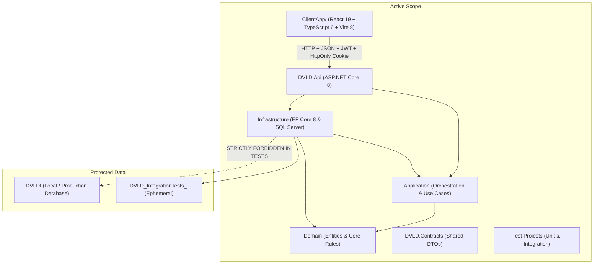
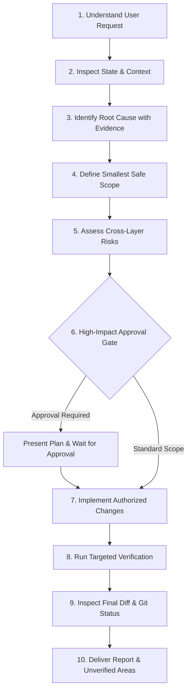

# AI Agent Engineering Governance — DVLD Repository

> **Authority Level:** Universal Mandatory Repository Governance  
> **Target Systems:** Google Antigravity, AI Coding Assistants, and Pair-Programming Agents  
> **Repository Root:** `D:\DVLD-System`  
> **Governance Status:** ACTIVE & ENFORCED  
> **Active Backend:** ASP.NET Core Web API (`DVLD.Api`)  
> **Active Frontend:** React SPA in `ClientApp/`  

---

## 1. Overview and Mission

This repository contains the **Driver & Vehicle Licensing Department (DVLD)** management system. The architecture comprises a .NET 8 Web API backend (`DVLD.Api`), enterprise persistence with SQL Server and Entity Framework Core 8 (`Infrastructure`), business use-case orchestration (`Application`), pure domain models (`Domain`), a shared contract boundary (`DVLD.Contracts`), automated test suites (`Test/`), and a React 19 single-page application (`ClientApp/`).

This document is the **sole general AI engineering governance and operational workflow document** for the repository (consolidating the former `AI-ENGINEERING-INSTRUCTIONS.md` and operational rules from the continuity charter). Frontend-specific rules live separately in [`ClientApp/AGENTS.md`](./ClientApp/AGENTS.md) without duplicating these repository-wide rules.

The foundational engineering philosophy is:
- **Evidence Over Assumption:** Base all diagnosis on concrete source code, tests, execution traces, or logs (`File.cs:Lline-Lline`).
- **Minimal Surface of Change:** Touch only the lines strictly necessary to resolve the defect or implement the requested feature.
- **Defensive Data Safety:** Guard databases (`DVLDf`) and existing working-tree state with extreme caution.
- **Honest Verification:** Report exact execution outputs, failure logs, and unverified assumptions without exaggeration.

---

## 2. Single-Source-of-Truth Documentation Hierarchy

| Topic | Authoritative Active Source |
|---|---|
| **Product Overview & Quick Start** | [`README.md`](./README.md) |
| **AI Agent Rules, Safety Gates & Workflow** | [`AGENTS.md`](./AGENTS.md) (this document) |
| **Frontend-Specific Agent Rules** | [`ClientApp/AGENTS.md`](./ClientApp/AGENTS.md) |
| **Task Priorities, Status & Authorization** | [`ENGINEERING-ROADMAP.md`](./ENGINEERING-ROADMAP.md) |
| **Architectural, Security & Policy Decisions (ADRs)** | [`ENGINEERING-DECISIONS.md`](./ENGINEERING-DECISIONS.md) |
| **Developer Setup, Run, Test & CI Guide** | [`docs/development/DEVELOPMENT-GUIDE.md`](./docs/development/DEVELOPMENT-GUIDE.md) |
| **Layered Architecture, UoW, Locking & Code Standards** | [`docs/development/ENGINEERING-STANDARDS.md`](./docs/development/ENGINEERING-STANDARDS.md) |
| **Authentication, Sessions, SoD, Upload & Client Security** | [`docs/development/SECURITY-STANDARDS.md`](./docs/development/SECURITY-STANDARDS.md) |
| **Test Isolation, Ephemeral SQL Lifecycle & SQL Guide** | [`docs/development/TESTING-STANDARDS.md`](./docs/development/TESTING-STANDARDS.md) |
| **Verified SDK, NuGet, npm & CI Manifests** | [`docs/development/TECHNOLOGY-STACK.md`](./docs/development/TECHNOLOGY-STACK.md) |
| **Civic Licensing Business Rules** | [`docs/reference/LICENSING-DOMAIN-SPECIFICATION.md`](./docs/reference/LICENSING-DOMAIN-SPECIFICATION.md) |
| **End-User Portal Guide (Staff & Admin)** | [`docs/client/USER-GUIDE.md`](./docs/client/USER-GUIDE.md) |
| **Documentation Index & Historical Archive** | [`docs/README.md`](./docs/README.md) |

---

## 3. Scope and Boundaries

### 3.1 Task Boundaries & Layered Dependency Rules
- **Layered Architecture Dependency Rules:**
  - `Domain` has no dependency on Application, Infrastructure, or API.
  - `Application` depends only on `Domain`.
  - `Infrastructure` depends on `Application` and `Domain` where required to implement application contracts and persistence behavior.
  - `DVLD.Api` depends on `Application` and `Infrastructure` as required by composition and dependency injection.
  - `Application` must **never** depend on `Infrastructure`.
- **Backend .NET Tasks:** Encompass `API/`, `Application/`, `Infrastructure/`, `Domain/`, `DVLD.Contracts/`, and `Test/`.
- **Frontend React Tasks:** Encompass `ClientApp/` only. Frontend-specific workflows are further governed by [`ClientApp/AGENTS.md`](./ClientApp/AGENTS.md).
- **Cross-Layer / Full-Stack Tasks:** Root governance overrides component rules in any conflict.

---

## 4. Mandatory Pre-Execution & Post-Execution Checks

Every AI agent invocation must execute the following non-negotiable Git safety checks:

1. **Initial Git Status Check:**
   Run `git status --short --untracked-files=all` immediately upon invocation. Record active branch, HEAD commit, and any pre-existing uncommitted changes.
2. **Protection of User Work:**
   Never revert, overwrite, stash, or destroy existing uncommitted changes in the working tree.
3. **Audit Document Preservation:**
   The foundational Phase A discovery deliverables ([`phase-a-repository-discovery.md`](./docs/archive/audits/phase-a-repository-discovery.md) and [`phase-a-supplementary-review.md`](./docs/archive/audits/phase-a-supplementary-review.md)) are preserved historical assets in `docs/archive/audits/`. They must never be deleted or modified during normal implementation tasks.
4. **Final Git Status Check:**
   Before completing a turn, run `git status --short --untracked-files=all` and inspect the git diff to verify that only authorized files were modified.

---

## 5. Absolute Prohibitions & Database Safety Protocols

1. **Zero Destructive Git Operations:**
   Never run `git reset`, `git checkout --`, `git restore`, `git clean`, `git stash`, `git branch -D`, `git rebase`, or force-push commands. If an unintended file edit occurs, use targeted file editing tools to restore the original lines.
2. **Zero Unapproved Commits & Git Permission Separation:**
   Do not run `git add`, `git commit`, or `git push` unless explicitly instructed in writing by the human engineer.
   - **Four Independent Permission Categories:** (1) Local File Read, (2) Local File Write, (3) Git Inspection (`git status`, `git diff`, `git log`, `git branch`), and (4) Git Management (`git add`, `git commit`, `git push`, branching). Authorizing local file access/modification does **not** grant Git management authority, and authorizing Git inspection does **not** grant commit/push authority.
3. **No Database Modification on `DVLDf` & Strict Test DB Lifecycle:**
   The development/production database `DVLDf` (and `DVLD`) is strictly protected:
   - **NEVER** connect to, query, drop, truncate, recreate, wipe, or overwrite `DVLDf`.
   - **NEVER** run integration tests against `DVLDf` or any developer-owned database.
   - **NEVER** apply schema migrations to `DVLDf` without separate explicit human approval and a verified backup. When authorized, EF Core migrations must be reviewed via `dotnet ef migrations script` before execution.
   - **Test Database Lifecycle Safety:** Integration tests (`Infrastructure.IntegrationTests` and `API.IntegrationTests`) must strictly create dynamic test databases named `DVLD_IntegrationTests_<GUID>` (or `DVLD_IntegrationTests_Api_<GUID>`) via `DVLD_TEST_CONNECTION` and `DVLD_TEST_EXPECTED_INSTANCE`, with **no fallback** to `DVLDf`, `master`, or any developer-owned database if configuration is missing. Before any automated deletion during teardown (`DisposeAsync`), the test runner must verify:
     1. The database name was generated by the current test execution.
     2. The database belongs to the isolated test connection (`DVLD_TEST_CONNECTION`) and verified instance (`DVLD_TEST_EXPECTED_INSTANCE`).
     3. The target is not `DVLDf` or any developer-owned database.
     4. The deletion target is explicitly validated before execution.
     5. The test execution has sufficient evidence of ownership of the database it intends to delete (`DVLD_Test_Run_Token`, `database_id`, `service_broker_guid`).
     6. If ownership or target identity cannot be verified, teardown must fail safely without deleting the database.
   - **Administrative Connection vs. Test Database:** Connecting to `master` strictly as an administrative connection to create or drop an isolated test database is permitted where required; using `master` as the actual integration test database is strictly prohibited.
4. **No Speculative Architecture:**
   Do **not** introduce MediatR, CQRS, event sourcing, Redis, microservices, or external message buses without an approved ADR recorded in [`ENGINEERING-DECISIONS.md`](./ENGINEERING-DECISIONS.md).
5. **No Hallucinated Verification:**
   Never state or imply that a build, unit test, integration test, or migration succeeded unless the command was actually executed during the current turn and the process exited with code 0.

---

## 6. Bounded Authorization, Stop-on-Risk & Approval Gates

### 6.1 Bounded Authorization & Stop-on-Risk Protocol
- **Bounded Scope:** Authorization is strictly bounded by the requested objective, target paths, permitted operations, and exclusions. **Technical capability never substitutes for permission.**
- **Stop-on-Risk Protocol:** Immediately halt and request user guidance if:
  1. An unanticipated conflict arises with existing uncommitted user modifications.
  2. An action risks data loss, file overwrite, or schema corruption.
  3. An unauthorized file modification would be required to proceed.
  4. An undocumented security or architectural side effect is discovered.

### 6.2 Autonomous Execution vs. Mandatory Approval Gates

Agents may proceed autonomously with narrow, in-scope tasks, but **must stop and obtain explicit human approval** before crossing high-impact boundaries:

| Operational Domain | Autonomous Execution Permitted | Mandatory Human Approval Required |
|---|---|---|
| **Documentation** | Authoring or correcting documentation and reports. | Modifying core governance policies or standards. |
| **Bug Fixes (Logic)** | Narrow bug fixes within an isolated service or repository with existing test coverage. | Structural refactoring, changing public method signatures, or altering shared interfaces. |
| **API Contracts** | Internal implementation details within controllers without contract changes. | Deleting, removing, or altering public API endpoints (e.g., `POST /api/applications/{id}/complete`) or breaking request/response schemas. |
| **Database & Schema** | Inspecting entity configurations and migrations (Read-Only). | Creating EF migrations, editing schema mappings, modifying indexes, or touching `DVLDf`. |
| **Security & Auth** | Enforcing existing policies (`AdminOnly`, `StaffOnly`) or adding missing rate limiting. | Relaxing policies (e.g., `StaffOnly` to `StaffOrAdmin`), modifying Segregation of Duties (SoD), or changing role definitions. |
| **Testing** | Running existing unit/integration tests with test connection strings. | Modifying test database connection infrastructure, deleting tests, or altering test assertions. |
| **Dependencies** | Inspecting `.csproj` and `package.json`. | Adding, upgrading, or removing NuGet or npm packages. |
| **Roadmap Phase** | Completing authorized sub-tasks within the active phase. | Transitioning between engineering phases in [`ENGINEERING-ROADMAP.md`](./ENGINEERING-ROADMAP.md). |

---

## 7. Mandatory 10-Step Engineering Workflow

Every implementation, bug fix, or analysis task must follow these ten sequential steps:

1. **Understand the Request:** Read the request completely, clarify ambiguities before assuming, and identify affected layers (`Domain`, `Application`, `Infrastructure`, `DVLD.Api`, `Test`, `ClientApp`).
2. **Inspect Repository State & Context:** Run `git status --short --untracked-files=all`, confirm branch/HEAD, inspect relevant source/tests/configs, and verify task authorization in [`ENGINEERING-ROADMAP.md`](./ENGINEERING-ROADMAP.md) and decisions in [`ENGINEERING-DECISIONS.md`](./ENGINEERING-DECISIONS.md).
3. **Identify Root Cause Using Evidence:** Trace execution paths from controllers through services, repositories, and SQL; inspect actual errors/stack traces and cite `File.cs:Lline-Lline`.
4. **Define the Smallest Safe Scope:** Apply the **Minimal-Change Principle** — do not refactor surrounding code, reformat unrelated lines, or add dependencies.
5. **Identify Cross-Layer Risks & Side Effects:** Check `UnitOfWork` transaction boundaries, SQL locking (`sp_getapplock`, row locks), authorization boundaries (`Admin` vs. `Staff`), and `DVLD.Contracts` / `ClientApp` contract impacts.
6. **Present Plan & Request Approval (High-Impact Changes):** If an Approval Gate (§6.2) is crossed, present the problem, affected files, exact changes, and verification strategy, and **stop for explicit approval**.
7. **Implement Only Authorized Changes:** Apply targeted edits adhering to [`ENGINEERING-STANDARDS.md`](./docs/development/ENGINEERING-STANDARDS.md) and [`SECURITY-STANDARDS.md`](./docs/development/SECURITY-STANDARDS.md), preserving formatting and line endings.
8. **Run Appropriate Verification:** Execute targeted builds/tests following [`TESTING-STANDARDS.md`](./docs/development/TESTING-STANDARDS.md) (e.g., `--filter "FullyQualifiedName~..."` for backend; `npm.cmd --prefix ClientApp run build` and `lint` for frontend). Observe exit codes and stderr.
9. **Inspect Final Diff and Git Status:** Run `git status --short --untracked-files=all` and inspect the diff to ensure only authorized files changed and zero protected DB/config targets were altered.
10. **Deliver Report & Explicitly Document Risks:** Report baseline commit, modified files, exact commands run with exit codes, verified vs. unexecuted scope, and any unresolved business/legal decisions.

---

## 8. Verification Integrity, Evidence Taxonomy & Lightweight Handoff Rules

1. **Cataloged vs. Executed Distinction:** Never conflate *Cataloged / Discovered* tests (`--list-tests` or file counts) with *Executed & Passed* tests. Report unexecuted suites honestly as `Not Executed`.
2. **Reporting Failures Honestly:** Report full compiler errors, stack traces, or failing assertions; never suppress failures by skipping, weakening, or deleting tests.
3. **Audit & Traceability Classification Taxonomy:**
   - `Verified`: Statically confirmed in source code, configuration, or documented runtime output matching specification.
   - `Partially Verified`: Partially implemented or adjacent coverage exists, but lacks full specification coverage or runtime validation.
   - `Not Implemented`: Specified capability, endpoint, schema column, or test suite is absent.
   - `Contradiction`: Physical code or configuration contradicts the specification or another active governance document.
   - `Insufficient Evidence`: Ambiguous, unverified, or missing artifacts prevent determination.
4. **Evidence Confidence Levels:**
   - `VERIFIED` (direct runtime output, test execution, or source inspection within stated scope), `REPORTED` (sourced from prior docs without fresh re-verification), `INFERRED` (derived logically; requires empirical proof), `PENDING` (unverified/open), `SUPERSEDED` (replaced by newer verified state).
5. **Task Readiness & Authorization Lifecycle States:**
   - `Technically Analyzed` $\rightarrow$ `Implementation-Ready` $\rightarrow$ `Authorized for Implementation` *(only state permitting code edits)* $\rightarrow$ `Implemented and Verified`.
6. **Decision Status Vocabulary:**
   - `IMPLEMENTED`, `APPROVED`, `APPROVED DESIGN` *(does not authorize implementation)*, `PLANNED`, `PROPOSED`, `PROVISIONAL`, `NEEDS VALIDATION`, `NOT AUTHORIZED`, `PROHIBITED`, `SUPERSEDED`, `CLOSED`.
7. **Lightweight Handoff & Session Logging Rule:**
   - Do **not** create session log files for routine queries, documentation reads, or minor edits.
   - Record a concise handoff summary only for major multi-phase engineering efforts or key architectural/policy decisions — and never create unrequested log files in the repository without explicit write authorization (otherwise prepare the handoff summary directly in the conversation response).
