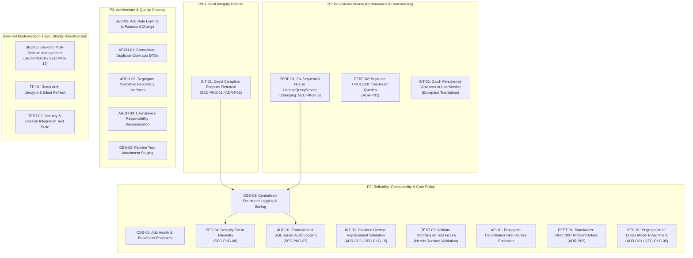

# Engineering Remediation Roadmap & Backlog

> **Authority Level:** Sole Authoritative Engineering Prioritization, Backlog & Execution Roadmap  
> **Parent Document:** [`AGENTS.md`](./AGENTS.md)  
> **Repository Root:** `D:\DVLD-System`
>
> **Baseline Commit:** `e9e843e974af86a86003bcc364f0e7686c3faa87` (Reconciled with Active Source on 2026-11-18)
>
> **Governance Status:** CONSOLIDATED & ENFORCED (Reconciled Baseline + Production Readiness Plan)

---

## 1. Roadmap Architecture & Execution Principles

This document constitutes the sole authoritative engineering execution roadmap and backlog for the Driver & Vehicle Licensing Department (DVLD) platform. It consolidates all verified remediation items, architecture decision alignments, and security specifications across the repository.

### 1.1 Non-Negotiable Governance & Authorization Rules
1. **Roadmap Inclusion Does Not Authorize Implementation:** Inclusion of an item, task, or phase in this roadmap, dependency graph, or backlog schedule does **not** constitute authorization to write code, modify schemas, or execute work. Every implementation phase requires separate, explicit human engineering authorization before work begins.
2. **Approved Policy Does Not Authorize Code Changes:** The approval of an architectural or civic policy record (such as `ADR-O01` Model B) establishes the conceptual policy standard only. Translating approved policies into code modifications (e.g., altering controller authorization attributes or frontend route guards) requires explicit implementation authorization.
3. **Proposed Work Is Not Authorized Work:** All items marked `PROPOSED`, `PLANNED`, or `CONFIRMED / PLANNED` are scheduled proposals. They carry zero execution authority until authorized under an approved phase gate.
4. **Deferred Work Remains Deferred:** Work items assigned to deferred tracks (`SEC-05`, `FE-01`, `TEST-02`, `SEC-PKG-17`) are explicitly excluded from initial production release planning. They remain deferred and strictly unauthorized until formally reprioritized by the Project Owner.
5. **External Regulatory Approvals Are Independent Gates:** Legal and regulatory rulings from the Licensing Authority (such as `ADR-O02` / `DEC-POL-01` and `DEC-POL-02`) are external prerequisite gates under Gate 3. Engineering teams may not anticipate or assume statutory approval. No implementation code may be introduced until written regulatory confirmation is recorded.
6. **Database Schema Changes Require Independent Approval:** Schema modifications, table alterations, and Entity Framework Core migrations (including Schema Gate 5 for user lockout columns) require separate human DBA review, explicit approval, and isolated verification against ephemeral test databases (`DVLD_IntegrationTests_<GUID>`). Migrations to `DVLDf` are strictly prohibited.
7. **Documenting a Gate Does Not Satisfy It:** Logging an operational requirement, regulatory condition, or risk gate in documentation does not fulfill that gate. Gates remain unsatisfied until verifiable runtime evidence, DBA sign-off, or formal human authorization is executed.
8. **Task Readiness vs Implementation Authorization:** Technical readiness (analysis complete, solution designed, zero schema changes) does **not** constitute authorization to begin coding. All Phase 12.2 through 12.5 tasks remain strictly **PROPOSED / UNAUTHORIZED** until explicit human authorization is granted. Cross-check architectural boundaries in [`docs/development/ENGINEERING-STANDARDS.md`](./docs/development/ENGINEERING-STANDARDS.md) and formal decisions in [`ENGINEERING-DECISIONS.md`](./ENGINEERING-DECISIONS.md). *(The former `PROJECT-COMPLETION-MASTER-PLAN.md` is preserved only as superseded history in [`docs/archive/superseded/PROJECT-COMPLETION-MASTER-PLAN.md`](./docs/archive/superseded/PROJECT-COMPLETION-MASTER-PLAN.md).)*

---

## 2. Remediation Priority Hierarchy

The canonical backlog is organized into four prioritized tiers based on verified system impact:

---

## 3. Canonical Remediation Backlog

### 3.1 P0: Critical Integrity Defects

#### [INT-01] Direct Application Completion Endpoint Removal
- **Finding ID:** `INT-01`
- **Evidence Classification:** `CONFIRMED — REMEDIATED & VERIFIED IN CODE` (`IMPLEMENTED — RUNTIME UNVERIFIED` in current doc-only audit)
- **Priority:** `P0 (Critical)`
- **Affected Components:** `API/DVLD.Api/Controllers/ApplicationsController.cs`, `Application/Services/ApplicationService.cs` (`CompleteApplicationStateAsync`), `Test/API.IntegrationTests/Controllers/ApplicationsControllerTests.cs`.
- **Description:** Historically, `POST /api/applications/{id}/complete` allowed authenticated staff to update an application's status directly to `Completed`, bypassing fee payment and test invariants.
- **Technical Remediation Implemented:** Following `DEC-APP-01` Option 1 (`ADR-P03`), the `Complete` endpoint was permanently deleted from `ApplicationsController.cs`, and `ApplicationService.CompleteApplicationStateAsync` executes only inside an outer `UnitOfWork` workflow transaction.
- **Verification Requirements:** `ApplicationsControllerTests.PostComplete_WhenCalled_ReturnsNotFoundBecauseRouteIsRemoved` asserts HTTP `404 Not Found` (`not executed` during current doc-only pass).
- **Current Status:** `IMPLEMENTED` *(historically verified; not re-executed in current pass)*.
- **Implementation Authorization:** **COMPLETED (Phase 12.2 / DEC-APP-01 Option 1).**

---

### 3.2 P1: Provisional Engineering Priority (Performance & Concurrency)

#### [PERF-01] Sequential N+1 in LicenseQueryService
- **Finding ID:** `PERF-01`
- **Evidence Classification:** `RECONCILED IN CODE — BATCHING IMPLEMENTED` (broader `SEC-PKG-03` unpaged endpoint clamping remains `NOT IMPLEMENTED`)
- **Priority:** `P1`
- **Affected Components:** `Application/Services/LicenseQueryService.cs` (`MapToDtosBatchAsync`, `EvaluateRenewalEligibilityAsync`), `Infrastructure/Repositories/LicenseRepository.cs` (`GetNewerLicensesBatchAsync`).
- **Description:** Historical discovery flagged sequential per-row queries (`GetNewerLicenseForDriverAndClassAsync`) inside paged license listings.
- **Current Source Reality (`e9e843e`):** `LicenseQueryService.MapToDtosBatchAsync` (lines 194–289) now preloads active detentions via `GetActiveDetainedLicenseIdsAsync` and newer licenses in batch via `GetNewerLicensesBatchAsync` (`IMPLEMENTED` for list projections; single-item `EvaluateRenewalEligibilityAsync` still evaluates a single license). Meanwhile, `SEC-PKG-03` (eliminating unpaged fallbacks across controllers and tightening max page bounds from `100` to `50`) remains **`NOT IMPLEMENTED`** (`NOT AUTHORIZED`).
- **Verification Requirements:** `API.IntegrationTests` / `Application.UnitTests` verifying single-batch SQL behavior and future `SEC-PKG-03` pagination clamping when authorized.
- **Current Status:** `PARTIALLY IMPLEMENTED` (list batching `IMPLEMENTED`; broader `SEC-PKG-03` unpaged-endpoint clamping `PLANNED` / `NOT AUTHORIZED`).
- **Implementation Authorization:** **List batching COMPLETED; `SEC-PKG-03` clamping remains NOT AUTHORIZED.**

#### [PERF-02] Pessimistic Lock on Read-Only License Queries
- **Finding ID:** `PERF-02`
- **Evidence Classification:** `RECONCILED IN CODE (ADR-P01)` (`IMPLEMENTED — RUNTIME UNVERIFIED` for concurrent benchmarks)
- **Priority:** `P1`
- **Affected Components:** `Infrastructure/Repositories/LicenseRepository.cs` (lines 24–53).
- **Description:** Historically, `LicenseRepository.GetLicenseByIdAsync` hardcoded `WITH (UPDLOCK, HOLDLOCK)` on read-only queries, serializing readers.
- **Current Source Reality (`e9e843e`):** Per `ADR-P01`, `GetLicenseByIdAsync` (lines 24–33) executes ordinary non-locking `.AsNoTracking().AsSplitQuery()` reads, while `GetForUpdateAsync` (lines 35–53) isolates `WITH (UPDLOCK, HOLDLOCK)` for write workflows. Concurrent load benchmarks remain unexecuted.
- **Verification Requirements:** Concurrent read integration tests and load measurements.
- **Current Status:** `IMPLEMENTED — RUNTIME UNVERIFIED` (benchmarks pending).
- **Implementation Authorization:** **COMPLETED (Phase 12.2 / `ADR-P01`).**

#### [INT-02] User Creation Persistence Boundary Exception Translation
- **Finding ID:** `INT-02`
- **Evidence Classification:** `RECONCILED IN CODE` (`IMPLEMENTED — RUNTIME UNVERIFIED` in current doc-only pass)
- **Priority:** `P1`
- **Affected Components:** `Infrastructure/UnitOfWork.cs` (`TranslateAndRethrowIfKnownConstraint`, lines 262–284), `Application/Services/UserService.cs` (lines 319–330), `API/DVLD.Api/Security/GlobalExceptionHandler.cs` (lines 118–137), `Test/Infrastructure.IntegrationTests/UnitOfWorkConstraintTranslationTests.cs`.
- **Description:** Duplicate `UserName` or `PersonID` races during user creation previously propagated raw `DbUpdateException`s as HTTP 500.
- **Current Source Reality (`e9e843e`):** `UnitOfWork.TranslateAndRethrowIfKnownConstraint` translates `IX_Users_UserName` and `IX_Users_PersonId` violations into domain exceptions (`DuplicateUsernameException`, `DuplicatePersonUserException`) without coupling `Application` to EF Core; `UserService.AddUserAsync` catches both and returns `Result<int>.FromConflict`, and `GlobalExceptionHandler` maps un-caught constraint exceptions to HTTP 409 Conflict.
- **Scope Boundary Enforcement:** Separate from `CONCURRENCY-01` / `SEC-PKG-04` (`UserService` still retains hardcoded `id == 2 && "ayhm"` check separately).
- **Current Status:** `IMPLEMENTED — RUNTIME UNVERIFIED` (not executed in current doc pass; verify `UpdateUserAsync` & sibling constraint coverage under Production Readiness Domain B/C).
- **Implementation Authorization:** **COMPLETED (Phase 12.2 Scope).**

---

### 3.3 P2: Reliability, Observability & Core Policy

#### [OBS-01] Health and Readiness Endpoints
- **Finding ID:** `OBS-01`
- **Evidence Classification:** `CONFIRMED — NOT IMPLEMENTED`
- **Priority:** `P2`
- **Affected Components:** `API/DVLD.Api/Program.cs` (zero `AddHealthChecks` / `MapHealthChecks` calls exist).
- **Description:** `DVLD.Api` lacks standard `/health/live` and `/health/ready` endpoints for container orchestrators, load balancers, and monitoring systems.
- **Proposed Technical Remediation:** Register ASP.NET Core Health Checks middleware with SQL Server connectivity checks.
- **Dependencies & Approvals:** Review of health probe security (suppressing detailed connection errors from anonymous callers) and any NuGet approval (`AspNetCore.HealthChecks.SqlServer` if added).
- **Verification Requirements:** Automated tests checking HTTP 200 on healthy probes and HTTP 503 on degraded connectivity.
- **Current Status:** `NOT IMPLEMENTED` (`PLANNED`)
- **Implementation Authorization:** **NOT AUTHORIZED (Phase 12.3 Scope).**

#### [OBS-03] Centralized Structured Application Logging & Correlation IDs
- **Finding ID:** `OBS-03`
- **Evidence Classification:** `APPROVED DESIGN / ROADMAP INTEGRATION`
- **Priority:** `P2`
- **Affected Components:** `API/DVLD.Api/Program.cs`, `API/DVLD.Api/Middleware/CorrelationIdMiddleware.cs`, `appsettings.json`.
- **Description:** Application relies on default Console logging with non-structured text and lacks correlation IDs to trace requests across controllers, application services, and EF Core queries.
- **Proposed Technical Remediation:**
  - Integrate Serilog behind standard `ILogger` abstractions.
  - Implement request correlation ID middleware (`X-Correlation-Id` header pass-through and generation, pushed to Serilog `LogContext`).
  - Configure structured JSON rolling file sink (`logs/dvld-.json`) with retention and PII redaction rules.
- **Dependencies & Approvals:** Explicit human approval required for adding `Serilog.AspNetCore` NuGet package.
- **Verification Requirements:** Log inspection asserting valid JSON formatting, correlation ID propagation, and PII masking.
- **Current Status:** `Confirmed / Planned`
- **Implementation Authorization:** **NOT AUTHORIZED (Phase 12.3 Scope).**

#### [SEC-04] Security Event Telemetry & Logging
- **Finding ID:** `SEC-04`
- **Evidence Classification:** `APPROVED DESIGN / ROADMAP INTEGRATION`
- **Priority:** `P2`
- **Affected Components:** `Application/Interfaces/ISecurityAuditService.cs`, `API/DVLD.Api/Controllers/AuthController.cs`, `Application/Services/UserService.cs`.
- **Description:** Authentication and user-management services log only standard application diagnostics. No tamper-evident, structured audit log exists for logins, logouts, password changes, or account status updates.
- **Proposed Technical Remediation:** Define dedicated `ISecurityAuditService` emitting structured `SecurityEvent` payloads to an isolated security sink per `DEC-AUD-01` and `DEC-AUD-02`.
- **Associated Security Package:** `SEC-PKG-06` (Structured Security Audit Trail & Event Framework).
- **Governing Architectural Decisions:** `DEC-AUD-01` (Storage Sink Selection) and `DEC-AUD-02` (Fail-Open Ring Buffer Policy).
- **Dependencies & Approvals:** Approval of audit sink storage topology.
- **Verification Requirements:** Unit and integration tests asserting emission of security events on login success/failure and password change.
- **Current Status:** `Confirmed / Planned`
- **Implementation Authorization:** **NOT AUTHORIZED (Phase 12.3 Scope).**

#### [AUD-01] Transactional SQL Server Audit Logging for Core Business Mutations
- **Finding ID:** `AUD-01`
- **Evidence Classification:** `APPROVED DESIGN / ROADMAP INTEGRATION`
- **Priority:** `P2`
- **Affected Components:** `Domain/Entities/AuditLog.cs`, `Infrastructure/Persistence/DVLDDbContext.cs`, `Infrastructure/Persistence/Configurations/AuditLogConfiguration.cs`, `Infrastructure/UnitOfWork.cs`.
- **Description:** Core licensing mutations (license issuance, renewals, replacements, detentions, releases) lack persistent, queryable SQL audit records tracking acting user, timestamp, before/after values, and client IP.
- **Proposed Technical Remediation:** Implement `AuditLog` entity in `Domain`, configure EF Core entity mapping in `Infrastructure`, and integrate audit capture inside `UnitOfWork.SaveChangesAsync` to ensure business mutations and audit records commit atomically within the same database transaction.
- **Associated Security Package:** `SEC-PKG-07` (Transactional Security Event Instrumentation).
- **Dependencies & Approvals:** Human DBA approval for EF Core schema migration creating `AuditLogs` table.
- **Verification Requirements:** Integration tests verifying atomic rollback of business mutations if audit record insert fails.
- **Current Status:** `Confirmed / Planned`
- **Implementation Authorization:** **NOT AUTHORIZED (Phase 12.3 Scope).**

#### [INT-03] Detained License Replacement Validation
- **Finding ID:** `INT-03`
- **Evidence Classification:** `TECHNICAL GAP CONFIRMED — REGULATORY APPROVAL REQUIRED`
- **Priority:** `P2`
- **Affected Components:** `Application/Services/LicenseReplacementService.cs` (lines 76–120).
- **Description:** `LicenseReplacementService` currently issues replacements for lost or damaged licenses without verifying whether the underlying license is actively detained under an administrative or judicial seizure order.
- **Proposed Technical Remediation:** Inject `IDetainedLicenseRepository` into `LicenseReplacementService` and return `Result.Failure("Cannot replace an actively detained license.")` if an active detention record exists.
- **Associated Security Package:** `SEC-PKG-15` (Detained License Replacement Precondition Enforcement).
- **Governing Architectural Decisions:** `ADR-O02` (Provisional Selection of Option A) cross-referenced to `DEC-POL-01` (Regulatory Confirmation Pending).
- **Scope Boundary Enforcement:** `INT-03` governs domestic license replacement exclusively. International driving permit detention verification is tracked separately under `SEC-PKG-16` / `DEC-POL-02`.
- **Dependencies & Approvals:** **Mandatory External Regulatory Sign-Off Required (`DEC-POL-01` under Gate 3).** Zero implementation code is permitted until written confirmation is received from the Licensing Authority.
- **Verification Requirements:** Integration tests asserting failure Result when attempting to replace an actively detained license.
- **Current Status:** `Confirmed / Planned`
- **Implementation Authorization:** **NOT AUTHORIZED (Phase 12.3 Scope).**

#### [TEST-01] Throttled Integration Test Migrations
- **Finding ID:** `TEST-01`
- **Evidence Classification:** `Proposed Remediation — Needs Runtime Validation`
- **Priority:** `P2`
- **Affected Components:** `Test/Infrastructure.IntegrationTests/SqlServerTestDatabase.cs` (lines 40–48).
- **Description:** During Phase 12.1 discovery, 1 test out of 612 in `Infrastructure.IntegrationTests` failed with an SSL pre-login handshake timeout. Parallel xUnit test classes simultaneously invoking `MigrateAsync()` against LocalDB is a plausible contributing factor.
- **Proposed Technical Remediation:** Throttle database creation and schema migrations in `SqlServerTestDatabase.cs` using `SemaphoreSlim(2, 2)`.
- **Verification Requirements:** Empirical validation across multiple consecutive test runs on LocalDB proving zero SSL handshake timeouts under concurrent xUnit execution.
- **Current Status:** **`NOT COMPLETED / RUNTIME VALIDATION REQUIRED`**
- **Implementation Authorization:** **NOT AUTHORIZED (Phase 12.3 Scope).**

#### [TEST-03] Test-Host Database Isolation & Startup Write Removal
- **Finding ID:** `TEST-03`
- **Evidence Classification:** `CONFIRMED — REMEDIATED & VERIFIED`
- **Priority:** `P0 (Data Safety)`
- **Affected Components:** `API/DVLD.Api/Program.cs`, `Infrastructure/Configuration/SqlServerConnectionSafety.cs`, `Test/API.IntegrationTests/Infrastructure/ApiWebApplicationFactory.cs`, `Test/API.IntegrationTests/Infrastructure/TestHostDatabaseSafety.cs`, `Test/API.IntegrationTests/Infrastructure/TestHostEnvironment.cs`, `Test/API.IntegrationTests/Infrastructure/ConnectionAttemptRecorder.cs`.
- **Description:** `Program.cs` executed a license-expiration database write before `app.Run()`. Because `WebApplicationFactory` runs the entry point up to `app.Run()`, every controller-test host performed that write. `ApiWebApplicationFactory` replaced application services but did not override `ConnectionStrings:DVLDConnection`, so the host inherited `Server=.;Database=DVLDf` from `appsettings.json`. On a developer machine with that instance reachable, running the API test suite could deactivate licenses in the protected database.
- **Technical Remediation Implemented:**
  1. Removed the inline startup sweep. `LicenseExpirationBackgroundService` already performs its first sweep immediately at startup and then on its polling interval, so production expiration processing is unchanged while host construction performs no database work.
  2. Added `SqlServerConnectionSafety.EnsureSafeForHost`, a pure connection-string guard (it never opens a connection). Test hosts — environment `Testing` or `DVLD_TEST_HOST=1` — may only target `DVLD_IntegrationTests_(Api_)?<GUID>`; `DVLD`, `DVLDf`, `master`, and unapproved catalogs are rejected at startup.
  3. `ApiWebApplicationFactory` pins an isolated, non-existent test catalog, supplies a test-only JWT signing key, and installs a `DbConnectionInterceptor` that counts connection attempts.
  4. Test assemblies set `DVLD_TEST_HOST=1` through a module initializer, so every host they create is validated, including factories that do not set `Testing` explicitly.
- **Verification Requirements:** Safety tests proving the guard rejects `DVLD`/`DVLDf`/unapproved catalogs, that a test host configured with `DVLDf` fails fast without connecting, that the mock host opens zero connections while serving requests, that the resolved `DbContext` catalog is an isolated test database, and that cleanup naming/configuration validators reject application databases.
- **Current Status:** **`Verified`** (17 safety test cases across guard, host, and cleanup suites).
- **Implementation Authorization:** **AUTHORIZED (explicit REST-01 task Part A) & COMPLETED.**

#### [API-01] Propagate CancellationToken Across Endpoints
- **Finding ID:** `API-01`
- **Evidence Classification:** `CONFIRMED — REMEDIATED & VERIFIED`
- **Priority:** `P2`
- **Affected Components:** `API/DVLD.Api/Controllers/` (20 controllers), `API/DVLD.Api/BackgroundServices/LicenseExpirationBackgroundService.cs`, `Application/Interfaces/`, `Application/Services/` (26 services), `Infrastructure/Repositories/` (15 repositories), `Infrastructure/Services/PhysicalFileStorageService.cs`.
- **Description:** Controller actions, service methods, and repository queries omitted `CancellationToken` parameters, allowing orphaned database queries to continue executing after client disconnection.
- **Technical Remediation Implemented:** Propagated `CancellationToken` from all 109 async controller actions across 20 controllers (out of 110 total actions, where `AuthController.Me` is the sole synchronous claims-reading action) through all async application service methods, `IFileStorageService`/`PhysicalFileStorageService` stream operations (`CopyToAsync`, `FlushAsync`), and repository queries to 100% of EF Core async operations (`ToListAsync`, `FirstOrDefaultAsync`, `SingleOrDefaultAsync`, `SingleAsync`, `AnyAsync`, `CountAsync`, `AddAsync`, `ToDictionaryAsync`, `ExecuteUpdateAsync`, `ExecuteSqlInterpolatedAsync`) and `UnitOfWork` transaction/save operations across all 5 domain bundles. Also propagated `stoppingToken` in `LicenseExpirationBackgroundService` and guaranteed `OperationCanceledException` is never swallowed. Full inventory and final audit recorded in `docs/archive/audits/api-01-cancellation-token-inventory.md`.
- **Verification Requirements:** Verified by 935 passing tests in `Application.UnitTests` (0 failed), 461 passing controller and background service integration tests in `API.IntegrationTests` (0 failed), and clean compilation of `Infrastructure.IntegrationTests` (0 warnings, 0 errors; 34 database-free tests passed, while 622 SQL-dependent tests require external `DVLD_TEST_CONNECTION` configuration).
- **Current Status:** **`Verified`** (All 5 domain bundles & Final Audit 100% implemented and verified).
- **Implementation Authorization:** **AUTHORIZED & COMPLETED (Phase 12.3 Scope).**

#### [REST-01] Standardize Error Payloads on RFC 7807 ProblemDetails
- **Finding ID:** `REST-01`
- **Evidence Classification:** `CONFIRMED — REMEDIATED & VERIFIED`
- **Priority:** `P2`
- **Affected Components:** `API/DVLD.Api/Results/ResultHttpMapper.cs`, `API/DVLD.Api/Results/ApiProblemDetails.cs`, `API/DVLD.Api/Security/GlobalExceptionHandler.cs`, `API/DVLD.Api/Controllers/AuthController.cs`, `API/DVLD.Api/Controllers/PeopleController.cs`, `API/DVLD.Api/Program.cs`, `Application/Common/Results/`, `ClientApp/src/services/apiClient.ts`.
- **Description:** `AuthController` returned custom `{ error = "..." }` schemas, `PeopleController` returned a custom upload envelope, and `GlobalExceptionHandler` returned standard `ProblemDetails`. Middleware-generated failures (401 challenge, 403 forbidden, unmatched-route 404, rate-limiter 429) had empty bodies, malformed JSON surfaced as 500, and every `Result` failure without an explicit category surfaced as 500.
- **Error Catalog Outcome:** All failure factories in `Application/Services` were audited. The earlier report's "143 `Result.Failure` call sites" was a combined regular expression over every failure factory; measured counts are **26 `Result.Failure(...)`** and **43 `Result<T>.FromFailure(...)`**. The 26 direct sites are persistence/consistency failures (zero rows affected, repository update returned false, missing parent aggregate) and correctly remain HTTP 500. The genuine misclassifications were the login contract (401 encoded as an ad-hoc body) and the absence of an authentication category in `ErrorType`. Full catalog in `docs/archive/audits/rest-01-error-handling-and-test-database-safety.md`.
- **Technical Remediation Implemented:**
  1. `ErrorType.Unauthorized` added and propagated by all `PropagateFailure<T>` translators; `AuthService` returns it for invalid credentials.
  2. `ResultHttpMapper` rewritten as the single deterministic `ErrorType` → HTTP translator, with `ValidationProblemDetails` for validation (aggregated `detail` plus structured `errors`), and explicit 401/403/404/409/500 mappings.
  3. A successful `Result` passed to the failure mapper no longer throws; it logs a programming error and fails closed with a generic 500.
  4. `ApiProblemDetails` centralizes payload construction (`status`, `title`, `detail`, `type`, `instance`, `traceId`, `application/problem+json`).
  5. `ApiBehaviorOptions.InvalidModelStateResponseFactory` produces `ValidationProblemDetails` for model-binding and malformed-body failures.
  6. `UseStatusCodePages` renders ProblemDetails for responses produced outside MVC (401, 403, 404, 405, 429).
  7. `GlobalExceptionHandler` maps client cancellation to 499, malformed requests to 400, curated duplicate conflicts to 409, and unexpected failures to a generic 500 with no internal detail.
  8. `AuthController` and `PeopleController` custom envelopes were removed.
  9. The React transport parses ProblemDetails into a typed `ApiError`/`UnauthorizedError`/`ForbiddenError` with field errors and trace id.
- **HTTP Mapping Rules:** Validation → 400 (`ValidationProblemDetails`); authentication failure → 401; authorization failure → 403; missing resource → 404; current-state conflict → 409; unexpected infrastructure/application failure → 500. No 200 is returned for a failed operation.
- **Scope Boundary Enforcement:** `REST-01` is strictly a backend response standardization and client parser alignment task. It does **not** include React Error Boundaries, frontend error component trees, or client recovery logic (which remain candidate requirements under `FE-ERR`).
- **Governing Architectural Decisions:** `ADR-P02` (Standardized RFC 7807 ProblemDetails across All Endpoints).
- **Verification Requirements:** Integration tests verifying `Content-Type: application/problem+json`, standard payload schema, per-request `traceId`, 401/403/404/405/409/500 behavior, malformed JSON handling, safe 500 responses, and unchanged success contracts. Result-mapping unit tests cover every `ErrorType`.
- **Current Status:** **`Verified`**.
- **Implementation Authorization:** **AUTHORIZED (explicit REST-01 task) & COMPLETED.**

#### [AUTH-01] Persisted Refresh-Token Sessions, Rotation & Revocation Lifecycle
- **Finding ID:** `AUTH-01`
- **Evidence Classification:** `CONFIRMED — REMEDIATED & VERIFIED`
- **Priority:** `P0 (Security)`
- **Affected Components:** `Domain/Entities/{User,UserSession}.cs`, `Application/Services/{AuthService,RefreshTokenService,UserService}.cs`, `Application/Interfaces/`, `Infrastructure/Repositories/UserSessionRepository.cs`, `Infrastructure/Configurations/`, `Infrastructure/Migrations/20261109163257_AuthSessions*`, `API/DVLD.Api/{Program.cs,Controllers/AuthController.cs,Security/JwtTokenService.cs}`, `ClientApp/src/{context,services,utils,components}`.
- **Description:** 240-minute non-revocable bearer tokens, no refresh token, tokens persisted in web storage, and no invalidation on password/role/activation changes.
- **Technical Remediation Implemented:** 15-minute access tokens with an `sst` security-stamp claim validated per request; SHA-256-hashed opaque refresh tokens in a persisted `UserSessions` family model with a 14-day absolute / 7-day idle lifetime; single-winner rotation via a conditional `UPDATE`; 30-second reuse grace with 409 retry, then family revocation on confirmed reuse; logout, logout-all, password-change, role-change and deactivation revocation; HttpOnly `SameSite=Lax` cookie transport with a CSRF header and credential-scoped CORS; React single-flight refresh, one retry per request, proactive renewal, cross-tab logout synchronization and removal of all token persistence.
- **Verification Requirements:** Auth unit tests (login/refresh/rotation/reuse/expiry/idle/logout/stamp), service-level concurrency test, API contract tests for cookie attributes/CSRF/401-409 behavior, and full database-free regression.
- **Evidence:** **945** Application unit tests passed (0 failed), **514** database-free API tests passed (0 failed); frontend lint/build exit 0.
- **Current Status:** **`IMPLEMENTED`** *(verified under prior `AUTH-01` & `AUTH-01-CROSS-PROCESS` runs; not re-executed in current doc pass)*.
- **Implementation Authorization:** **AUTHORIZED & COMPLETED.**
- **Known Limitations & Open Client Follow-Up:** Cross-process concurrency was previously verified with two real API OS processes sharing one isolated SQL database (`AUTH-01-CROSS-PROCESS`); lost HTTP-response and process-termination fault injection remain unverified, grace-window timing relies on injected-clock unit tests, and in `ClientApp` (`AuthContext.tsx` / `apiClient.ts`) `logoutSession()` runs best-effort without surfacing server revocation failure in the UI (so a failed `/api/Auth/logout` request can leave the `dvld_rt` cookie valid across page reloads). Additionally, `AuthContext.logoutAll` has no dedicated UI button outside automated password-change revocation.

#### [CI-SQL-01] Azure Pipelines SQL Server Test Environment Reliability
- **Finding ID:** `CI-SQL-01`
- **Evidence Classification:** `CONFIRMED — IMPLEMENTED (Azure runtime run pending)`
- **Priority:** `P1 (CI Reliability)`
- **Affected Components:** `azure-pipelines.yml`, `eng/scripts/Initialize-TestSqlEngine.ps1`, `Test/API.IntegrationTests/Security/ProblemDetailsContractTests.cs`.
- **Description:** Both SQL suites failed at fixture initialization with `DVLD_TEST_EXPECTED_INSTANCE must identify the approved SQL Server instance.` because the pipeline never produced or passed the expected instance identity; LocalDB itself was available.
- **Technical Remediation Implemented:** The initialization script now queries `<SERVERPROPERTY('ServerName')>|<@@SERVICENAME>` from the running engine and publishes `SqlExpectedInstance`; both SQL test tasks receive `DVLD_TEST_EXPECTED_INSTANCE`; a fail-fast contract validation step precedes the suites; cleanup runs with `always()` while retaining ownership checks; a `dotnet --info` diagnostic records the effective SDK. SQL safety validation was not weakened. The xUnit2013 assertion in `ProblemDetailsContractTests` was corrected to `Assert.NotEmpty`.
- **Verification Evidence:** Provisioning + cleanup scripts validated end-to-end on a temporary LocalDB instance; the SQL auth fixtures passed **10/10** against that instance using the published identity; YAML parses; **945** unit and **514** database-free API tests pass.
- **Current Status:** **`Implemented — Azure Pipeline runtime verification pending`**.
- **Implementation Authorization:** **AUTHORIZED & IMPLEMENTED.**

#### [CONCURRENCY-01] Business Workflow Concurrency & Transaction Safety
- **Finding ID:** `CONCURRENCY-01`
- **Evidence Classification:** `CONFIRMED — P0 REMEDIATED & VERIFIED; BROADER WORKFLOWS AUDITED`
- **Priority:** `P0 (Integrity)`
- **Affected Components:** `Application/Services/UserService.cs`, `Application/Interfaces/IUserRepository.cs`, `Infrastructure/Repositories/UserRepository.cs`, `Test/Infrastructure.IntegrationTests/Concurrency/LastAdministratorConcurrencyTests.cs`.
- **Description:** The last-active-administrator invariant was enforced by a check-then-act sequence outside a transaction; concurrent demotions could leave the system without an active administrator. Repositories were verified to share the scoped DbContext (no `IDbContextFactory` split-context defect).
- **Technical Remediation Implemented:** Administrator mutations acquire a transaction-owned `sp_getapplock('DVLD_AdminMutation')`; the active-admin count is re-checked under the lock inside the mutation transaction; the loser receives a 409 domain conflict. Deletion follows the same protocol.
- **Verification Evidence:** Two concurrent demotions through independent contexts/UnitOfWork on real SQL: one success, one 409, one active administrator. Last-admin deactivation returns 409 with no mutation. **945** unit and **514** database-free API tests pass.
- **Current Status:** **`Verified`** (P0 invariant). Other workflows audited with existing protections retained; no additional race tests executed in this pass.
- **Implementation Authorization:** **AUTHORIZED & IMPLEMENTED.**

#### [SEC-01] Segregation of Duties Model B Policy Alignment
- **Finding ID:** `SEC-01`
- **Evidence Classification:** `APPROVED POLICY RECORD — IMPLEMENTATION NOT AUTHORIZED`
- **Priority:** `P2`
- **Affected Components:** `API/DVLD.Api/Program.cs`, `ApplicationsController.cs`, `LicensesController.cs`, `ClientApp/src/utils/permissions.ts`.
- **Description:** Operational licensing counter actions are restricted to `Staff`. Administrators receive HTTP 403 Forbidden. Frontend navigation currently permits administrators to navigate to License History, causing permission mismatch errors.
- **Proposed Technical Remediation:** Align frontend navigation guards with approved Model B rules. Maintain backend `StaffOnly` authorization policies.
- **Associated Security Package:** `SEC-PKG-05` (License History Segregation of Duties Enforcement).
- **Governing Architectural Decisions:** `ADR-O01` (Approved Policy: Model B) cross-referenced to `DEC-RBAC-01` (Unapproved Inspection Proposal).
- **Dependencies & Approvals:** Formal implementation authorization under Phase 12.2 / Phase 12.4.
- **Verification Requirements:** Frontend and backend tests verifying administrators cannot access counter actions and do not experience broken UI navigation.
- **Current Status:** `Approved Policy / Implementation Planned`
- **Implementation Authorization:** **NOT AUTHORIZED.**

---

### 3.4 P3: Architecture & Quality Cleanup

#### [SEC-03] Rate Limiting on Password Change
- **Finding ID:** `SEC-03`
- **Evidence Classification:** `PARTIALLY IMPLEMENTED` (reconciled across 4 dimensions)
- **Priority:** `P3`
- **Affected Components:** `API/DVLD.Api/Controllers/AuthController.cs` (line 230), `API/DVLD.Api/Program.cs` (lines 233–250), `Test/API.IntegrationTests/Controllers/AuthControllerTests.cs`.
- **4-Dimension Reconciliation:**
  1. **Original Specification:** Proposed sliding-window `[EnableRateLimiting("PasswordChangeLimit")]` throttling on `POST /api/Auth/change-password`.
  2. **Current Code (`IMPLEMENTED`):** `[AUTH-01]` added `[EnableRateLimiting("ChangePasswordRateLimit")]` using a `FixedWindowRateLimiter` (5 requests / 1 minute per `RemoteIpAddress`, HTTP 429).
  3. **Automated Tests (`NOT IMPLEMENTED`):** `AuthControllerTests.cs` verifies HTTP 429 only for `Login` (`Login_WhenRateLimitIsExceeded_ReturnsTooManyRequests`); zero HTTP 429 integration tests exist for `ChangePassword` or `Refresh`.
  4. **Roadmap Status (Open):** Remains **`PARTIALLY IMPLEMENTED`** / Open pending automated HTTP 429 integration tests and confirmation on fixed-window vs. sliding-window policy (plus `UseForwardedHeaders` `DEC-DEP-01` behind proxies).
- **Scope Boundary Enforcement:** `SEC-03` is strictly an endpoint rate-limiting task on `change-password`. It does **not** encompass login timing side-channel defenses (`SEC-PKG-08`), password complexity policies (`SEC-PKG-09`), or account lockout counters (`SEC-PKG-11`).
- **Verification Requirements:** Integration tests asserting HTTP `429 TooManyRequests` when `POST /api/Auth/change-password` exceeds configured rate limits.
- **Current Status:** `PARTIALLY IMPLEMENTED` (rate limiter attribute `IMPLEMENTED`; 429 integration test `NOT IMPLEMENTED`).
- **Implementation Authorization:** **Additional changes/tests remain NOT AUTHORIZED until scheduled (Phase 12.5 Scope).**

#### [ARCH-01] Consolidate Duplicated Contracts DTOs
- **Finding ID:** `ARCH-01`
- **Evidence Classification:** `CONFIRMED`
- **Priority:** `P3`
- **Affected Components:** `DVLD.Contracts`, `Application/DTOs`.
- **Description:** Duplicate DTO definitions exist across `DVLD.Contracts` and `Application/DTOs`, causing redundant mapping code.
- **Proposed Technical Remediation:** Consolidate shared request/response models into `DVLD.Contracts`.
- **Verification Requirements:** Solution build succeeds with zero compiler warnings or duplicate type ambiguities.
- **Current Status:** `Confirmed / Planned`
- **Implementation Authorization:** **NOT AUTHORIZED (Phase 12.5 Scope).**

#### [ARCH-02] Segregate Monolithic Repository Interfaces (ILicenseRepository ISP Refinement)
- **Finding ID:** `ARCH-02`
- **Evidence Classification:** `CONFIRMED`
- **Priority:** `P3`
- **Affected Components:** `Application/Interfaces/ILicenseRepository.cs`, `Infrastructure/Repositories/LicenseRepository.cs`.
- **Description:** `ILicenseRepository` has accumulated 25 methods coupling core CRUD operations, pagination filters, background scheduled sweeps (`DeactivateExpiredLicensesAsync`), and dashboard reporting aggregates (`GetRenewalSummaryAsync`), violating the Interface Segregation Principle (ISP) and complicating unit test doubles.
- **Proposed Technical Remediation:** Segregate into cohesive role interfaces (`ILicenseRepository`, `ILicenseExpirationMaintenanceRepository`, `ILicenseReportingRepository`). Concrete `LicenseRepository` implements all interfaces preserving binary compatibility, while services depend strictly on their required role interface.
- **Scope Boundary Enforcement:** Pure C# interface segregation refactoring. Zero database schema modifications, zero API contract changes, zero entity changes.
- **Verification Requirements:** Solution build succeeds with zero errors; unit tests for `LicenseExpirationBackgroundService` compile and run using isolated maintenance interface mocks.
- **Current Status:** `Proposed / Planned`
- **Implementation Authorization:** **NOT AUTHORIZED (Phase 12.5 Scope).**

#### [ARCH-03] UserService Responsibility Decomposition Assessment (SRP Refinement)
- **Finding ID:** `ARCH-03`
- **Evidence Classification:** `CONFIRMED`
- **Priority:** `P3`
- **Affected Components:** `Application/Services/UserService.cs`, `Application/Interfaces/IUserService.cs`.
- **Description:** `UserService` (590 lines) conflates user demographic CRUD with credential verification, BCrypt password hashing, and role authorization checks, concentrating multiple distinct responsibilities into a single service class.
- **Proposed Technical Remediation:** Evaluate decomposing `UserService` into focused components—specifically extracting an `IUserCredentialService` or `IPasswordHashingService` for credential and password operations—while retaining user profile orchestration in `UserService`. Zero premature abstractions prior to Phase 12.5.
- **Scope Boundary Enforcement:** Pure C# application service refactoring. Zero database schema modifications, zero API route or contract changes.
- **Verification Requirements:** Solution build succeeds with zero compiler warnings; existing unit and integration tests for user creation, update, and password change pass with code 0.
- **Current Status:** `Proposed / Planned`
- **Implementation Authorization:** **NOT AUTHORIZED (Phase 12.5 Scope).**

#### [OBS-02] Pipeline Test Attachment Staging
- **Finding ID:** `OBS-02`
- **Evidence Classification:** `CONFIRMED`
- **Priority:** `P3`
- **Affected Components:** `azure-pipelines.yml`.
- **Description:** CI pipeline does not stage test attachments to a unified directory for TRX publishing.
- **Proposed Technical Remediation:** Configure `PublishTestResults@2` to publish TRX attachments directly in the pipeline run summary.
- **Scope Boundary Enforcement:** `OBS-02` is strictly a test-result staging task in Azure Pipelines. It does **not** encompass automated software composition analysis (SCA) dependency scanning (`SEC-PKG-14`).
- **Verification Requirements:** Pipeline execution produces published test run summary with attached TRX files.
- **Current Status:** `Confirmed / Planned`
- **Implementation Authorization:** **NOT AUTHORIZED (Phase 12.5 Scope).**

---

### 3.5 Informational & Rejected Backlog Items

#### [API-02] Unpaged Small Static Lookups
- **Finding ID:** `API-02`
- **Evidence Classification:** `REJECTED (INFORMATIONAL)`
- **Governing Architectural Decisions:** `ADR-R03`.
- **Description:** Reference tables (`ApplicationTypes`, `TestTypes`, `Countries`) contain tiny, static datasets. Paginating them introduces client overhead with zero database performance gain. *(Note: `ADR-R03` rejected **pagination** on static lookup endpoints; it did **not** implement `IMemoryCache` server-side caching, which currently has 0 occurrences in `API/`, `Application/`, or `Infrastructure/` and remains an unimplemented `PROPOSED` optimization.)*
- **Status:** `REJECTED / INACTIVE`.

#### [SEC-02] Citizen Photo Access Ownership
- **Finding ID:** `SEC-02`
- **Evidence Classification:** `REJECTED (INFORMATIONAL)`
- **Governing Architectural Decisions:** `ADR-R02`.
- **Description:** Multi-tenant IDOR claims on citizen photos are rejected. Authenticated staff manage public citizen records under role-based authorization and audit logging.
- **Status:** `REJECTED / INACTIVE`.

#### [PERF-03] Task.Run for In-Process CPU Work
- **Finding ID:** `PERF-03`
- **Evidence Classification:** `REJECTED (INFORMATIONAL)`
- **Governing Architectural Decisions:** `ADR-R01`.
- **Description:** Wrapping CPU-bound work in `Task.Run` in ASP.NET Core causes ThreadPool starvation. CPU work must run synchronously on the request thread.
- **Status:** `REJECTED / INACTIVE`.

---

### 3.6 Deferred Modernization Track (Strictly Unauthorized)

#### [SEC-05] Backend Refresh Token & Multi-Session Management
- **Finding ID:** `SEC-05`
- **Evidence Classification:** `PROPOSED ARCHITECTURE / ROADMAP SPECIFICATION (NOT IMPLEMENTED)`
- **Priority:** `P2 (Deferred Modernization)`
- **Affected Components:** `Domain/Entities/UserSession.cs`, `Domain/Entities/RefreshToken.cs`, `Infrastructure/Persistence/DVLDDbContext.cs`, `Application/Services/AuthService.cs`, `API/DVLD.Api/Controllers/AuthController.cs`.
- **Description:** Implements database-backed refresh tokens with family tracking, token reuse detection, and multi-session revocation.
- **Associated Security Packages:** `SEC-PKG-10` (Token Lifetime Bounding) and `SEC-PKG-17` (Refresh Token Lifecycle & Session Modernization).
- **Governing Architectural Decisions:** `DEC-SEC05-01` (Transport Mechanism) and `DEC-SEC05-02` (Reuse Invalidation Scope).
- **Current Status:** **`DEFERRED / STRICTLY UNAUTHORIZED`** *(Cross-reference note: The historical `SEC-05` deferral above was later superseded by the implemented `[AUTH-01]` (`ADR-006`) task in §3.3, which implemented `UserSession` SHA-256 refresh tokens, rotation, reuse detection, `HttpOnly` cookie transport, and CSRF checks.)*

#### [FE-01] React Authentication Lifecycle & Silent Refresh Coordination
- **Finding ID:** `FE-01`
- **Evidence Classification:** `PROPOSED ARCHITECTURE / ROADMAP SPECIFICATION (NOT IMPLEMENTED)`
- **Priority:** `P2 (Deferred Modernization)`
- **Affected Components:** `ClientApp/src/context/AuthContext.tsx`, `ClientApp/src/services/apiClient.ts`, `ClientApp/src/hooks/useAuth.ts`.
- **Description:** Manages silent token refresh, in-memory token state, and session timeout warnings in the React SPA.
- **Associated Security Package:** `SEC-PKG-17`.
- **Current Status:** **`DEFERRED / STRICTLY UNAUTHORIZED`** *(Cross-reference note: React single-flight refresh, in-memory access token storage, and cross-tab coordination were subsequently delivered under `[AUTH-01]`; making server logout revocation failure observable in the UI remains an open reliability follow-up.)*

#### [TEST-02] Security, Session & Transactional Audit Integration Test Suite
- **Finding ID:** `TEST-02`
- **Evidence Classification:** `PARTIALLY SUPERSEDED` (Session tests implemented under `AUTH-01`; SQL transactional audit suite `NOT IMPLEMENTED`)
- **Priority:** `P2 (Deferred Modernization)`
- **Affected Components:** `Test/API.IntegrationTests/Controllers/AuthControllerTests.cs`, `Test/API.IntegrationTests/Auth/CrossProcessRefreshTests.cs`, `Test/Infrastructure.IntegrationTests/Auth/AuthSession*.cs`, `Test/Infrastructure.IntegrationTests/Persistence/AuditLogPersistenceTests.cs` (absent).
- **Description:** Comprehensive integration test harness validating session rotation, token revocation, and transactional audit commits.
- **Current Status:** `PARTIALLY IMPLEMENTED` (Auth session rotation, cross-process reuse, and revocation tests exist under `AUTH-01` — not re-executed in current doc audit — whereas `AuditLogPersistenceTests.cs` for `AUD-01` remains **`NOT IMPLEMENTED`** / **`DEFERRED / NOT AUTHORIZED`**).

---

## 4. Security Package Specifications (All 17 Packages)

The 17 security packages defined in [`docs/archive/security-sources/SECURITY-MASTER-PLAN.md`](./docs/archive/security-sources/SECURITY-MASTER-PLAN.md) are incorporated as technical specifications, acceptance criteria, or operational gates. The unified risk inventory associates each package with its canonical risk (where foundational Phase A findings `RSK-S01`–`RSK-S13` map to `RSK-01`–`RSK-14`, `RSK-16`, and 7 additional risk records `RSK-08`, `RSK-11`, `RSK-15`, `RSK-17`–`RSK-20` complete the 20-risk inventory; full canonical mapping is maintained in [`SECURITY-STANDARDS.md`](./docs/development/SECURITY-STANDARDS.md) §7). No artificial task mappings are applied, and no new task IDs are created:

| Package ID | Title & Technical Specification | Governance Classification | Attached Canonical Task / Gate | Governing Authority & Status |
|:---|:---|:---|:---|:---:|
| **`SEC-PKG-01`** | Direct Application Completion Route Removal & Telemetry | Canonical Task Specification | [`INT-01`](#int-01-direct-application-completion-endpoint-removal) | Software Architect / `ADR-P03`, `DEC-APP-01` |
| **`SEC-PKG-02`** | `ImagePath` Parameter Stripping from Citizen DTOs | Unassigned Security Specification | Citizen / Person API Boundary | System Architect / `DEC-FILE-01` (Wave 0) |
| **`SEC-PKG-03`** | Unbounded Query Pagination Clamping ($PageSize \le 100$) | Phase Acceptance Criterion | [`PERF-01`](#perf-01-sequential-n1-in-licensequeryservice) & List Queries | API Lead / Phase 12.2 Acceptance |
| **`SEC-PKG-04`** | Administrative Privilege Safety & Anti-Self-Demotion | Unassigned Security Specification | `UserService` Business Logic | Application Architect / Wave 0 |
| **`SEC-PKG-05`** | License History Segregation of Duties Enforcement | Canonical Task Specification | [`SEC-01`](#sec-01-segregation-of-duties-model-b-policy-alignment) | Business Stakeholders / `ADR-O01`, `DEC-RBAC-01` |
| **`SEC-PKG-06`** | Dedicated Security Audit Trail & Event Framework | Canonical Task Specification | [`SEC-04`](#sec-04-security-event-telemetry--logging) | Project Owner / `DEC-AUD-01`, `DEC-AUD-02` |
| **`SEC-PKG-07`** | Transactional Security Event Instrumentation | Canonical Task Specification | [`AUD-01`](#aud-01-transactional-sql-server-audit-logging-for-core-business-mutations) | Database Architect / Wave 1 |
| **`SEC-PKG-08`** | Constant-Time Password Verification & Timing Defense | Unassigned Security Specification | `AuthService.AuthenticateAsync` | Application Architect / Wave 2 |
| **`SEC-PKG-09`** | NIST SP 800-63B Credential Complexity Enforcement | Unassigned Security Specification / Phase Acceptance | `UserValidator.ValidatePassword` | Project Owner / `DEC-CRED-01` (Wave 2) |
| **`SEC-PKG-10`** | Stateless JWT Lifetime Bounding & Unique `jti` | Deferred Architecture Specification / Proposal | [`SEC-05`](#sec-05-backend-refresh-token--multi-session-management) (Stateless JWT) | Project Owner / `DEC-AUTH-01`, `DEC-AUTH-02` |
| **`SEC-PKG-11`** | Account-Level Lockout Defense & Brute-Force Counter | Schema-Dependent Security Specification | `Users` Table Schema Gate 5 | Project Owner / `DEC-CRED-02`, `RSK-05`, Gate 5 |
| **`SEC-PKG-12`** | HTTP Security Headers & Reverse Proxy Trust | Operational Release Gate | `Program.cs` Middleware Pipeline | System Architect / `DEC-DEP-01`, `DEC-DEP-02` |
| **`SEC-PKG-13`** | Production Configuration Hardening & Secret Isolation | Operational Release Gate | `appsettings.Production.json` | DevOps Lead / `DEC-DEP-01` (Wave 3) |
| **`SEC-PKG-14`** | Automated Dependency Vulnerability Scanning (SCA) | Unassigned Security Specification / Operational CI | CI/CD Pipeline Scanning | DevOps / Security Lead (Separate from `OBS-02`) |
| **`SEC-PKG-15`** | Detained License Replacement Precondition Enforcement | Canonical Task Specification | [`INT-03`](#int-03-detained-license-replacement-validation) | Licensing Authority / `ADR-O02`, `DEC-POL-01` |
| **`SEC-PKG-16`** | International Permit Domestic Detention Verification | External Regulatory Decision Specification | `InternationalService` (Gate 3) | Licensing Authority / `DEC-POL-02` (Distinct from `INT-03`) |
| **`SEC-PKG-17`** | Refresh Token Lifecycle & Session Modernization | Deferred Architecture Specification | [`SEC-05`](#sec-05-backend-refresh-token--multi-session-management) / [`FE-01`](#fe-01-react-authentication-lifecycle--silent-refresh-coordination) | Architect / Project Owner (Strictly Unauthorized) |

---

## 5. Phase Authorization & Execution Summary

> [!WARNING]
> **Phase Execution Non-Authorization Boundary:**  
> Phases 12.2 through 12.5 remain **PLANNED / PROPOSED / STRICTLY UNAUTHORIZED**. Zero implementation authority is granted. No code, configuration, or database modifications may be performed under any Phase 12 work stream until explicit human authorization is granted.

| Phase | Scope & Key Work Items | Governance Status | Prerequisites & Authorization Dependencies |
|:---|:---|:---:|:---|
| **Phase A / A.1** | Deep Repository Discovery & Supplementary Review | **Completed** | Concluded and documented in `docs/archive/audits/`. |
| **Phase B** | Engineering Governance Suite Setup | **Completed** | Approved and documented across governance markdown suite. |
| **Phases C / D / E** | Decisions, Detention Domain & Concurrency Investigation | **Completed** | `ADR-O01` approved; `ADR-O02` provisionally selected; concurrency review closed. |
| **Phase 12.2** | P0 & P1 Critical Integrity & Performance (`INT-01`, `INT-02`, `PERF-01`, `PERF-02`) + `SEC-PKG-03` Pagination Clamping | **CORE P0/P1 IMPLEMENTED; `SEC-PKG-03` NOT AUTHORIZED** | `INT-01`, `INT-02`, `PERF-02`, and `PERF-01` list batching are implemented in source (`RUNTIME UNVERIFIED` in current pass); removing unpaged endpoint fallbacks (`SEC-PKG-03`) remains **NOT AUTHORIZED**. |
| **Phase 12.3** | P2 Observability, Reliability & Transactional Audit Logging (`OBS-01`, `OBS-03`, `SEC-04`, `AUD-01`, `INT-03`, `TEST-01`) | **PLANNED / NOT AUTHORIZED** | `REST-01`, `TEST-03`, and `API-01` were completed under dedicated authorizations; `OBS-01`, `OBS-03`, `SEC-04`, `AUD-01`, `INT-03`, and `TEST-01` remain unimplemented (`NOT AUTHORIZED` — gated on NuGet approval, DBA Schema Gate 5, and `DEC-POL-01` Gate 3). |
| **Phase 12.4** | Frontend Alignment, Test Harness Setup & SoD Verification (`SEC-01` Client Guards, Vitest/Playwright CI) | **CI VERIFIED / `SEC-01` ALIGNMENT NOT AUTHORIZED** | Vitest (`9` files, `46/46`) and Playwright (`1` spec, `8/8`) are wired into `Frontend_CI` and passing locally; aligning `Person License History` / `SEC-01` guards remains **NOT AUTHORIZED**. |
| **Phase 12.5** | P3 Architecture Cleanup, Password Rate Limiting & CI Hardening (`ARCH-01`, `ARCH-02`, `ARCH-03`, `SEC-03`, `OBS-02`) | **PLANNED / NOT AUTHORIZED** | `SEC-03` limiter exists (`ChangePasswordRateLimit`), but 429 test verification (`SEC-03`) and `ARCH-*`/`OBS-02` items remain **NOT AUTHORIZED**. |
| **Deferred Modernization Track** | Session Lifecycle & Audit Tests (`SEC-05`, `FE-01`, `TEST-02`, `SEC-PKG-17`, `DEC-SEC05-01/02`) | **CORE SESSION IMPLEMENTED VIA `AUTH-01`; REMAINDER UNAUTHORIZED** | `UserSessions`, cookie transport, and single-flight React refresh were delivered via `AUTH-01`; `logoutSession()` UI error feedback, `AuditLogPersistenceTests` (`AUD-01`), and `DEC-SEC05-01/02` revisions remain unimplemented / **NOT AUTHORIZED**. |

> [!NOTE]
> **Targeted authorization recorded (2026-11-09):** `REST-01` (RFC 7807 ProblemDetails standardization) and its prerequisite `TEST-03` (test-host database isolation and removal of the startup expiration sweep) were explicitly authorized as a dedicated engineering task and are **Verified**. All other Phase 12.3 items and every other phase remain unauthorized exactly as stated above.

---

## 6. Multi-Dimensional Verification Gates & Test Evidence Baseline

### 6.1 Multi-Dimensional Verification Gates
- **Gate 1 (Planning Baseline):** Authoritative governance documents reconciled and approved.
- **Gate 2 (Package Proposal Approval):** Individual engineering packages reviewed before coding.
- **Gate 3 (Licensing Authority / Legal Sign-off):** External written confirmation on statutory policies (`ADR-O02` / `DEC-POL-01` and `DEC-POL-02`).
- **Gate 4 (Automated Test Verification):** 100% test pass rate across unit and integration suites without regressions.
- **Gate 5 (Database Schema Review):** Explicit human DBA approval and down-migration verification for schema changes (`AuditLogs`, `Users` lockout).
- **Gate 6 (API Breaking Change Gate):** ClientApp alignment and deprecation notice window for public contract alterations (`CompleteApplication`, DTOs).
- **Gate 7 (Deployment & Infrastructure Review):** Verified reverse proxy, header configuration, and secret isolation.
- **Gate 8 (Roadmap Phase Transition / Risk Acceptance):** Formal human sign-off on phase completion and documented Risk Owner acceptance for deferred risks (`RSK-11`).

### 6.2 Test Evidence Baseline (Historical Discovery Evidence)
The test metrics recorded below originate exclusively from the Phase A repository discovery run executed at baseline commit `29e43d6ce26ff6e7f516c45f4f475b10bdc2bfd3` (dated 2026-11-08). In compliance with read-only rules, no test runner was executed during Phase 1 consolidation. These figures serve as **Historical Discovery Baseline Evidence**:

- **`Test/Application.UnitTests/Application.UnitTests.csproj`:** 919 passed, 0 failed, 0 skipped (duration: ~14s).
- **`Test/Infrastructure.IntegrationTests/Infrastructure.IntegrationTests.csproj`:** 612 tests cataloged; 611 passed, 1 failed with transient SSL handshake timeout in `SqlServerTestDatabase.cs:40-48` (`TEST-01`, duration: 4m 21s).
- **`Test/API.IntegrationTests/API.IntegrationTests.csproj`:** 1 passed (`ApplicationsSmokeTests`), 435 skipped / unexecuted.

---

## 7. Deferred Architecture Findings & Candidate Tasks

The following findings were identified during the REST-01 review but are **explicitly out of scope**. They are recorded as candidates only; none is authorized, scheduled, or implemented. Candidate IDs use the non-canonical `CAND-` prefix so they cannot collide with governed task identifiers.

| Candidate ID | Finding | Severity | Prerequisites / Dependencies | Suggested Scope |
|:---|:---|:---:|:---|:---|
| `CAND-01` | Reconciled by `AUTH-01` (`ADR-006`): 15-min JWTs, `sst` security stamp, `sid`, `jti`, and `OnTokenValidated` DB validation (`IsPrincipalCurrentAsync`) are implemented; client `logoutSession()` UI error feedback remains an open follow-up. | **RECONCILED (`AUTH-01`)** | Verified in `JwtTokenService.cs`, `Program.cs`, and `AuthService.cs`. | `AUTH-01` / `SEC-PKG-10` |
| `CAND-02` | Reconciled by `CONCURRENCY-01` (`ADR-007`): Last-administrator mutations serialize via `sp_getapplock('DVLD_AdminMutation')`; hardcoded `id == 2 && "ayhm"` check in `UserService.cs:381-402` still remains to be removed under `SEC-PKG-04`. | **PARTIALLY RECONCILED (`CONCURRENCY-01`)** | SQL `sp_getapplock` verified in `LastAdministratorConcurrencyTests.cs`; hardcoded check cleanup open. | `CONCURRENCY-01` / `SEC-PKG-04` |
| `CAND-03` | `GetUserForUpdateAsync`, `GetPersonForUpdateAsync`, and `ApplicationRepository.GetApplicationForUpdateAsync` perform plain reads despite their names; read-modify-write paths have lost-update exposure. | **P1 (Integrity)** | Introduce real `UPDLOCK` reads inside transactions or rename the methods and add optimistic concurrency (`Person.RowVersion` added; `UserRepository`/`ApplicationRepository` `UPDLOCK` patterns remain mixed). | Repository concurrency hardening |
| `CAND-04` | `Result.Failure` is used for persistence anomalies that also occur on legitimate no-op updates; zero-row updates surface as HTTP 500. | **P2 (API Semantics)** | Requires business sign-off on no-op update semantics. | Application service cleanup |
| `CAND-05` | BCrypt hashing and SkiaSharp image processing are implemented inside the `Application` layer instead of behind infrastructure ports. | **P3 (Architecture)** | Move implementations to `Infrastructure`; introduce `IPasswordHasher`. | `ARCH-01` follow-up |
| `CAND-06` | Resolved: Created root solution `DVLD.sln` containing all backend projects and updated `azure-pipelines.yml` and scripts. | **RESOLVED** | Root `DVLD.sln` created, `azure-pipelines.yml` updated. | CI/CD & Solution Decoupling |
| `CAND-07` | **Framework & package alignment completed (`net10.0` / `10.0.15` / `17.12.0` / `2.9.2`), without adopting `Directory.Packages.props`.** All EF Core, ASP.NET Core, `Microsoft.Extensions.*`, xUnit, and Test SDK drift across `.csproj` files has been aligned on `net10.0`; optional central package management (`Directory.Packages.props`) remains unimplemented. | **RESOLVED (PACKAGE ALIGNMENT); CPM DEFERRED** | Verified via `dotnet restore` and `dotnet list DVLD.sln package --include-transitive`. | Optional `Directory.Packages.props` adoption |
| `CAND-08` | `Infrastructure/DVLDDbContextFactory.cs` hardcodes `Database=DVLDf`, so design-time `dotnet ef` commands target the protected database unless overridden. | **P1 (Data Safety)** | Requires human DBA approval and migration tooling review. | Migration safety |
| `CAND-09` | Unpaged list endpoints (`PeopleController.GetAll`, `DriversController.GetAll`, `LicensesController.GetAll` fallbacks, plus unpaged `Users`, `DetainedLicenses`, `InternationalLicenses`, `TestAppointments`, `Tests`) bypass the 100-row page clamp. | **P2 (Performance)** | Pagination contract change (`SEC-PKG-03`); client alignment. | `PERF` follow-up |
| `CAND-10` | The domain model is anemic: entities expose public setters and the appointment state machine is enforceable only in services. | **P3 (Architecture)** | Domain redesign; no schema change required. | `ARCH` follow-up |
| `CAND-11` | `Infrastructure/UnitOfWork.cs` is ~690 lines with a hand-rolled commit-verification tracker; `BeginTransactionAsync` overloads bypass the retry execution strategy. | **P3 (Maintainability)** | Remove non-strategy overloads from `IUnitOfWork`; add focused tests. | Transaction hardening |

---

## 8. Production Readiness Evidence & Exit Criteria

> [!CAUTION]
> **Non-Authorization & Release Eligibility Governance Banner:**
> 1. Listing a requirement, gap, target milestone, or exit criterion in Section 8 **does NOT grant implementation authority** (`NOT AUTHORIZED` unless separately approved).
> 2. **No Invented Quantitative Targets:** Zero fabricated SLA percentages, RPS throughput numbers, millisecond latency limits, or RPO/RTO durations appear here; operational SLAs and backup/recovery budgets remain **`NOT DEFINED`** pending Project Owner, Infrastructure/Ops, and DBA sign-off.
> 3. **Production Ineligibility:** DVLD is **not eligible for Production release** until every blocker below reaches `IMPLEMENTED` + `Verified` runtime evidence and clears its designated Approval Gate (including Legal Gate 3 `DEC-POL-01`/`DEC-POL-02`, Schema Gate 5 `Users`/`AuditLogs`, Deployment Gate 7 `DEC-DEP-01`/`DEC-DEP-02`, and Risk Acceptance Gate 8 `RSK-11`).

### 8.1 Domain A — Security & Identity Readiness

| ID | Capability / Requirement | Current Repository State | Code / Config Evidence | Runtime / Test Evidence | Gap / Risk | Required Action | Approval / Owner Gate | Target Milestone |
|---|---|---|---|---|---|---|---|---|
| **A-01** | Supported LTS runtime & SDK baseline | **IMPLEMENTED & HOSTED VERIFIED (`.NET 10 LTS` + `Node 26.x`)** | `global.json` (`10.0.404`), all 8 `*.csproj` (`net10.0`, EF/ASP.NET `10.0.15`), `azure-pipelines.yml` (`26.x`) | Hosted Azure DevOps Run `20261118.5` on commit `690aec48` (`main`) succeeded end-to-end (`100%` tests passed, `94.26%` coverage, `7` artifacts — see closed `G-01`/`G-02`); local verification previously confirmed Release build, `627/627` API, `739/739` Infra, `983/983` Unit, `46/46` Vitest, `8/8` Playwright, and `0` prod npm advisories | Hosted CI verified (`G-02` closed); remaining dev-only `picomatch <=4.0.7` advisories (`12` high) remain open under `G-05` | Maintain `.NET 10 LTS` / `Node 26.x` baseline and track upstream dev-dependency fix under `G-05` | **DevOps + Engineering Lead** | Release Verification Gate |
| **A-02** | Plaintext PII minimization / masking (`RSK-11`) | `NOT IMPLEMENTED` | `PersonResponse`, `UserDetailsResponse` expose raw national ID, DOB, address, phone | Static confirmed (`NOT AUTHORIZED` to mask without sign-off) | Regulatory privacy exposure under Jordan PDPL (Law No. 24 of 2023) | Obtain formal Risk Owner assignment & Gate 8 sign-off or approve field masking / redaction design | **Project Owner / DPO (Gate 8)** — Mandatory Release Blocker | Pre-Production Blocker |
| **A-03** | Frontend vs Backend RBAC alignment (`SEC-01` / `RSK-12`) | `IMPLEMENTED & FRONTEND VERIFIED` | `ClientApp/src/utils/permissions.ts` (`'Person License History': ['Staff']`); backend `LicensesController` & `InternationalLicensesController` unchanged (`[Authorize(Policy = "StaffOnly")]`); `AppRouter` guards routes via `isPagePermitted`; `sidebarNavigation.ts` & `CommandPalette.tsx` filter entries by role; shared `components/people/` exposes zero license-history actions | Verified via Vitest `permissions.test.ts` (`8/8` passed, incl. `buildVisibleSections` & fail-closed matrix) and `rbacNavigationGuard.test.tsx` (`5/5` passed, confirming `Admin` on `/licenses/history` renders `AccessDenied` without mounting `LicenseHistoryPage` or triggering license/person API requests, while `Staff` retains full access); full `ClientApp` lint, `tsc -b`, `59/59` Vitest, and `vite build` passed | UI route/navigation mismatch closed under `ADR-O01` Model B; `DEC-RBAC-01` remains `PROPOSAL (UNAPPROVED)` / `NOT AUTHORIZED` (no Admin read-only license inspection); separate non-blocking `DashboardPage` summary call to `LocalDrivingLicenseApplications` catches `403` for `Admin` (out of A-03 scope); authenticated Playwright E2E role-navigation suite not implemented | **Closed for A-03 frontend alignment** — keep `DEC-RBAC-01` unapproved unless separately authorized by Project Owner | **Project Owner** (`ADR-O01` / `DEC-RBAC-01`) | Phase 12.4 (Closed) |
| **A-04** | Password-change & Refresh rate limiting verification (`SEC-03`) | `IMPLEMENTED & INTEGRATION VERIFIED` | `API/DVLD.Api/Program.cs:182-243` (`UseRateLimiter` at `L545` after `UseRouting`/`UseCors` and before `UseAuthentication`/`UseAuthorization`; `GlobalLimiter = null`; `FixedWindowRateLimiter`, `Window = 1m`, `QueueLimit = 0`, `AutoReplenishment = true`, `RemoteIpAddress ?? "unknown"` partition): `LoginRateLimit` (`5/min` -> `POST /api/Auth/login`, `[AllowAnonymous]`), `RefreshRateLimit` (`30/min` [correcting prior `5/min` roadmap text] -> `POST /api/Auth/refresh`, `[AllowAnonymous]`), `ChangePasswordRateLimit` (`5/min` -> `POST /api/Auth/change-password`, `[Authorize]`); RFC 7807 `429` via `UseStatusCodePages` `L514-537` (no `OnRejected` / `Retry-After` header emitted) | Verified via real middleware HTTP integration tests in `Test/API.IntegrationTests/Controllers/AuthControllerTests.cs` (`Login_WhenRateLimitIsExceeded_ReturnsTooManyRequests`, `Refresh_WhenRateLimitIsExceeded_ReturnsTooManyRequestsAndDoesNotInvokeAuthService`, `ChangePassword_WhenRateLimitIsExceeded_ReturnsTooManyRequestsAndDoesNotInvokePasswordChange`, `ChangePassword_WhenRateLimitExceededWithJwtBearer_RejectsBeforeTokenValidationAndBusinessLogic`, `ChangePassword_WhenUnauthenticatedRequestsExceedLimit_Returns401WithinLimitAnd429AboveLimit`, `RateLimitPolicies_MaintainIndependentQuotasAcrossAuthEndpoints`, `RateLimitPolicies_PartitionIndependentlyByRemoteIpAddress`): `Login` (5 pass, 6th+7th `429`), `Refresh` (30 pass, 31st+32nd `429`), `ChangePassword` (5 pass, 6th+7th `429`); confirmed RFC 7807 `429`, absent `Retry-After`, blocked pre-service/pre-JWT validation, independent policy quotas & IP partitions, `0` defects, `0` DB connections | `60s` window reset verified statically only (no 60s sleep); `Retry-After` header not emitted; legacy `SEC-03` sliding-window preference, reverse-proxy `RemoteIpAddress` (`C-01`), and single-node in-process limiter scope (`E-04`) tracked separately | **Closed for A-04 verification** — evaluate `Retry-After` header, sliding-window alignment, proxy headers (`C-01`), or distributed store (`E-04`) only under separate approved tasks | **Engineering + Security Lead** | Phase 12.5 (Closed) |
| **A-05** | Password policy & breached-password blocklist (`DEC-CRED-01` / `RSK-07`) | `PARTIALLY IMPLEMENTED` | `UserValidator.cs:196-215` checks length `8–100` only | Unit tests cover length only (`ChangePasswordPage.test.tsx`) | Weak or breached passwords accepted without entropy/blocklist check | Approve & implement `DEC-CRED-01` NIST SP 800-63B rules if selected | **Project Owner (Gate 2)** | Post-MVP / Security Hardening |
| **A-06** | Account-level brute-force lockout (`DEC-CRED-02` / `RSK-05`) | `NOT IMPLEMENTED` | No `AccessFailedCount`/`LockoutEnd`/`LockoutEnabled` columns on `User` | Static confirmed absent | IP-only rate limit can be bypassed across rotating IPs; hard lockout carries DoS hazard | Select lockout model (`DEC-CRED-02`) & approve Schema Gate 5 + Risk Acceptance | **Project Owner + Human DBA (Gate 5)** | Future Security Milestone |
| **A-07** | Login timing side-channel parity (`SEC-PKG-08` / `RSK-03`) | `NOT IMPLEMENTED` | `AuthService.LoginAsync` (`lines 60-66`) skips `BCrypt.Verify` when `user is null` | Static confirmed absent | Observable response-time delta distinguishes valid vs non-existent usernames | Evaluate approving dummy-hash verification (`TST-AUTH-03`) | **Security Lead / PO (Gate 2)** | Security Hardening |
| **A-08** | Citizen photo `ImagePath` sanitization & orphan cleanup (`DEC-FILE-01` / `RSK-02`) | `PARTIALLY IMPLEMENTED` | `PhysicalFileStorageService` + SkiaSharp (`ImageProcessingService`) active; `CreatePersonRequest`/`UpdatePersonRequest` still accept `ImagePath` string | `ImageProcessingServiceTests`, `PhysicalFileStorageServiceTests` exist (not run here) | Client-supplied `ImagePath` surface & lack of periodic orphan file scavenger | Approve `DEC-FILE-01` Option 1 (`ImagePath` removal from write DTOs) + background orphan sweep evaluation | **Software Architect + PO (Gate 2)** | Security Hardening |
| **A-09** | Remove hardcoded primary-admin check (`SEC-PKG-04` / `RSK-09`) | `PARTIALLY IMPLEMENTED` | `CONCURRENCY-01` (`sp_getapplock`) implemented, **but** `UserService.cs:381-402` still checks `id == 2 && "ayhm"` | `LastAdministratorConcurrencyTests` verifies dynamic lock only | Hardcoded username `"ayhm"` / ID `2` assumption breaks across seeded environments | Remove environment-specific ID/username hardcoding under `SEC-PKG-04` | **Project Owner / Engineering Lead** | Phase 12.2/12.5 Cleanup |
| **A-10** | Administrative MFA / TOTP (`DEC-AUTH-03` / `RSK-08`) | `NOT IMPLEMENTED` (`DEFERRED`) | Single-factor username + password + JWT/refresh session only | Static confirmed absent | Compromised admin credentials grant full account management without second factor | Keep explicitly deferred or approve MFA implementation specification | **Project Owner** | Future Security Phase |
| **A-11** | Client logout failure visibility & multi-device logout UI (`AUTH-01` / `FE-01`) | `PARTIALLY IMPLEMENTED` | `AuthContext.tsx` & `apiClient.ts` fire `void logoutSession()` without status check; `logoutAll` context helper unused in UI | `apiClientSession.test.ts` & `authContextStaleRefresh.test.tsx` (unexecuted here) | Failed `POST /api/Auth/logout` leaves `dvld_rt` cookie live after browser reload | Surface revocation failures cleanly in UI; decide whether to add "Sign out all devices" action | **Project Owner / Frontend Lead** | Pre-Production Hardening |

### 8.2 Domain B — Civic Licensing Regulatory Gates & Workflow Integrity

| ID | Capability / Requirement | Current Repository State | Code / Config Evidence | Runtime / Test Evidence | Gap / Risk | Required Action | Approval / Owner Gate | Target Milestone |
|---|---|---|---|---|---|---|---|---|
| **B-01** | Detained domestic license replacement policy (`DEC-POL-01` / `INT-03` / `ADR-O02`) | `NOT IMPLEMENTED` (Provisional design only) | `LicenseReplacementService.cs` does not inject `IDetainedLicenseRepository` | Confirmed absent in source | Actively detained domestic license can be replaced without release | Obtain written legal ruling (`DEC-POL-01`), then implement & test if Option A confirmed | **Licensing Authority & Legal Counsel (Gate 3)** | Pre-Production Legal Gate |
| **B-02** | International permit domestic detention rule (`DEC-POL-02` / `SEC-PKG-16`) | `NOT IMPLEMENTED` (Pending legal) | `InternationalService.cs` does not enforce domestic detention ban via `DEC-POL-02` | Confirmed absent in source | Potential statutory violation issuing IDP while domestic license detained | Obtain written legal ruling (`DEC-POL-02`) before any code change | **Licensing Authority & Legal Counsel (Gate 3)** | Pre-Production Legal Gate |
| **B-03** | Repository lock-naming honesty (`CAND-03`) | `PARTIALLY IMPLEMENTED` | `LicenseRepository.GetForUpdateAsync` uses `WITH (UPDLOCK, HOLDLOCK)`, while `GetUserForUpdateAsync`/`GetPersonForUpdateAsync`/`GetApplicationForUpdateAsync` audit mixed | `Person.RowVersion` added; `UserRepository.cs:147` / `ApplicationRepository.cs:197,224` reviewed partially | Method names implying exclusive update locks may perform plain reads on some paths | Audit and either apply consistent row locks/optimistic concurrency or rename accurately | **Architecture / DB Lead** | Pre-Production Quality |
| **B-04** | No-op update & transaction strategy cleanup (`CAND-04`, `CAND-11`) | `NOT IMPLEMENTED` | Zero-row `SaveChangesAsync() <= 0` returns `Result.Failure` (500); `IUnitOfWork` retains non-strategy `BeginTransactionAsync` overloads | Unit/UoW tests exist (`UnitOfWorkTests.cs`) | No-op edits risk 500 responses; non-strategy overloads bypass SQL retry safety | Business decision on no-op update semantics; remove unsafe `BeginTransactionAsync` overloads | **Project Owner + Architecture Lead** | Phase 12.5 Cleanup |

### 8.3 Domain C — Hosting, Transport, Proxy & Deployment Hardening

| ID | Capability / Requirement | Current Repository State | Code / Config Evidence | Runtime / Test Evidence | Gap / Risk | Required Action | Approval / Owner Gate | Target Milestone |
|---|---|---|---|---|---|---|---|---|
| **C-01** | Production reverse proxy & forwarded headers (`DEC-DEP-01`) | `NOT IMPLEMENTED` | `Program.cs` has zero `UseForwardedHeaders` / `ForwardedHeadersOptions` | Static confirmed absent | Behind Nginx/IIS/ALB, `RemoteIpAddress` resolves to proxy IP—breaking per-client rate limiting | Select hosting topology (`DEC-DEP-01`) and configure `KnownProxies`/`KnownNetworks` | **DevOps / Infrastructure Lead (Gate 7)** | Pre-Production Blocker |
| **C-02** | SPA host CSP & defensive HTTP security headers (`DEC-DEP-02` / `SEC-PKG-12`) | `NOT IMPLEMENTED` | `Program.cs` serves JSON/CORS only; no `X-Content-Type-Options`, `X-Frame-Options`, `Referrer-Policy`, `HSTS`, or SPA CSP | Static confirmed absent (`TST-OPS-01` unexecuted) | Missing browser defense-in-depth headers on API & SPA host | Configure CSP + headers on SPA web server/proxy & evaluate `UseHsts` / headers in API | **DevOps + Security Lead (Gate 7)** | Pre-Production Blocker |
| **C-03** | Production HTTPS enforcement & removal of Vite local proxy settings | `CONFIGURED FOR DEV ONLY` | `vite.config.ts` sets `secure: false` & strips `; Secure` from `Set-Cookie`; `Program.cs` CORS allows `http://localhost:5173` only | Static confirmed | Local dev proxy settings break TLS/cookie confidentiality if replicated; CORS origin hardcoded to `:5173` | Parameterize CORS allowed origins for Production; serve SPA & API strictly over HTTPS with valid certs | **DevOps / Infrastructure Lead (Gate 7)** | Pre-Production Blocker |
| **C-04** | Production secrets, storage path & `appsettings.Production.json` (`SEC-PKG-13`) | `NOT IMPLEMENTED` | Only `appsettings.json` (`Server=.;Database=DVLD;...`, `../DVLD_Storage/People`, no `Jwt:SecretKey`) checked in | Startup `ValidateOnStart` rejects missing `SecretKey` | Accidental fallback to dev defaults or unencrypted config secrets | Provision vault/env injection (`Jwt:SecretKey`, `DVLDConnection`, `Storage:PersonImagesPath`) | **DevOps / Ops Lead (Gate 7)** | Pre-Production Blocker |
| **C-05** | Design-time EF migration safety (`CAND-08`) | `NOT RESOLVED` | `Infrastructure/DVLDDbContextFactory.cs` hardcodes `Database=DVLDf` | Static confirmed | Running bare `dotnet ef database update` without `-Connection` targets protected `DVLDf` | Require `-Connection` / isolated target in tooling or review `DVLDDbContextFactory` under DBA gate | **Human DBA (Gate 5)** | Pre-Production Operations |

### 8.4 Domain D — Observability, Health Checks & Audit Trail

| ID | Capability / Requirement | Current Repository State | Code / Config Evidence | Runtime / Test Evidence | Gap / Risk | Required Action | Approval / Owner Gate | Target Milestone |
|---|---|---|---|---|---|---|---|---|
| **D-01** | Health & Readiness probe endpoints (`OBS-01`) | `NOT IMPLEMENTED` | Zero `AddHealthChecks` / `MapHealthChecks` calls in `API/`, `Application/`, `Infrastructure/` | Static confirmed absent | Load balancers / orchestrators cannot distinguish process liveness from SQL DB readiness | Add `/health/live` & SQL-verified `/health/ready` suppressing internal connection details | **Engineering + Ops Lead** (NuGet check) | Pre-Production Blocker |
| **D-02** | Structured JSON logging & Correlation IDs (`OBS-03`) | `NOT IMPLEMENTED` | Default ASP.NET console `ILogger<T>` (`appsettings.json`); `traceId` exists in `ApiProblemDetails`, no `X-Correlation-Id` middleware | Static confirmed absent | Plaintext console logs hinder incident search & cross-request tracing | Approve Serilog (`Serilog.AspNetCore`) + `CorrelationIdMiddleware` + PII redaction (`OBS-03`) | **Project Owner + Engineering (NuGet Gate)** | Pre-Production Blocker |
| **D-03** | Dedicated security event log (`SEC-04` / `SEC-PKG-06`) | `PARTIALLY IMPLEMENTED` (diagnostic `ILogger` warnings only) | `AuthService` logs failed logins via `ILogger`; `ISecurityAuditService` / `DEC-AUD-01`/`02` sink not present | Static confirmed | No tamper-evident security audit stream or sink resilience (`DEC-AUD-02`) | Approve `DEC-AUD-01` storage sink + `DEC-AUD-02` failure policy and implement `ISecurityAuditService` | **Project Owner / Security Lead (Gate 2)** | Pre-Production / Phase 12.3 |
| **D-04** | Transactional SQL business audit log (`AUD-01` / `SEC-PKG-07`) | `NOT IMPLEMENTED` | No `AuditLog` entity or `AuditLogs` EF migration exists (`Infrastructure/Migrations/`) | Static confirmed absent | Licensing mutations (issue/renew/replace/detain/release) lack immutable before/after audit table | Design `AuditLogs` schema & atomic `UnitOfWork` capture; clear DBA Schema Gate 5 | **Human DBA (Gate 5) + PO** | Phase 12.3 / Compliance |
| **D-05** | Distributed telemetry / APM (`OpenTelemetry`) | `NOT IMPLEMENTED` | Zero `AddOpenTelemetry` occurrences across solution | Static confirmed absent | No latency histograms or dependency traces for API/SQL diagnostics | Evaluate OpenTelemetry metrics/tracing once hosting topology (`DEC-DEP-01`) is selected | **Architecture + Ops Lead** | Post-Baseline Operations |

### 8.5 Domain E — Performance, Concurrency & Scalability (All 11 Items)

| ID | Capability / Requirement | Current Repository State | Code / Config Evidence | Runtime / Test Evidence | Gap / Risk | Required Action | Approval / Owner Gate | Target Milestone |
|---|---|---|---|---|---|---|---|---|
| **E-01** | Mandatory pagination & clamping (`SEC-PKG-03` / `CAND-09` / `RSK-10`) | `PARTIALLY IMPLEMENTED` | `PaginationRequest` clamps `MaxPageSize = 100`; `People`/`Drivers`/`Licenses` fall back to unpaged `GetAll*`; `Users`/`Detained`/`International`/`Appointments`/`Tests` unpaged | Static confirmed (`TST-PAG-01` unimplemented) | Full-table `ToListAsync()` payloads cause unbounded memory/network growth and mass PII fetch (`RSK-20`) | Enforce paged contracts across all list endpoints + align page cap (`50` vs `100`) & client tables | **API Lead + Frontend Lead + PO** | Pre-Production Blocker |
| **E-02** | In-memory caching for static lookups (`Countries`, `LicenseClasses`, `ApplicationTypes`, `TestTypes`) | `NOT IMPLEMENTED` (`PROPOSED`) | Zero `IMemoryCache` / `AddMemoryCache` occurrences (`ADR-R03` rejected pagination, did not implement cache) | Static confirmed absent | Repeated DB reads for near-static reference catalogs on every dropdown/page view | Evaluate read-through `IMemoryCache` with cache invalidation on Admin `PUT` | **Architecture Lead** | Performance Hardening |
| **E-03** | License query batching & remaining single-item paths (`PERF-01`) | `PARTIALLY IMPLEMENTED` | `LicenseQueryService.MapToDtosBatchAsync` uses `GetActiveDetainedLicenseIdsAsync` & `GetNewerLicensesBatchAsync`; single-item `EvaluateRenewalEligibilityAsync` still queries individually | Batch integration/unit tests exist (`not executed` in current doc pass) | Unverified query count & execution plan at larger table sizes | Verify single-round-trip SQL counts under `Infrastructure.IntegrationTests` | **Engineering / QA** | Verification Milestone |
| **E-04** | Multi-instance rate limiter store | `SINGLE-NODE ONLY` | `Program.cs:182-251` uses in-process `FixedWindowRateLimiter` | Static confirmed | Behind an L7 balancer with $N$ instances, effective IP rate limit multiplies by $N$ | Keep single-instance aware or approve distributed store / gateway throttling for scale-out | **Infrastructure + Security Lead** | Horizontal Scale Gate |
| **E-05** | Shared citizen photo storage (`PhysicalFileStorageService`) | `SINGLE-NODE ONLY` | `PhysicalFileStorageService.cs` writes to local OS directory `_storageRoot` (`Storage:PersonImagesPath` or `LocalAppData/DVLD`) | `PhysicalFileStorageServiceTests` local disk only | Multi-instance API nodes cannot read photos saved on a different host's local disk | Provision shared SMB/NAS or Azure Blob implementation of `IFileStorageService` before multi-node scale-out | **DevOps / Infrastructure Lead** | Horizontal Scale Gate |
| **E-06** | Multi-instance `BackgroundService` coordination | `SINGLE-NODE ONLY` | `LicenseExpirationBackgroundService` & `NoShowBackgroundService` run polling loops in every API instance | `LicenseExpirationBackgroundServiceTests`, `AppointmentNoShowIntegrationTests` | Multiple API replicas execute redundant concurrent sweeps simultaneously | Add distributed SQL lease/`sp_getapplock` coordination or dedicated singleton worker before multi-node scale-out | **Architecture + DevOps** | Horizontal Scale Gate |
| **E-07** | Per-request DB hit in `OnTokenValidated` (`IsPrincipalCurrentAsync`) | `IMPLEMENTED (STATEFUL SQL)` | `Program.cs:101-161` invokes `IAuthService.IsPrincipalCurrentAsync` on every authenticated API request | Static & `AUTH-01` tests | Improves instant revocation security, but ties every API request to SQL Server latency/availability | Benchmark DB connection pool under realistic traffic; keep SQL validation unless approved ADR introduces short-TTL revocation cache | **Security + Performance Architect** | Capacity Baseline |
| **E-08** | EF Core query projections, indexes & split-query tuning | `PARTIALLY IMPLEMENTED` | `AsNoTracking` (92 matches) and `AsSplitQuery` (9 matches) widely used; `EF.CompileQuery` = 0; unique/filtered indexes configured | Some SQL repository tests (`not executed` here) | Missing query-plan verification on large tables (`People`, `Licenses`, `TestAppointments`) | Profile SQL execution plans & missing non-clustered search indexes on synthetic seeded dataset | **DBA + Backend Lead** | Capacity Baseline |
| **E-09** | Connection pool sizing, retries & locking contention (`UnitOfWork` / `sp_getapplock`) | `IMPLEMENTED — RUNTIME UNVERIFIED UNDER LOAD` | `EnableRetryOnFailure()`, `UnitOfWork.ExecuteInTransactionAsync`, `WITH (UPDLOCK, HOLDLOCK)`, `sp_getapplock`, `Person.RowVersion` | `LastAdministratorConcurrencyTests`, `AppointmentConcurrencyIntegrationTests` exist (`not executed` here) | Lock contention/timeouts under peak concurrent booking or renewal bursts remain unmeasured | Execute concurrent SQL contention tests & review retry timeouts (`Application` & DB) | **DBA + QA** | Capacity Baseline |
| **E-10** | Load, stress & capacity benchmark baseline | `NOT EXECUTED` | Zero load-testing scripts (`k6`, `JMeter`, `NBomber`) in repository | Zero empirical RPS, p95/p99, or concurrency ceilings measured (`NEEDS VERIFICATION`) | Unknown safe concurrency ceiling for vertical/horizontal sizing | Run repeatable load benchmark against realistic seeded SQL DB and establish empirical baseline | **Performance / Ops Lead** | Pre-Production Gate |
| **E-11** | Frontend list rendering & Vite bundle optimization | `PARTIALLY IMPLEMENTED` | Route-level `React.lazy` groups implemented in `components/layout/router/`; table search filters loaded arrays client-side for unpaged endpoints | `vite build` configured (`not run` in doc pass) | Unpaged API lists degrade browser responsiveness as table rows grow | Pair server pagination (`E-01`) with server-side filtering across remaining UI pages | **Frontend Lead** | Linked to `E-01` |

### 8.6 Domain F — Frontend Reliability, Type Safety & Accessibility

| ID | Capability / Requirement | Current Repository State | Code / Config Evidence | Runtime / Test Evidence | Gap / Risk | Required Action | Approval / Owner Gate | Target Milestone |
|---|---|---|---|---|---|---|---|---|
| **F-01** | TypeScript strict mode (`"strict": true`) | `NOT IMPLEMENTED` | `ClientApp/tsconfig.app.json` enables `noUnusedLocals`, `verbatimModuleSyntax`, `erasableSyntaxOnly`—omits `"strict": true` | `tsc -b` in CI runs non-strict | `strictNullChecks` / implicit `any` gaps can hide runtime null dereferences | Audit & enable `"strict": true` progressively after explicit code authorization | **Frontend Lead** | Phase 12.4+ Hardening |
| **F-02** | React Error Boundaries & crash recovery (`FE-ERR`) | `NOT IMPLEMENTED` | Zero React `ErrorBoundary` wrappers found around lazy routes in `App.tsx` / `AppRouter.tsx` | Static confirmed | Uncaught render error or lazy-chunk fetch failure crashes entire SPA white-screen | Implement top-level & route-level `ErrorBoundary` with reload recovery (`FE-ERR`) | **Frontend Lead** | Pre-Production UX |
| **F-03** | Cross-tab session sync & logout revocation UX | `PARTIALLY IMPLEMENTED` | `BroadcastChannel('dvld-auth')` implemented; `logoutSession()` swallows non-OK/network failures without user feedback | Unit specs exist (`apiClientSession.test.ts`, `authContextStaleRefresh.test.tsx` — unexecuted) | Users may believe session ended server-side after offline/500 logout | Inspect `POST /api/Auth/logout` outcome and warn user if server revocation failed (`AUTH-01` follow-up) | **Frontend + Security Lead** | Pre-Production UX |
| **F-04** | End-to-End & Accessibility test breadth (`@axe-core/playwright`) | `PARTIALLY IMPLEMENTED` (Login E2E `8/8` passing; workflow breadth limited) | `playwright.config.ts` & `@axe-core/playwright` wired in `Frontend_CI`; `tests/e2e/login.spec.ts` updated to accessible button locator (+ 16 PNGs) | Executed on Node `26.13.1` + Chromium: **8/8 passed** in both local and `CI=true` modes (JUnit & HTML verified) | Core staff & admin flows (applications, exams, license issue/renew/detain, RBAC 403) lack E2E coverage beyond Login | Expand E2E + accessibility coverage across critical workflows before release | **QA + Frontend Lead** | Pre-Production QA |

### 8.7 Domain G — CI/CD, Testing & Release Supply Chain

| ID | Capability / Requirement | Current Repository State | Code / Config Evidence | Runtime / Test Evidence | Gap / Risk | Required Action | Approval / Owner Gate | Target Milestone |
|---|---|---|---|---|---|---|---|---|
| **G-01** | Execute frontend Vitest & Playwright tests in CI (`azure-pipelines.yml`) | `IMPLEMENTED & HOSTED VERIFIED` | `azure-pipelines.yml` (`Frontend_CI`), `playwright.config.ts` (`CI=true` JUnit + HTML reporters) | **Hosted Evidence:** Azure DevOps Run `20261118.5` on commit `690aec48` (`main`) — `Frontend_CI` **Succeeded** (`3m 22s`, executing Vitest and Playwright; pipeline summary: `100%` tests passed). **Local Evidence (Node `26.13.1`):** Vitest `9/9` (`46/46` passed); Playwright `8/8` passed in local & `CI=true` modes | None for hosted CI test execution (broader functional E2E workflow coverage beyond Login remains tracked separately under `F-04`) | **Closed** — hosted `Frontend_CI` verified via Run `20261118.5` (`690aec48`); retain as mandatory CI quality gate | **DevOps + Frontend Lead** | Closed (Hosted CI Verified) |
| **G-02** | Hosted Azure Pipeline execution evidence (`CI-SQL-01` / `Backend_CI`) | `CLOSED — CURRENT HOSTED PIPELINE VERIFIED` | `azure-pipelines.yml` (`Frontend_CI` `25`m & `Backend_CI` `60`m with `Initialize-TestSqlEngine.ps1`, `Cleanup-TestSqlEngine.ps1`, `Stage-BackendTestReports.ps1`, fail-closed `npm audit` gates from `66654e0`, and `xUnit2031` test cleanup in `690aec48`) | **Hosted Run `20261118.5`** (`ayhm325/DVLD-System`, `main`, commit `690aec48` / `690aec488e16e16617aa68bacd6fb8232fe0f008`): **Succeeded** — `Total: 19m 53s`, `Frontend_CI`: Succeeded (`3m 22s`), `Backend & Solution CI`: Succeeded (`16m 08s`), `Tests: 100% Passed`, `Code Coverage: 94.26%`, `7` published artifacts, `1` non-blocking npm dev-advisory warning (tracked under `G-05`). *(Prior historical hosted run: `20261118.3` on commit `15730709`, Succeeded in `22m 04s`, `94.28%` coverage.)* | None for hosted CI execution on `690aec48` (CI pass does not close unrelated pre-production gates; non-blocking dev npm advisories remain open under `G-05`) | **Completed & Closed** — hosted `Frontend_CI` and `Backend_CI` verification evidence archived for Run `20261118.5` (`690aec48`) | **DevOps / Engineering Lead** | Closed (Hosted CI Verified) |
| **G-03** | Full local SQL integration test verification (`API` + `Infrastructure`) | **VERIFIED LOCALLY ON `.NET 10`** (`net10.0` / `Ayhm\|MSSQLSERVER`) | `41` Infra + `58` API + `41` Unit files (`Application.UnitTests` `983/983`, `API.IntegrationTests` `627/627`, `Infrastructure.IntegrationTests` `739/739` unfiltered) | Executed cleanly against isolated ephemeral DBs (`Boundary5` deadlock fixed & passed `3/3` isolated + `14/14` `AuthSessionRefreshSqlConcurrencyTests`) | Re-execution required after any subsequent code freeze; hosted CI verified under `G-02` (`Run 20261118.5` on `690aec48`) | Keep as Gate 4 check on release candidates | **QA / Engineering Lead (Gate 4)** | Gate 4 Verification |
| **G-04** | Integration DB migration throttling (`TEST-01`) | `NOT IMPLEMENTED` | `SqlServerTestDatabase.cs` has zero `SemaphoreSlim` throttling (unlike `SqlServerApiWebApplicationFactory.cs`) | Historical `1/612` SSL pre-login timeout observed in Phase 12.1 | Transient SSL handshake flakiness under concurrent xUnit fixture startup | Validate multi-run stability and implement/verify `TEST-01` if SSL flakiness recurs | **Engineering Lead** | CI Stability |
| **G-05** | Automated SCA dependency scanning (`SEC-PKG-14` / `RSK-18`) | **IMPLEMENTED (FAIL-CLOSED PROD & FULL GATES; DEV HIGH WARNED)** | `azure-pipelines.yml` enforces fail-closed NuGet (`0` advisories), fail-closed `--omit=dev --audit-level=high --json` production npm (`0` advisories), and fail-closed `--audit-level=critical --json` full npm gates (failing on missing/invalid/error JSON or `critical > 0`, logging dev `high`/`moderate`/`low` warnings, and publishing `clientapp-npm-audit`) | **Hosted Run `20261118.5` (`690aec48`):** Production npm audit `0` vulnerabilities (`critical=0, high=0, moderate=0, low=0`, `exit 0`); Full npm audit `0` critical, `0` moderate, `0` low, `12` dev-only `high` (`picomatch <=4.0.7`, `exit 0` — single non-blocking CI warning). **Locally verified:** `0` NuGet vulnerabilities; `npm audit --omit=dev --audit-level=high` `0`; `18/18` simulated gate matrix passed | Upstream `picomatch <=4.0.7` (`latest: 4.0.7` on npm) affects devDependencies (`vite`/`vitest`/`typescript-eslint`) with no non-breaking upstream patch | **Remain Open:** Upgrade `picomatch` / parent tooling once upstream patched `>4.0.7` publishes on npm | **DevOps + Security Lead** | Pre-Production CI |
| **G-06** | Fault-injection verification for lost HTTP response / process crash (`AUTH-01`) | `NOT IMPLEMENTED` | `CrossProcessRefreshTests.cs` verifies concurrent race & reuse revocation only | Explicit known limitation in `TESTING-STANDARDS.md` §9 | Client/network interruption right after token rotation DB commit not empirically fault-tested | Design & execute fault-injection test for refresh commit + dropped response behavior | **Security + QA** | Resilience Verification |

### 8.8 Domain H — Backup, Disaster Recovery & Operational Runbooks *(No Invented Numbers)*

| ID | Capability / Requirement | Current Repository State | Code / Config Evidence | Runtime / Test Evidence | Gap / Risk | Required Action | Approval / Owner Gate | Target Milestone |
|---|---|---|---|---|---|---|---|---|
| **H-01** | Production SQL Server backup, offsite retention & restore drill (`RPO`/`RTO`) | `NOT IMPLEMENTED` (`RPO`/`RTO` `NOT DEFINED`) | No backup schedule, restore script, or DR runbook exists in repo (`AGENTS.md` forbids agent DB restores) | Zero restore drill evidence | Hardware/DB corruption or accidental data loss cannot be safely recovered within known bounds | Define formal `RPO`/`RTO` targets with stakeholders; implement automated SQL backups & periodic restore drills | **Human DBA + Infrastructure Ops** | Pre-Production Blocker |
| **H-02** | Citizen photo filesystem backup & orphan reconciliation | `NOT IMPLEMENTED` | Photos live on filesystem (`Storage:PersonImagesPath`); synchronous delete compensation exists on upload failure, no periodic orphan scavenger | Static confirmed | DB backup without synchronized photo storage backup causes broken citizen images on restore | Include photo store in synchronized backup plan & implement audited orphan reconciliation job | **Human DBA + Ops + PO** | Pre-Production Operations |
| **H-03** | Production EF migration review & rollback runbook | `NOT IMPLEMENTED` | 7 EF Core migrations in `Infrastructure/Migrations/`; `DVLDf` protected (`AGENTS.md` §5 requires `dotnet ef migrations script`) | Static confirmed | Unreviewed schema changes risk downtime or irreversible DDL faults in Production | Author signed idempotent SQL migration script review & rollback checklist per release | **Human DBA (Gate 5)** | Pre-Production Operations |
| **H-04** | Emergency incident, JWT key rotation & bulk session revocation runbook | `PARTIALLY IMPLEMENTED` (code primitives exist; no runbook) | `UserSessions` supports revocation & `SecurityStamp` invalidates JWTs; `Jwt:SecretKey` single active key only (no kid keyring) | Static confirmed | Rotating compromised `Jwt:SecretKey` currently invalidates all active tokens abruptly with no dual-key grace runbook | Document incident response runbook (`SecretKey` rotation, mass session revocation, rate-limit escalation) | **Security + Ops Lead** | Pre-Production Operations |
| **H-05** | Formal Production SLA / SLO / Error-Budget definitions | `NOT DEFINED` | Zero SLA/SLO/alerting thresholds defined in repository documentation | `NOT DEFINED` | Missing operational monitoring alert thresholds and uptime/support commitments | Define and ratify operational SLIs/SLOs with Project Owner & IT Operations (no fabricated numbers) | **Project Owner + IT Operations** | Pre-Production Governance |
