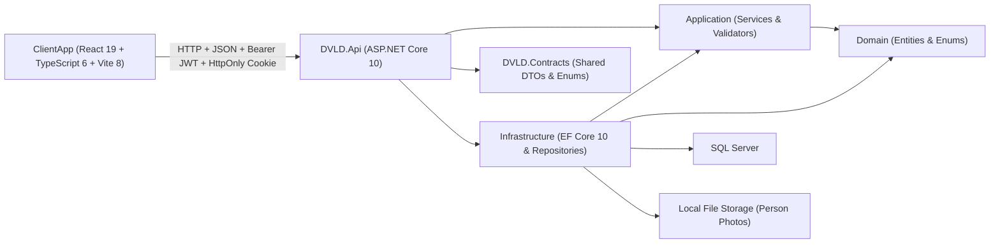

# Driver & Vehicle Licensing Department (DVLD) Management System

An enterprise full-stack driver licensing, examination scheduling, and civic identity management platform built with **.NET 10**, **ASP.NET Core Web API**, **Entity Framework Core 10**, **SQL Server**, and a **React 19 + TypeScript 6 + Vite 8** single-page application.

---

## Live Demo

- **URL**: https://dvld-demo-ayhm-2026-frcwbghpadcccxaj.uaenorth-01.azurewebsites.net/
- **Username**: `ajad`
- **Password**: `12345678`

---

## Key Capabilities

- **Civic Identity & Driver Records**: Manage person records with optimistic concurrency (`RowVersion`), national ID uniqueness, country lookup, and disk-backed photo storage with ETag caching.
- **Local Driving License Applications**: Full lifecycle management for new local license applications, including age eligibility validation, duplicate active application prevention, and cancellation.
- **Sequential Examination Workflow**: Enforces the three-stage examination sequence (**Theory → Written → Practical**) with 40-minute slot availability (`08:00`–`15:20`, Sunday–Thursday in Jordan time), two-day booking/rescheduling/cancellation cutoffs, automatic retake fee applications, and background **No-Show** processing.
- **License Lifecycle Operations**:
  - **First-Time Issuance** upon passing all three required tests.
  - **Renewal** for expired, non-detained licenses.
  - **Replacement** for active, non-expired lost or damaged licenses.
  - **Detention & Release** with fine tracking, automatic license deactivation on detention, and conditional reactivation upon release.
  - **International License Issuance** (1-year validity) for active, non-expired Class 3 (Ordinary) local licenses.
- **Security & Session Governance**: Short-lived HMAC-SHA256 JWT access tokens stored strictly in client memory, 256-bit `HttpOnly` refresh token cookies (`dvld_rt`) with token-family rotation, reuse detection, idle/absolute timeouts, `SecurityStamp` invalidation, CSRF header enforcement (`X-CSRF-Protection: 1`), and IP-partitioned rate limiting.
- **Background Automation**: Periodic workers for automatic license expiration state transitions and appointment no-show processing.

---

## Architecture Overview



| Layer / Project | Target | Responsibility |
|---|---|---|
| [`Domain/`](./Domain/) | `net10.0` | Core domain entities, enums, and domain-level constraints; zero external project dependencies. |
| [`DVLD.Contracts/`](./DVLD.Contracts/) | `net10.0` | Shared API request/response DTOs, pagination models, and contract enums. |
| [`Application/`](./Application/) | `net10.0` | Business use-case orchestration, validators, options, and repository/service interfaces. Depends only on `Domain`. |
| [`Infrastructure/`](./Infrastructure/) | `net10.0` | EF Core 10 `DVLDDbContext`, Fluent API entity configurations, SQL migrations, `UnitOfWork`, locking (`sp_getapplock`, `UPDLOCK`), Jordan clock, and physical photo storage. |
| [`API/DVLD.Api/`](./API/DVLD.Api/) | `net10.0` | REST controllers, JWT/cookie authentication, authorization policies, ProblemDetails mapping, Serilog redaction, rate limiting, and background services. |
| [`ClientApp/`](./ClientApp/) | React 19 / TS 6 | Single-page application with in-memory JWT storage, History API routing, RBAC guards, and Tailwind CSS 4 UI. |
| [`Test/`](./Test/) | `net10.0` | `Application.UnitTests`, `API.IntegrationTests`, and `Infrastructure.IntegrationTests` with isolated SQL Server test lifecycle. |

---

## Quick Start

### Prerequisites

- **.NET SDK**: `10.0.404` (configured in [`global.json`](./global.json))
- **Node.js & npm**: Node 22.x+ / 26.x (used across GitHub Actions and Azure Pipelines)
- **SQL Server**: LocalDB or SQL Server instance

### 1. Configure Secrets & Connection Strings

Configure `ConnectionStrings:DefaultConnection` and `Jwt:SecretKey` (minimum 32 UTF-8 bytes) via .NET User Secrets or environment variables:

```powershell
dotnet user-secrets --project API/DVLD.Api/DVLD.Api.csproj set "ConnectionStrings:DefaultConnection" "<YOUR_SQL_SERVER_CONNECTION_STRING>"
dotnet user-secrets --project API/DVLD.Api/DVLD.Api.csproj set "Jwt:SecretKey" "<YOUR_32_PLUS_BYTE_SIGNING_KEY>"
```

### 2. Apply Database Migrations & Run the Backend

```powershell
dotnet ef database update --project Infrastructure/Infrastructure.csproj --startup-project API/DVLD.Api/DVLD.Api.csproj
dotnet run --project API/DVLD.Api/DVLD.Api.csproj --launch-profile https
```

The API listens on `https://localhost:7125` and `http://localhost:5260` (Swagger UI is enabled in `Development`).

### 3. Run the Frontend Development Server

```powershell
cd ClientApp
npm install
npm run dev
```

The Vite dev server runs on `http://localhost:5173` and proxies `/api` requests to `https://localhost:7125`.

---

## Documentation Index

| Category | Document | Description |
|---|---|---|
| **Overview** | [System Overview](./docs/overview/system-overview.md) | Capabilities, user roles, technology stack, and project layout. |
| **Architecture** | [Architecture Overview](./docs/architecture/architecture-overview.md) | Clean Architecture boundaries, cross-cutting patterns, and request flow. |
| | [Backend Architecture](./docs/architecture/backend-architecture.md) | API pipeline, DI, `UnitOfWork`, locking, and background services. |
| | [Frontend Architecture](./docs/architecture/frontend-architecture.md) | React 19 SPA structure, routing, auth state, hooks, and services. |
| **Domain & Workflows** | [Domain Model](./docs/domain/domain-model.md) | Core entities, domain enums, and invariants. |
| | [Business Rules](./docs/domain/business-rules.md) | Validation rules, eligibility gates, fees, and concurrency controls. |
| | [Local License Application](./docs/domain/workflows/local-license-application.md) | Creating, updating, deleting, and cancelling local applications. |
| | [Test Appointment Lifecycle](./docs/domain/workflows/test-appointment-lifecycle.md) | Availability, scheduling, rescheduling, cancellation, results, and no-shows. |
| | [First License Issuance](./docs/domain/workflows/first-license-issuance.md) | Driver creation, test completion verification, and initial issuance. |
| | [License Renewal](./docs/domain/workflows/license-renewal.md) | Expiration checks, detention guards, and renewal issuance. |
| | [License Replacement](./docs/domain/workflows/license-replacement.md) | Lost and damaged license replacement workflow. |
| | [License Detention & Release](./docs/domain/workflows/license-detention-and-release.md) | Detention, fine tracking, deactivation, and conditional reactivation. |
| | [International License Issuance](./docs/domain/workflows/international-license-issuance.md) | Class 3 eligibility and 1-year international license issuance. |
| **Database** | [Database Design](./docs/database/database-design.md) | SQL Server schema, tables, indexes, and EF Core configurations. |
| | [Database Relationships](./docs/database/relationships.md) | Entity-relationship diagram, foreign keys, and delete behaviors. |
| **API & Security** | [API Reference](./docs/api/api-reference.md) | Complete REST endpoint inventory, pagination, and ProblemDetails format. |
| | [Authentication & Security](./docs/security/authentication-and-security.md) | JWT, refresh token rotation, reuse detection, RBAC, rate limiting, and redaction. |
| **Operations & Testing** | [Installation Guide](./docs/operations/installation.md) | Local development setup for backend, database, and frontend. |
| | [Configuration Reference](./docs/operations/configuration.md) | All `appsettings` sections, option validators, and environment variables. |
| | [Deployment Guide](./docs/operations/deployment.md) | Azure App Service GitHub Actions and Azure Pipelines CI/CD workflows. |
| | [Testing Guide](./docs/testing/testing-guide.md) | Unit tests, SQL-isolated integration tests, Vitest, and Playwright E2E. |
