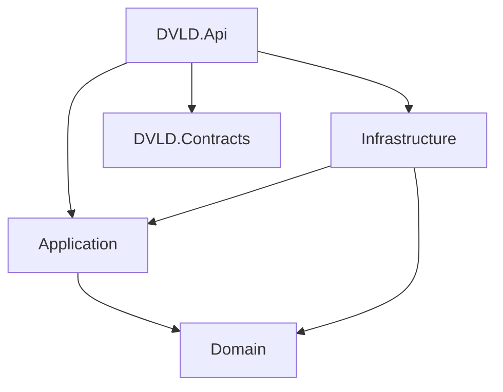
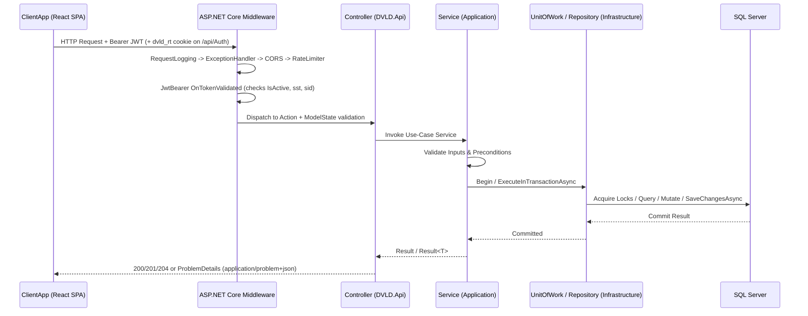

# Architecture Overview

## 1. Architectural Style and Dependency Rules

DVLD follows a **Clean Architecture / Layered Monolith** structure organized into five runtime projects inside [`DVLD.sln`](../../DVLD.sln):

Verified `.csproj` project reference rules:

- **`Domain`** has **zero** project references.
- **`DVLD.Contracts`** has **zero** project references.
- **`Application`** references **only** `Domain`. It never references `Infrastructure` or `DVLD.Api`.
- **`Infrastructure`** references `Application` and `Domain` to implement repository interfaces, `IUnitOfWork`, clock abstractions, and file storage.
- **`DVLD.Api`** references `Application`, `DVLD.Contracts`, and `Infrastructure` for composition, dependency injection, HTTP transport, and security.

---

## 2. Cross-Cutting Architectural Patterns

### 2.1 Result Pattern & ProblemDetails Mapping

Application services return `Result` / `Result<T>` outcomes rather than throwing exceptions for expected domain, validation, or authorization failures. At the HTTP boundary, `ResultHttpMapper.ToActionResult` translates each `ErrorType` into RFC-style `application/problem+json` responses:

| `ErrorType` | HTTP Status | Problem Type URN | Title |
|---|---|---|---|
| `Validation` | `400` | `urn:dvld:error:validation` | `Validation error` (`ValidationProblemDetails` with `errors.request`) |
| `Unauthorized` | `401` | `urn:dvld:error:unauthorized` | `Unauthorized` |
| `Forbidden` | `403` | `urn:dvld:error:forbidden` | `Forbidden` |
| `NotFound` | `404` | `urn:dvld:error:not-found` | `Resource not found` |
| `Conflict` | `409` | `urn:dvld:error:conflict` | `Conflict` |
| `Failure` / other | `500` | `urn:dvld:error:internal` | `An unexpected error occurred.` (internal message redacted) |

Unexpected exceptions are handled by `GlobalExceptionHandler` (`IExceptionHandler`), which maps client cancellations (`OperationCanceledException`) to `499`, malformed JSON/bad requests to `400`/`413`, `DuplicateUsernameException` / `DuplicatePersonUserException` / `ConcurrencyConflictException` to `409`, and unhandled exceptions to a generic `500` while redacting sensitive values from log messages.

### 2.2 Transaction Management & Concurrency Control

Multi-step state transitions execute inside `UnitOfWork` transactions (`ReadCommitted` or `Serializable`), supplemented by:

- **Application-Level SQL Locks (`sp_getapplock`)**: Used for serialized test appointment scheduling (`DVLD_...` locks via `AcquireSchedulingLocksAsync`), single-appointment no-show processing (`AcquireAppointmentLockAsync`), admin mutation serialization (`AcquireAdminMutationLockAsync`), and refresh token family/user-session locking (`DVLD_UserSessions_{userId}`, `DVLD_TokenFamily_{tokenFamilyId}`).
- **Row-Level SQL Locks (`UPDLOCK, ROWLOCK`)**: Used in `ForUpdate` repository queries (e.g., `GetUserForPasswordChangeAsync`, `GetForUpdateAsync`) before mutating state.
- **Optimistic Concurrency**: `People.RowVersion` is configured as an EF Core row-version concurrency token (`IsRowVersion()`), validated on person updates and photo mutations.
- **Database Filtered Unique Indexes**: Enforce active license uniqueness per `(DriverID, LicenseClass)`, active international license uniqueness per `DriverID`, and single active detention per `LicenseID`.

### 2.3 Timezone & Clock Abstraction

Business rules that depend on facility operating hours and calendar dates (such as appointment booking slots `08:00`–`15:20`, Sunday–Thursday workweeks, 2-day booking/cancellation cutoffs, and age calculations) use `IClock` implemented by `Infrastructure/Services/JordanClock.cs`. Security token lifetimes and session expiration use `UtcNow`.

### 2.4 End-to-End Request Lifecycle

---

## Implementation References

- Project files: [`Domain/Domain.csproj`](../../Domain/Domain.csproj), [`DVLD.Contracts/DVLD.Contracts.csproj`](../../DVLD.Contracts/DVLD.Contracts.csproj), [`Application/Application.csproj`](../../Application/Application.csproj), [`Infrastructure/Infrastructure.csproj`](../../Infrastructure/Infrastructure.csproj), [`API/DVLD.Api/DVLD.Api.csproj`](../../API/DVLD.Api/DVLD.Api.csproj)
- Result & ProblemDetails mapping: [`API/DVLD.Api/Results/ResultHttpMapper.cs`](../../API/DVLD.Api/Results/ResultHttpMapper.cs), [`API/DVLD.Api/Results/ApiProblemDetails.cs`](../../API/DVLD.Api/Results/ApiProblemDetails.cs), [`API/DVLD.Api/Security/GlobalExceptionHandler.cs`](../../API/DVLD.Api/Security/GlobalExceptionHandler.cs)
- Persistence & time: [`Infrastructure/UnitOfWork.cs`](../../Infrastructure/UnitOfWork.cs), [`Infrastructure/Services/JordanClock.cs`](../../Infrastructure/Services/JordanClock.cs)
