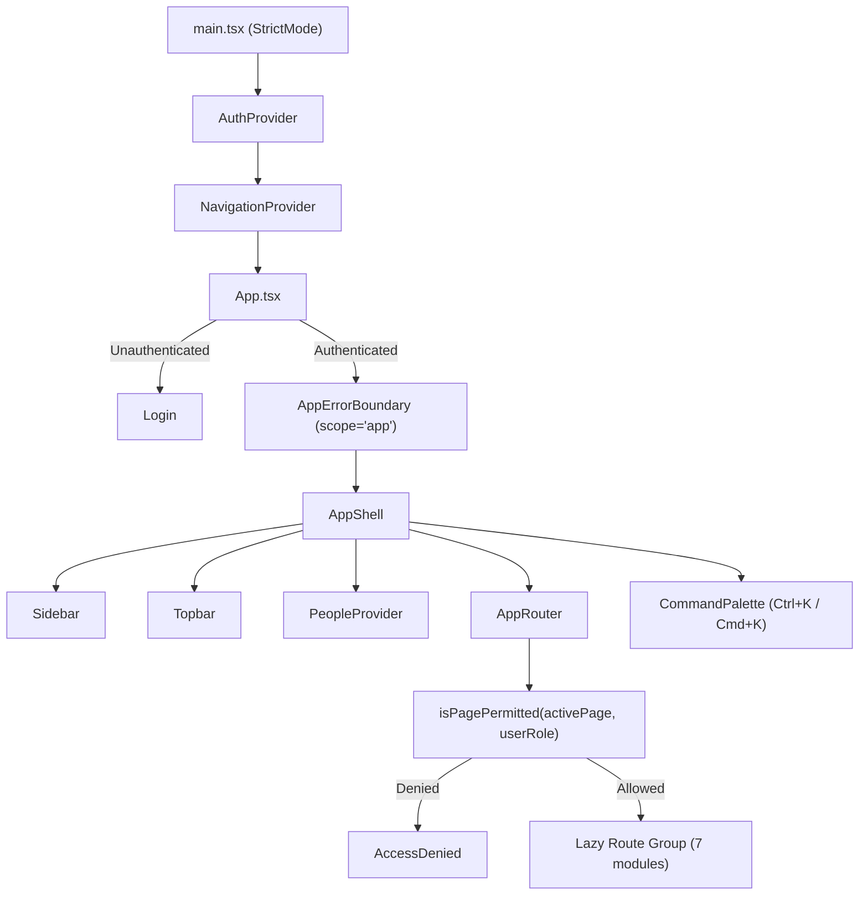

# Frontend Architecture (`ClientApp/`)

## 1. Stack and Build Configuration

`ClientApp/` is a **React 19** single-page application written in **TypeScript 6** and bundled with **Vite 8** and **Tailwind CSS 4** (`@tailwindcss/vite`).

- **TypeScript (`ClientApp/tsconfig.app.json`)**: `strict: true`, `noUnusedLocals: true`, `noUnusedParameters: true`, `erasableSyntaxOnly: true`, `verbatimModuleSyntax: true`, path alias `@/*` -> `./src/*`.
- **Vite (`ClientApp/vite.config.ts`)**: Listens on `0.0.0.0:5173` (`strictPort: true`) and proxies `/api` to `https://localhost:7125` (`secure: false`), stripping `; secure` from `set-cookie` headers so `HttpOnly` refresh cookies work over local HTTP development.

---

## 2. Application Boot, Providers, and Shell

- **`App.tsx`**: Displays a loading spinner while `AuthProvider` probes `/api/Auth/refresh` on boot, renders `<Login />` when unauthenticated, or lazy-loads `<AppShell />` inside `<AppErrorBoundary scope="app">` and `<Suspense>`. Coordinates cross-page refresh keys (`internationalRefreshKey`, `statisticsRefreshKey`).
- **`AppShell.tsx`**: Composes `Sidebar`, `Topbar`, `PeopleProvider`, `AppRouter`, logout `ConfirmModal`, global `CommandPalette` (`Ctrl+K`/`Cmd+K`), and `Footer`.

---

## 3. Authentication State & Token Lifecycle (`AuthContext`)

`AuthContext.tsx` (`utils/authTokenStore.ts`, `utils/sessionStorage.ts`) implements memory-only JWT management:

1. **In-Memory Access Token**: Access tokens are stored exclusively in module memory (`authTokenStore.ts`), never in `localStorage` or `sessionStorage`. On mount, `purgeLegacyTokenStorage()` removes legacy keys (`access_token`, `dvld_token`, `dvld_auth_session`).
2. **Startup Session Restoration**: Calls `refreshSession()` using the `HttpOnly` `dvld_rt` cookie, guarded by `getAuthGeneration()` to prevent stale responses from resurrecting a logged-out session.
3. **Cross-Tab Synchronization**: Uses `BroadcastChannel('dvld-auth')` to propagate `login`, `logout`, and `token-refreshed` events across open browser tabs.
4. **Proactive Silent Renewal**: Schedules renewal at `expiresAt - 60_000` (minimum 15s) with bounded backoff (`15s -> 30s -> 60s`) on non-fatal errors, plus a `visibilitychange` check when `<= 90s` remain before expiry.
5. **Logout**: Invokes `logoutSession()` while the current token is still readable, clears client auth state immediately, and warns if server revocation fails.

---

## 4. Custom History API Routing & RBAC

Instead of an external router package, `NavigationContext.tsx` implements a History API router:

- Maps **29 page IDs** bidirectionally between `PAGE_TO_PATH` and `PATH_TO_PAGE` (unknown paths default to `"Dashboard"`).
- Synchronizes browser `popstate` events and query parameters (`id`, `personId`, `appId`, `localAppId`, `testTypeId`, `appointmentId`).
- Sanitizes entity-dependent routes via `sanitizeParamsForPage` and strips non-serializable objects via `createSerializableNavigationParams`.
- Exposes semantic navigation helpers (`navigateToPersonDetails`, `navigateToEditPerson`, `navigateToAddPerson`, `navigateToPersonLicenseHistory`, `navigateToAppointmentDetails`, `navigateToScheduleAppointment`, `navigateToManageTestAppointments`, `navigateToTakeExamination`, `goBack`).

### 4.1 Route Groups (`components/layout/router/routeConfig.ts`)

`AppRouter.tsx` validates `isPagePermitted(activePage, userRole)` (fail-closed on missing/invalid role or unknown page) before dispatching inside `<AppErrorBoundary scope="route" resetKey={activePage}>` to one of 7 lazy-loaded route modules:

| Route Module | Pages |
|---|---|
| `DashboardRoutes.tsx` | `DashboardPage` |
| `UserRoutes.tsx` | `UsersPage` |
| `PeopleRoutes.tsx` | `PeoplePage`, `AddPersonPage`, `EditPersonPage`, `PersonDetailsPage`, `DriversPage`, `LicenseHistoryPage` |
| `LicenseRoutes.tsx` | `LicensesPage`, `InternationalLicensesPage`, `IssueInternationalLicensePage`, `LicenseRenewalReplacementPage`, `LicenseDetentionPage` |
| `AppointmentRoutes.tsx` | `LocalApplicationsPage`, `TestAppointmentsPage`, `AppointmentDetailsPage`, `ManageTestAppointmentsPage`, `TakeExaminationPage`, `ScheduleAppointmentPage` |
| `ReferenceDataRoutes.tsx` | `CountriesPage`, `ApplicationTypesPage`, `LicenseClassesPage`, `TestTypesPage` |
| `AccountRoutes.tsx` | `MyProfilePage`, `ChangePasswordPage` |

### 4.2 Role Enforcement (`utils/permissions.ts`)

- **Admin-only**: `'User Management'`; edit actions (`canManageReferenceData` / `canEditPage`) on `'Application Types'`, `'License Classes'`, `'Test Types'`. (`'Countries'` is always read-only.)
- **Staff-only**: `'Drivers'`, `'Licenses'`, `'Person License History'`, `'International Licenses'`, `'Local Applications'`, `'Test Appointments'`, `'Manage Test Appointments'`, `'Written Test Appointments'`, `'Appointment Details'`, `'Schedule Appointment'`, `'Take Examination'`, `'Renew & Replace License'`, `'Renew License'`, `'Replace License'`, `'License Detention'`, `'Detain License'`, `'Detained Licenses'`.
- **Shared (`Admin` & `Staff`)**: `'Dashboard'`, `'People'`, `'Add Person'`, `'Edit Person'`, `'Person Details'`, `'Application Types'`, `'License Classes'`, `'Test Types'`, `'Countries'`, `'My Profile'`, `'Change Password'`.

---

## 5. HTTP Client, Services, and Custom Hooks

### 5.1 `apiClient.ts`

- Base URL defaults to `'/api'`.
- Automatically injects `Authorization: Bearer <token>`, `credentials: 'include'`, `Accept: application/json`, and `X-CSRF-Protection: 1` on `/Auth/refresh`, `/Auth/logout`, and `/Auth/logout-all`.
- Enforces a 30-second `AbortController` timeout (`DEFAULT_REQUEST_TIMEOUT_MS = 30_000`).
- Uses single-flight `refreshSession()` with `authGeneration` anti-resurrection checks, a single 250ms retry on HTTP `409` rotation races, fatal `unauthorizedHandler` on `401`, and non-fatal handling for network/`429`/`500` errors.
- Exports `ApiError`, `UnauthorizedError`, `ForbiddenError`, `apiRequest`, and `apiBlobRequest`.

### 5.2 Service Modules (`ClientApp/src/services/`)

15 service modules encapsulate API communication: `apiClient.ts`, `authService.ts`, `dashboardService.ts`, `peopleService.ts`, `driverService.ts`, `userService.ts`, `localDrivingLicenseApplicationService.ts`, `testAppointmentService.ts`, `licenseService.ts`, `internationalLicenseService.ts`, `detainedLicenseService.ts`, `applicationTypeService.ts`, `licenseClassService.ts`, `testTypeService.ts`, and `countryService.ts` (which caches countries in module memory with single-flight `inflightCountries` deduplication).

### 5.3 Custom Hooks (`ClientApp/src/hooks/`)

| Hook | Purpose |
|---|---|
| `useAsyncData` | Async data fetching with `AbortController`, stale-response guard, and `refresh()`. |
| `useDashboardStatistics` | Wraps `getDashboardStatistics` with `useAsyncData`. |
| `useDebounce` | Debounces values (default `300ms`). |
| `useModal` | Modal open/close/toggle state with typed `payload`. |
| `usePagination` | Server/client pagination state (`PAGE_SIZE_OPTIONS = [10, 20, 60, 80, 100]`). |
| `useTableFilters` | Search query, `searchField`, and structured `filters` state. |

---

## Implementation References

- Entry & shell: [`ClientApp/src/main.tsx`](../../ClientApp/src/main.tsx), [`ClientApp/src/App.tsx`](../../ClientApp/src/App.tsx), [`ClientApp/src/components/layout/AppShell.tsx`](../../ClientApp/src/components/layout/AppShell.tsx), [`ClientApp/src/components/layout/AppRouter.tsx`](../../ClientApp/src/components/layout/AppRouter.tsx)
- Contexts & permissions: [`ClientApp/src/context/AuthContext.tsx`](../../ClientApp/src/context/AuthContext.tsx), [`ClientApp/src/context/NavigationContext.tsx`](../../ClientApp/src/context/NavigationContext.tsx), [`ClientApp/src/utils/permissions.ts`](../../ClientApp/src/utils/permissions.ts)
- API client & hooks: [`ClientApp/src/services/apiClient.ts`](../../ClientApp/src/services/apiClient.ts), [`ClientApp/src/hooks/index.ts`](../../ClientApp/src/hooks/index.ts)
- Config: [`ClientApp/package.json`](../../ClientApp/package.json), [`ClientApp/vite.config.ts`](../../ClientApp/vite.config.ts), [`ClientApp/tsconfig.app.json`](../../ClientApp/tsconfig.app.json)
