> [!WARNING]
> **HISTORICAL / SUPERSEDED STRATEGY DOCUMENT — NOT AN ACTIVE AUTHORITY.**  
> Verified factual findings from this 2026-11-17 strategy document (runtime `.NET 8` end-of-support warning, `EF Core` version drift, `AUTH-01` vs. `SEC-05` reconciliation, `ClientApp` Vitest/Playwright presence, and `tsconfig.app.json` settings) have been incorporated into the active documents under `docs/development/` (`TECHNOLOGY-STACK.md`, `SECURITY-STANDARDS.md`, `TESTING-STANDARDS.md`). Active task priorities and approvals live exclusively in [`ENGINEERING-ROADMAP.md`](../../../ENGINEERING-ROADMAP.md) and [`ENGINEERING-DECISIONS.md`](../../../ENGINEERING-DECISIONS.md).

# DVLD System
## Engineering Improvement Strategy & Delivery Roadmap

> **نوع الوثيقة:** Strategic Engineering Plan — خطة استراتيجية للتحسين الهندسي  
> **الإصدار:** 1.0  
> **تاريخ إعداد الوثيقة:** 17 November 2026  
> **المستودع:** [ayhm325/DVLD-System](https://github.com/ayhm325/DVLD-System)  
> **الفرع المفحوص:** `main`  
> **Commit المرجعي الحالي وقت الفحص:** `e4435e3006d88d99ed8ccac2f8fec741d5446afa`  
> **Commit السابق المباشر:** `62ac8eee4a55854cfb6d7e7b8291bc086dccc396`  
> **حالة المراجعة:** Static source and documentation review — لم يتم تشغيل Build أو Tests ضمن إعداد هذه الوثيقة.  
> **طبيعة التغيير:** وثيقة استراتيجية مستقلة؛ لا تمنح صلاحية تنفيذ أي تعديل برمجي أو تغيير في قاعدة البيانات.

---

## فهرس المحتويات

1. [الملخص التنفيذي](#1-الملخص-التنفيذي)
2. [الغرض والنطاق والحوكمة](#2-الغرض-والنطاق-والحوكمة)
3. [خط الأساس الحالي للمشروع](#3-خط-الأساس-الحالي-للمشروع)
4. [تقييم البنية المعمارية الحالية](#4-تقييم-البنية-المعمارية-الحالية)
5. [ما يجب المحافظة عليه](#5-ما-يجب-المحافظة-عليه)
6. [النتائج الهندسية المثبتة وسجل المخاطر](#6-النتائج-الهندسية-المثبتة-وسجل-المخاطر)
7. [استراتيجية تحديث المنصة وDependencies](#7-استراتيجية-تحديث-المنصة-وdependencies)
8. [خطة Authentication وLogin وإدارة الجلسات](#8-خطة-authentication-وlogin-وإدارة-الجلسات)
9. [خطة Security Engineering](#9-خطة-security-engineering)
10. [Logging وAudit وObservability](#10-logging-وaudit-وobservability)
11. [Database وEF Core والأداء](#11-database-وef-core-والأداء)
12. [خطة Frontend](#12-خطة-frontend)
13. [Testing وCI/CD وRelease Quality Gates](#13-testing-وci-cd-وrelease-quality-gates)
14. [Scalability وDeployment Readiness](#14-scalability-وdeployment-readiness)
15. [التقنيات المقترحة وما يجب تأجيله](#15-التقنيات-المقترحة-وما-يجب-تأجيله)
16. [خارطة التنفيذ المرحلية](#16-خارطة-التنفيذ-المرحلية)
17. [تفصيل المهام ومعايير القبول](#17-تفصيل-المهام-ومعايير-القبول)
18. [منع Regression وإدارة التغيير](#18-منع-regression-وإدارة-التغيير)
19. [مخاطر التنفيذ والقرارات المفتوحة](#19-مخاطر-التنفيذ-والقرارات-المفتوحة)
20. [Definition of Done](#20-definition-of-done)
21. [خلاصة القرارات الهندسية](#21-خلاصة-القرارات-الهندسية)
22. [المراجع الرسمية](#22-المراجع-الرسمية)
23. [ملحق A — مصادر الأدلة داخل المستودع](#ملحق-a--مصادر-الأدلة-داخل-المستودع)
24. [سجل التغييرات](#سجل-التغييرات)

---

# 1. الملخص التنفيذي

## 1.1 الرؤية

الهدف هو رفع DVLD-System إلى مستوى نظام إداري قابل للاعتماد والصيانة والتطور، دون إعادة بنائه من الصفر ودون إدخال تعقيد معماري لا تبرره احتياجاته الحالية.

المشروع يمتلك أساسًا جيدًا بالفعل: Backend مبني على ASP.NET Core، فصل واضح نسبيًا بين طبقات Domain وApplication وInfrastructure وAPI، قاعدة بيانات SQL Server، معاملات UnitOfWork متقدمة، حماية من حالات التزامن في بعض مسارات الأعمال، جلسات مصادقة محفوظة في قاعدة البيانات، وواجهة React مستقلة مع اختبارات Unit وE2E مهيأة.

لذلك فإن المسار الصحيح ليس استبدال هذه الأسس، بل:

1. معالجة انتهاء دعم المنصة الحالية.
2. إغلاق مخاطر الموثوقية في Authentication وLogout.
3. تأسيس Logging وMonitoring قابلين للتشخيص، مع فصل السجلات التشغيلية عن سجل التدقيق الأمني والتجاري.
4. تحسين الأداء بالقياس والاستعلامات المحددة والـ Pagination، لا بالتخمين.
5. إدخال اختبارات Frontend الموجودة أصلًا ضمن بوابة CI.
6. تحسين اتساق العقود بين Backend وReact.
7. تجهيز النظام للتوسع الأفقي فقط عندما تتحدد بيئة النشر والحاجة الفعلية.
8. ضبط الوثائق الحالية لتتفق مع الكود الموجود، ومنع وجود تعليمات متعارضة.

## 1.2 أهم الاستنتاجات

| المجال | الحالة التي تم التحقق منها | القرار الهندسي |
|---|---|---|
| Runtime | المشاريع تستهدف `net8.0` وSDK مثبت على `8.0.427`، وانتهى دعم .NET 8 في 10 نوفمبر 2026 | أولوية P0: الانتقال المنضبط إلى `.NET 10 LTS` |
| EF Core | توجد إصدارات 8.0.18 و8.0.0 في Packages مرتبطة بـ EF Core | توحيد الإصدارات بعد ترقية Framework والتحقق من Restore/Tests |
| Architecture | Layered Modular Monolith مع Domain وApplication وInfrastructure وAPI | المحافظة عليها؛ لا Microservices الآن |
| UnitOfWork | يدير المعاملات وExecution Strategy وRollback وChangeTracker وتنفيذ التحقق من نتيجة Commit | المحافظة عليه؛ لا إعادة كتابة دون سبب مثبت |
| Authentication | JWT قصير العمر، Security Stamp، Session ID، Refresh Token مخزن كـ Hash مع Rotation وRevocation | لا نعيد بناء المصادقة؛ نكمل اختبار الحواف ونصلح موثوقية Logout |
| Rate Limiting | سياسات Login وRefresh وChange Password موجودة، مبنية على عنوان IP | مراجعة الثقة بالـ Proxy وسلوك تعدد Instances |
| Logging | توجد استخدامات `ILogger<T>`، لكن لا توجد بنية مركزية مثبتة لـ Serilog/Correlation/OTel | تنفيذ OBS-03 بعد اعتماد الحزم والتخزين |
| Security Audit | توجد متطلبات وتصاميم في الوثائق، لكن Sink تدقيق مستقل وسجل تدقيق معاملات الأعمال ما زالا بحاجة لقرارات واعتماد | فصل SEC-04 عن AUD-01 وعدم افتراض موافقة التخزين |
| Frontend | React 19 وTypeScript 6 وVite 8، مع Vitest وPlaywright | الإبقاء على الـ Stack وإدخال الاختبارات في CI |
| Database Performance | بعض مسارات القوائم تستخدم Pagination، لكن توجد دوال تجلب قوائم كاملة مثل `GetAllAsync` للمواعيد | مراجعة الاستخدام الفعلي وتحديد الأولوية من Query Plans والقياس |
| Scalability | File Storage محلي وخدمات Background داخل API وسياسات Rate Limit محلية لكل Process | مناسب حاليًا لخادم واحد؛ يحتاج تصميمًا مشتركًا قبل التوسع الأفقي |

## 1.3 القرار المعماري الأعلى

**الاستمرار بهيكل Layered Modular Monolith.**

لا يوجد دليل حالي يبرر تقسيم المشروع إلى Microservices أو إدخال Kubernetes أو Kafka أو Event Sourcing. هذه التقنيات تزيد عبء التشغيل والمراقبة والتزامن والنشر، بينما الأولوية الحالية هي استقرار المنصة، وضوح العقود، القياس، واكتمال الاختبارات.

## 1.4 ترتيب الأولويات المقترح

- **P0 — Platform Support:** تحديث .NET وEF Core إلى إصدارات مدعومة، مع الحفاظ على قابلية الرجوع.
- **P1 — Security & Session Reliability:** معالجة حالات Logout الفاشلة، وتوثيق إعدادات Proxy/CORS/Cookies، واستكمال اختبار سيناريوهات Auth الحدية.
- **P1/P2 — Observability:** تفعيل Structured Logging وCorrelation IDs، ثم Security Audit منفصل بعد اتخاذ قرارات التخزين والاحتفاظ.
- **P2 — Performance:** القياس، مراجعة الاستعلامات والقوائم، Query Store، وتحسينات Pagination حسب الاستخدام.
- **P2 — Quality:** إدخال Vitest وPlaywright في CI، وتحسين توليد API Types.
- **P3 — Scale Readiness:** Shared Storage وWorker مستقل وDistributed Rate Limiting فقط عند اعتماد تعدد Instances.

> تصنيفات الأولوية في هذه الوثيقة تصف التسلسل الاستراتيجي المقترح، ولا تستبدل حالات المهام والموافقات الموجودة في `ENGINEERING-ROADMAP.md`.

---

# 2. الغرض والنطاق والحوكمة

## 2.1 الغرض

هذه الوثيقة تشرح اتجاه التطوير الهندسي طويل ومتوسط المدى، وتربط القرارات التقنية بأدلة من المستودع. وهي وثيقة استراتيجية مساندة وليست Backlog ثانية.

## 2.2 الوثائق المرجعية ذات السلطة

المستودع يمتلك بالفعل منظومة Governance. يجب الاستمرار في اعتبار الملفات التالية مرجعًا حاكمًا:

| الوثيقة | مسؤوليتها |
|---|---|
| [`AGENTS.md`](https://github.com/ayhm325/DVLD-System/blob/e4435e3006d88d99ed8ccac2f8fec741d5446afa/AGENTS.md) | قواعد العمل الإلزامية للـ AI Agents، حماية ملفات المستخدم وقاعدة البيانات، ومنع Commit/Push غير المصرح به |
| [`AI-ENGINEERING-INSTRUCTIONS.md`](https://github.com/ayhm325/DVLD-System/blob/e4435e3006d88d99ed8ccac2f8fec741d5446afa/AI-ENGINEERING-INSTRUCTIONS.md) | سير العمل الهندسي والتحقق قبل وبعد التغيير |
| [`ENGINEERING-ROADMAP.md`](https://github.com/ayhm325/DVLD-System/blob/e4435e3006d88d99ed8ccac2f8fec741d5446afa/ENGINEERING-ROADMAP.md) | **قائمة المهام التنفيذية الوحيدة المعتمدة** وترتيبها وحالة التفويض |
| [`ENGINEERING-DECISIONS.md`](https://github.com/ayhm325/DVLD-System/blob/e4435e3006d88d99ed8ccac2f8fec741d5446afa/ENGINEERING-DECISIONS.md) | Architectural Decision Records والقرارات المفتوحة أو المقبولة أو المرفوضة |
| [`ENGINEERING-STANDARDS.md`](https://github.com/ayhm325/DVLD-System/blob/e4435e3006d88d99ed8ccac2f8fec741d5446afa/ENGINEERING-STANDARDS.md) | حدود الطبقات وUnitOfWork والتزامن وقواعد البيانات ومعايير الكود |
| [`SECURITY-STANDARDS.md`](https://github.com/ayhm325/DVLD-System/blob/e4435e3006d88d99ed8ccac2f8fec741d5446afa/SECURITY-STANDARDS.md) | Authentication وAuthorization وحماية الملفات والمخاطر الأمنية |
| [`TESTING-STANDARDS.md`](https://github.com/ayhm325/DVLD-System/blob/e4435e3006d88d99ed8ccac2f8fec741d5446afa/TESTING-STANDARDS.md) | عزل قواعد بيانات الاختبار وسلامة تشغيل Integration Tests |
| [`TECHNOLOGY-STACK.md`](https://github.com/ayhm325/DVLD-System/blob/e4435e3006d88d99ed8ccac2f8fec741d5446afa/TECHNOLOGY-STACK.md) | جرد التقنيات والحزم وإصداراتها |
| [`docs/IMPLEMENTATION-EXECUTION-LOG.md`](https://github.com/ayhm325/DVLD-System/blob/e4435e3006d88d99ed8ccac2f8fec741d5446afa/docs/IMPLEMENTATION-EXECUTION-LOG.md) | سجل التنفيذ والاختبارات والأدلة التاريخية |
| [`docs/PROJECT-COMPLETION-MASTER-PLAN.md`](https://github.com/ayhm325/DVLD-System/blob/e4435e3006d88d99ed8ccac2f8fec741d5446afa/docs/PROJECT-COMPLETION-MASTER-PLAN.md) | تقييم الأنظمة وخطة الاكتمال على مستوى المشروع |

**قاعدة حوكمة:** إذا اختلفت هذه الوثيقة مع `ENGINEERING-ROADMAP.md` أو ADR معتمد، تكون الأولوية للوثيقة الحاكمة والقرار المعتمد. يجب تسجيل التغيير في الوثيقة صاحبة السلطة بدل إنشاء مسارين متنافسين.

## 2.3 نطاق هذه الخطة

يشمل:

- `Domain/`
- `Application/`
- `Infrastructure/`
- `API/DVLD.Api/`
- `DVLD.Contracts/`
- `ClientApp/`
- `Test/`
- `azure-pipelines.yml`
- إعدادات المنصة والحزم والتوثيق الهندسي.

لا يشمل إدخال WPF أو Presentation Layer جديدة، ولا يهدف إلى تغيير واجهات الاستخدام أو إعادة تصميمها ضمن خطة Backend/Platform هذه.

## 2.4 حدود التفويض

وجود توصية في هذه الوثيقة لا يعني الإذن بالتنفيذ. التغييرات التالية تحتاج موافقة مستقلة قبل التنفيذ:

- ترقية Framework أو الحزم الرئيسية.
- تعديل Schema أو إنشاء Migration.
- تعديل Authentication أو سياسة Session.
- إضافة Sink دائم لسجلات الأمن أو Audit.
- تغيير API Contract أو سلوك Endpoints.
- تغيير نموذج الصلاحيات أو السياسات التنظيمية.
- نقل الملفات إلى مزود تخزين خارجي.
- إنشاء Worker أو خدمة تشغيلية مستقلة.

---

# 3. خط الأساس الحالي للمشروع

## 3.1 هوية النسخة المفحوصة

تم فحص الفرع `main` عند Commit:

`e4435e3006d88d99ed8ccac2f8fec741d5446afa`

رسالة الـ Commit: `feat(ui): improve sidebar and card components`، والـ Parent هو `62ac8eee4a55854cfb6d7e7b8291bc086dccc396`.

التغيير المباشر في هذا الـ Commit يتركز على واجهة Sidebar وStatCard؛ لذلك لم يظهر في بيانات الـ Commit أنه يتضمن تعديلًا على منطق Backend أو مصادقة أو قاعدة البيانات. هذا لا يغني عن مراجعة الملفات الحالية عند تنفيذ أي تغيير لاحق.

## 3.2 بنية المستودع

```text
DVLD.sln
├── Domain/
├── Application/
├── Infrastructure/
├── DVLD.Contracts/
├── API/
│   └── DVLD.Api/
├── ClientApp/
│   ├── src/
│   └── tests/
├── Test/
│   ├── Application.UnitTests/
│   ├── API.IntegrationTests/
│   ├── Infrastructure.IntegrationTests/
│   └── Shared/
├── docs/
├── eng/
├── scripts/
├── global.json
└── azure-pipelines.yml
```

لا يظهر في البنية الأساسية الحالية مشروع WPF ضمن الحل النشط. هذه الخطة تتعامل مع API وReact والطبقات الخلفية الموجودة.

## 3.3 جرد التقنيات التي تحققت منها

### Backend

| العنصر | الموجود في الملفات المفحوصة | الملاحظة |
|---|---|---|
| SDK | `8.0.427` عبر `global.json` | يجب تغيير Pin بعد اعتماد الترقية |
| Target Framework | `net8.0` في API وApplication وInfrastructure | خارج الدعم اعتبارًا من 10-11-2026 |
| API | ASP.NET Core Web API | يستمر كطبقة HTTP وComposition Root |
| ORM | Entity Framework Core 8 | حزم EF لا تستخدم Patch Version موحدًا |
| Database | SQL Server | يعتمد النظام على خصائص SQL Server مثل `sp_getapplock` |
| Authentication | JWT Bearer + Persisted Refresh Sessions | دورة الجلسة مطبقة بالفعل |
| Password Hashing | BCrypt.Net-Next `4.2.0` | تغيير آلية التشفير يحتاج خطة وتوافقًا للـ Hash القديم |
| API Documentation | Swashbuckle `6.6.2` | OpenAPI موجود؛ التوليد الآلي لعقود React فرصة تحسين |
| Unit of Work | تنفيذ مخصص في `Infrastructure/UnitOfWork.cs` | لا يستبدل لمجرد استخدام مكتبة أخرى |

### Frontend

| العنصر | الموجود في `ClientApp/package.json` | القرار |
|---|---|---|
| React | `^19.3.1` | المحافظة عليه |
| React DOM | `^19.3.1` | المحافظة عليه |
| TypeScript | `~6.0.3` | المحافظة عليه مع مراجعة Strictness |
| Vite | `^8.3.4` | المحافظة عليه مع تحديثات متوافقة |
| Tailwind CSS | `^4.3.3` | المحافظة على نظام التصميم الحالي |
| Radix UI | مجموعة `@radix-ui/react-*` | المحافظة على المكونات القائمة |
| Lucide | `lucide-react ^1.65.0` | المحافظة عليه |
| Motion | `^14.9.0` | مراقبة الأداء عند استخدام الحركات المكثفة |
| Vitest | `^5.1.0` | موجود ومهيأ للاختبارات |
| React Testing Library | `^16.3.3` | موجود |
| Playwright | `^1.65.0` | موجود لاختبارات E2E |

### CI/CD

- Azure Pipelines.
- Windows Hosted Agent.
- Node.js `22.x` للواجهة.
- NuGet restore/build/test للـ Backend.
- npm install/lint/typecheck/build للـ Frontend.
- SQL Server LocalDB ديناميكي لاختبارات التكامل، مع قواعد حماية وعزل.

## 3.4 حالة الاختبارات التي أمكن إثبات وجودها

**هذه أعداد ملفات/إعدادات وليست عدد Test Cases ناجحة.**

| المنطقة | ما وجدته في الشجرة |
|---|---|
| Backend Unit Tests | مشروع `Test/Application.UnitTests` |
| API Integration Tests | مشروع `Test/API.IntegrationTests`، وفيه مجلد Auth وSecurity وWorkflows وغيرها |
| Infrastructure Integration Tests | مشروع `Test/Infrastructure.IntegrationTests` مع مجلدات Auth وConcurrency |
| Frontend Unit Tests | 7 ملفات ضمن `ClientApp/tests/unit/` |
| Frontend E2E | ملف `ClientApp/tests/e2e/login.spec.ts` واحد |
| Frontend Test Runner | `vitest.config.ts` و`playwright.config.ts` موجودان |

في هذه المهمة لم يتم تشغيل `dotnet test` أو `npm test` أو Playwright. أي أعداد نجاح محفوظة في ملفات التنفيذ هي أدلة تاريخية بتاريخها ولا يجوز تقديمها على أنها نتيجة تشغيل للنسخة الحالية.

---

# 4. تقييم البنية المعمارية الحالية

## 4.1 النمط المعماري

الوصف الأنسب هو **Layered Modular Monolith**، وليس Microservices.

- `Domain`: الكيانات وقواعد المجال الأساسية.
- `Application`: حالات الاستخدام والخدمات والتنسيق وقواعد التطبيق والواجهات التي تحتاجها الطبقة.
- `Infrastructure`: EF Core وSQL Server وRepositories وFile Storage والتكاملات التقنية.
- `DVLD.Api`: HTTP Controllers وMiddleware وAuthentication/Authorization وتجميع Dependency Injection عند تشغيل التطبيق.
- `DVLD.Contracts`: عقود HTTP المشتركة بين API ومشاريع .NET ذات الصلة.
- `ClientApp`: واجهة React مستقلة تتواصل مع API عبر HTTP/JSON.
- `Test`: طبقات تحقق مستقلة وفق نوع الاختبار.

## 4.2 مخطط الاعتماد

```mermaid
flowchart TD
    Web[React ClientApp]
    Api[ASP.NET Core DVLD.Api]
    Contracts[DVLD.Contracts]
    App[Application Services]
    Domain[Domain Model]
    Infra[Infrastructure: EF Core / Repositories / Storage]
    Sql[(SQL Server)]

    Web -->|HTTP + JSON + JWT + Cookie| Api
    Api --> Contracts
    Api --> App
    Api -->|Composition Root / DI| Infra
    App --> Domain
    Infra --> App
    Infra --> Domain
    Infra --> Sql
```



الرسم يبين الاعتماد المنطقي وليس كل Reference في كل مشروع. يجب أن تبقى قاعدة أن `Application` لا يعتمد على `Infrastructure`، وأن Domain لا يعتمد على الطبقات الخارجية.

## 4.3 نقاط القوة المعمارية

1. وجود طبقات واضحة بدل وضع الوصول إلى البيانات ومنطق الأعمال في Controller.
2. اعتماد Application Services على abstractions للـ persistence والخدمات.
3. وجود `DVLD.Contracts` كحد للعقود في .NET API.
4. وجود UnitOfWork واحد Scoped مع DbContext مشترك للعمليات متعددة المستودعات.
5. وجود اختبارات SQL Server فعلية لجزء من سلوك التزامن والمعاملات.
6. وجود فصل بين كود React وبين .NET API.

## 4.4 ما لا يجب تغييره الآن

لا توجد حجة لإعادة كتابة المشروع إلى Clean Architecture جديدة أو إدخال CQRS كامل. الأفضل تقوية حدود الطبقات الموجودة واختبارها. كما لا ينبغي تحويل كل Service إلى مجموعة Classes صغيرة إلا إذا ثبت أن مسؤولياتها متداخلة وأن الفصل يقلل التعقيد فعليًا.

---

# 5. ما يجب المحافظة عليه

| المكوّن | سبب المحافظة | ما الذي يجب فعله بدل استبداله؟ |
|---|---|---|
| Layered Modular Monolith | يناسب حجم النظام الحالي وعملياته المترابطة | Architecture Tests عند الحاجة لحماية الاتجاهات |
| UnitOfWork | يعالج معاملات متعددة الخطوات ونتائج Commit الغامضة | اختبارات Regression وتوثيق عقد المعاملات |
| Shared Scoped DbContext | يمنع استقلال مستودعات المعاملة الواحدة عن بعض | منع تسجيل Repositories بعمر حياة يسبب DbContext منفصلًا |
| Repository Pattern | يحصر تفاصيل SQL/EF في Infrastructure | تبسيط الواجهات عند وجود ISP problem مثبت |
| SQL Server application locks | مطلوبة لبعض عمليات الحجز والتزامن | الحفاظ على ترتيب الأقفال واختبارها بقاعدة SQL حقيقية |
| RowVersion / Unique Constraints | خط دفاع على مستوى قاعدة البيانات | المحافظة عليها وإضافة قيود عند وجود invariant مثبت |
| Result / Result<T> | توحيد نتائج الأخطاء المتوقعة | عدم استخدام Exceptions لتدفق الأعمال العادي |
| JWT + Refresh Session Model | المصادقة وإبطال الجلسات مطبقين بالفعل | اختبار الحالات الطرفية وتحسين Logout فقط عند الحاجة |
| React Shared UI | يقلل تكرار واجهات الاستخدام | تعزيز الاختبارات والعقود دون إعادة بناء المكونات |
| SQL Server Test Isolation | يحمي قاعدة البيانات غير المخصصة للاختبارات | منع أي تغيير يضعف شروط الاختبار أو الـ cleanup |

## 5.1 UnitOfWork تحديدًا

`Infrastructure/UnitOfWork.cs` يحتوي على منطق متقدم، من ضمنه:

- إنشاء Execution Strategy من EF Core.
- بدء Transaction.
- إدارة Deferred Physical Commit.
- Rollback عند فشل النتيجة أو الاستثناء.
- تنظيف ChangeTracker عند مسارات الفشل.
- التحقق من نتيجة Commit عند وجود حالة غامضة.
- تمرير CancellationToken.

هذه مسؤولية حساسة. يجب عدم تبسيطها أو إعادة كتابتها استنادًا إلى رأي عام حول Repository/UnitOfWork. أي تعديل مستقبلي يحتاج اختبارًا مباشرًا على SQL Server، خصوصًا حالات Commit Failure وRollback وConcurrency.

---

# 6. النتائج الهندسية المثبتة وسجل المخاطر

## 6.1 منهج التصنيف

- **Verified:** تمت ملاحظة الحالة مباشرة في ملفات الكود أو الإعدادات.
- **Documented:** واردة في وثائق المشروع؛ يجب مقارنة تاريخها بالحالة الحالية قبل التنفيذ.
- **Potential Risk:** خطر مشروط ببيئة تشغيل أو حجم بيانات أو سلوك لم يتم قياسه.
- **Not Verified:** لا توجد أدلة كافية للجزم.

## 6.2 سجل النتائج

| ID | المجال | النتيجة | التصنيف | الأولوية المقترحة | الأثر / الإجراء |
|---|---|---|---|---|---|
| F-001 | Runtime | `net8.0` وSDK `8.0.427` ما زالا الأساس في الملفات الحالية | Verified | P0 | الانتقال إلى .NET 10 LTS بسبب انتهاء دعم .NET 8 |
| F-002 | EF Packages | `Microsoft.EntityFrameworkCore` 8.0.18 بينما SqlServer/Design/Tools 8.0.0 في Infrastructure | Verified | P0 مع الترقية | توحيد النسخ بعد اختيار EF Core 10 |
| F-003 | Authentication | Refresh sessions وRotation وRevocation موجودة | Verified | محافظ عليها | لا تُنفذ مصادقة بديلة؛ استكمل اختبارات الحواف |
| F-004 | Logout Client | دالة Logout لا تفحص `response.ok`، وتفرغ Access Token محليًا حتى عند استجابة HTTP فاشلة | Verified | P1 | تمييز logout المحلي عن تأكيد revocation من الخادم، وتعريف سلوك فشل واضح |
| F-005 | Rate Limit | Login/Refresh/ChangePassword تستخدم Fixed Window على `RemoteIpAddress` | Verified | P1 | التحقق من Proxy الموثوق وتعدد Instances |
| F-006 | CORS | الأصل `http://localhost:5173` مثبت في إعداد ReactApp | Verified | P1 قبل Production | جعل Origins إعدادًا بيئيًا صريحًا بعد تحديد استضافة الواجهة |
| F-007 | Observability | ILogger مستخدم، لكن لا يوجد Serilog/Otel/Correlation Middleware مسجل في Program ضمن الحالة المفحوصة | Verified | P1/P2 | تنفيذ OBS-03 بعد اعتماد الحزم ووجهة السجلات |
| F-008 | Security Audit | وثائق الخطة تعتبر SEC-04 وAUD-01 أعمالًا مخططة وتحتاج قرارات تخزين/DBA | Documented | P2 | لا تضف Audit Sink أو Schema دون الموافقات المطلوبة |
| F-009 | Frontend CI | Vitest/Playwright مهيآن، لكن YAML المفحوص يشغّل lint/typecheck/build ولا يظهر فيه npm test أو Playwright | Verified | P2 | إضافة اختبارات الواجهة للـ CI بشكل تدريجي |
| F-010 | TypeScript | `ClientApp/tsconfig.app.json` لا يصرّح بـ `strict: true` | Verified | P2 | اعتماد strictness تدريجيًا بعد حصر أخطاء الأنواع |
| F-011 | Appointment Query | `TestAppointmentRepository.GetAllAsync` ينفذ `ToListAsync` بعد ترتيب دون Skip/Take | Verified — Usage needs trace | P2 candidate | فحص المستدعين والعدد المتوقع قبل فرض Pagination |
| F-012 | Per-request Auth | `OnTokenValidated` يراجع Session/Security Stamp عبر AuthService في كل طلب محمي | Verified | Trade-off | يحافظ على الإبطال الفوري؛ قِس تكلفة DB قبل أي تخفيف |
| F-013 | File Storage | `PhysicalFileStorageService` يخزن في مسار محلي افتراضي خارج `wwwroot` | Verified | P3 قبل Scale-out | مقبول لخادم منفرد؛ لا يكفي تلقائيًا لعدة API nodes |
| F-014 | Background Services | خدمات الخلفية تعمل ضمن Host API | Verified in repository design | P3 before multi-instance | راجع التكرار/Idempotency قبل تشغيل عدة Instances |
| F-015 | Health/Readiness | لا تظهر إضافة Health Checks/MapHealth في `Program.cs` المفحوص | Verified | P2/P3 | أضفها حسب متطلبات Deployment/Monitoring |

## 6.3 تعارضات الوثائق التي يجب إصلاحها

توجد فروقات بين بعض وثائق الحوكمة وبين الكود الحالي. هذه ليست بالضرورة Bugs في التطبيق، لكنها تجعل قرارات التنفيذ غير موثوقة إذا لم تُعالج:

| التعارض | ما تقوله الوثيقة | ما يظهر في الكود الحالي | التوصية |
|---|---|---|---|
| AUTH-01 مقابل SEC-05 | `ENGINEERING-ROADMAP.md` يوثق AUTH-01 كمكتمل، لكن قسم Deferred Modernization لا يزال يصف Refresh Sessions وReact Auth Lifecycle كأنها غير مطبقة | `UserSession` و`AuthService` و`AuthController` و`apiClient.ts` تنفذ Refresh Cookie/Rotation/Logout | توحيد السجل: نقل ما لم يعد مؤجلًا إلى الحالة الصحيحة، والإبقاء على الثغرات المتبقية كمهام منفصلة |
| Change Password Rate Limit | `SECURITY-STANDARDS.md` يذكر أن ChangePassword لا يملك Rate Limit، وSEC-03 ما يزال في Backlog | `AuthController` يطبق `ChangePasswordRateLimit`، و`Program.cs` يعرّف السياسة | تحديث SECURITY-STANDARDS وENGINEERING-ROADMAP حسب تنفيذ الكود، مع اختبار السياسة |
| TypeScript Strict | وثائق ClientApp/Technology Stack تذكر Strict Type Safety | `tsconfig.app.json` لا يحتوي تصريح `strict: true` | فحص جميع ملفات tsconfig وتحديث وصف الـ Stack إلى نتيجة مثبتة |
| Baseline Commit | بعض وثائق Stack/Roadmap تشير إلى SHAs قديمة | الفرع الحالي على `e4435e3...` وقت الفحص | تحديث Baseline Snapshot وتاريخ المراجعة دون تزوير تاريخ الأدلة |
| CI Test Claims | وثائق التنفيذ تتضمن نتائج تاريخية للـ Backend | إعداد YAML دليل إعداد فقط، ولا يثبت أن تشغيلًا حاليًا نجح؛ كما أن Frontend tests غير مضافة إلى YAML المفحوص | ربط كل ادعاء نجاح برقم Pipeline/Commit/تاريخ، وإضافة Frontend test steps |

**قاعدة:** لا يتم تغيير حالة أي Task إلى Completed لمجرد وجود كود مشابه. يلزم مطابقة الكود والاختبار وسجل التنفيذ، وتحديث جميع الوثائق المرجعية المتعارضة.

---

# 7. استراتيجية تحديث المنصة وDependencies

## 7.1 لماذا الترقية عاجلة؟

بحسب سياسة Microsoft الرسمية، انتهى دعم .NET 8 في **10 نوفمبر 2026**. تاريخ إعداد الخطة هو 17 نوفمبر 2026؛ أي أن النظام أصبح يعمل على Target Framework انتهى دعمه. كذلك انتهى دعم EF Core 8 في 10 نوفمبر 2026.

المسار الموصى به هو `.NET 10 LTS` مع `EF Core 10`، وليس القفز غير المدروس إلى إصدار STS لمجرد أنه أحدث. تتطلب EF Core 10 استهداف .NET 10 ولا تعمل على .NET 8.

المراجع:
- [Microsoft .NET Support Policy](https://dotnet.microsoft.com/en-us/platform/support/policy)
- [EF Core releases and planning](https://learn.microsoft.com/en-us/ef/core/what-is-new/)
- [What's new in EF Core 10](https://learn.microsoft.com/en-us/ef/core/what-is-new/ef-core-10.0/whatsnew)

## 7.2 نطاق الترقية

يجب إعداد مصفوفة تشمل جميع المشاريع والاختبارات:

- `global.json`.
- `Domain/*.csproj`.
- `Application/Application.csproj`.
- `Infrastructure/Infrastructure.csproj`.
- `API/DVLD.Api/DVLD.Api.csproj`.
- `DVLD.Contracts/*.csproj`.
- جميع `Test/**/*.csproj`.
- أي `Directory.Build.props/targets` أو NuGet configuration موجودة.
- Azure Pipeline SDK Installation / Restore / Build / Test.
- أدوات EF Design/Tools وSQL Server provider.

## 7.3 مصفوفة الحزم الحالية والمستهدفة

| الحزمة/الإطار | الحالي الذي تم التحقق منه | المقترح | ضابط التنفيذ |
|---|---|---|---|
| .NET Target | `net8.0` | `net10.0` | تحديث جميع المشاريع ضمن موجة واحدة متناسقة |
| SDK | `8.0.427` | أحدث SDK patch مستقر ضمن .NET 10 وقت التنفيذ | Pin محدد وتحديثه في CI |
| EF Core | مزيج 8.0.18 و8.0.0 | EF Core 10.x | توحيد Microsoft.EntityFrameworkCore وSqlServer وDesign وTools |
| JWT Bearer | `8.0.19` | نسخة متوافقة مع .NET 10 | لا تخلط نسخ Framework القديمة والجديدة |
| Swashbuckle | `6.6.2` | تقييم توافق النسخة الحالية ثم تحديث عند الحاجة | اختبار وثيقة OpenAPI وSwagger |
| Microsoft.Extensions.* | بعض الحزم `10.0.3` ضمن مشروع net8 | توحيد متوافق مع Target Framework | لا تفترض أنها خطأ runtime قبل Restore/Dependency Graph |
| Node.js Pipeline | `22.x` | تقييم Node.js `26 LTS` الحالي أولًا، مع إبقاء `22.x` مؤقتًا حتى إثبات توافق Vite/Playwright وجميع Dependencies | لا ترقية متزامنة مع .NET؛ تعتمد الترقية بعد نجاح lint/typecheck/build/Vitest/Playwright على Node 26 في Pipeline تجريبي |

## 7.4 استراتيجية التنفيذ الآمنة

1. إنشاء Branch ترقية منفصل بعد موافقة المالك.
2. تثبيت baseline الحالي: `dotnet --info`، `dotnet restore`، `dotnet build`، كل Test Projects، npm lint/build/test.
3. حفظ نتائج الـ Baseline مع Commit SHA.
4. مراجعة Breaking Changes من Microsoft وNuGet packages.
5. تحديث Target Framework وSDK.
6. تحديث EF Core Packages وProvider وDesign/Tools بصورة متوافقة.
7. تنفيذ Restore ثم Build.
8. تنفيذ Unit Tests أولًا، ثم API Integration، ثم Infrastructure SQL Integration وفق سياسة قاعدة الاختبار المعزولة.
9. مراجعة Migrations وSQL behavior وTransaction semantics.
10. تشغيل Frontend checks للتأكد من عدم وجود تأثير غير مباشر.
11. نشر نسخة تجريبية في بيئة منفصلة قبل Production.
12. وضع Rollback واضح إلى الـ Artifact/Commit السابق؛ لا تحاول Downgrade Database schema تلقائيًا دون خطة مستقلة.

## 7.5 Central Package Management

يمكن تقييم `Directory.Packages.props` بعد الترقية لتوحيد نسخ NuGet عبر الحل. لكنه ليس هدفًا مستقلًا؛ فائدته تقليل Version Drift. يجب أولًا حصر كل `PackageReference` وتوافقه، ثم اعتماد الملف واختبار جميع المشاريع. لا تنقل الإصدارات إلى ملف مركزي أثناء إصلاح Framework لتقليل عدد المتغيرات في كل خطوة.

---

# 8. خطة Authentication وLogin وإدارة الجلسات

## 8.1 المبدأ

المصادقة موجودة بالفعل وليست نظامًا يجب بناؤه من الصفر. المطلوب صيانة هذا النظام والتحقق من دورة الجلسة ووضوح سلوك الفشل.

## 8.2 التدفق الحالي الذي تمت مراجعته

- `AuthController.Login` يستقبل بيانات الاعتماد ويستدعي `IAuthService.LoginAsync`.
- يصدر Access Token قصير العمر، ويُرسل Refresh Token داخل Cookie.
- Refresh Cookie تستخدم `HttpOnly` و`SameSite=Lax` و`Secure` عند HTTPS، مع Path محدد وفق خيارات الجلسة.
- `UserSession` يمثل جيلًا من Refresh Token، ويخزن Hash فقط وليس القيمة الخام.
- `TokenFamilyId` يربط generations التابعة لتسجيل دخول واحد.
- `RefreshTokenService` ينشئ Token عشوائيًا ويحسب Hash.
- `UserSessionRepository.TryConsumeAsync` يستخدم تحديثًا شرطيًا لمنع استهلاك نفس الجلسة مرتين.
- التدوير والتعامل مع الطلبات المتزامنة يستخدمان أقفال SQL Server ومهلة Grace موثقة في Security Standard.
- `Program.cs` يتحقق من Claims `sst` و`sid` عبر `OnTokenValidated` باستدعاء `IAuthService.IsPrincipalCurrentAsync`.
- Frontend يحتفظ بـ Access Token في الذاكرة ويستخدم single-flight refresh وGeneration Coordination؛ لا يقرأ Refresh Cookie.

مصادر الكود:
- [AuthController.cs](https://github.com/ayhm325/DVLD-System/blob/e4435e3006d88d99ed8ccac2f8fec741d5446afa/API/DVLD.Api/Controllers/AuthController.cs)
- [AuthService.cs](https://github.com/ayhm325/DVLD-System/blob/e4435e3006d88d99ed8ccac2f8fec741d5446afa/Application/Services/AuthService.cs)
- [UserSession.cs](https://github.com/ayhm325/DVLD-System/blob/e4435e3006d88d99ed8ccac2f8fec741d5446afa/Domain/Entities/UserSession.cs)
- [UserSessionRepository.cs](https://github.com/ayhm325/DVLD-System/blob/e4435e3006d88d99ed8ccac2f8fec741d5446afa/Infrastructure/Repositories/UserSessionRepository.cs)
- [apiClient.ts](https://github.com/ayhm325/DVLD-System/blob/e4435e3006d88d99ed8ccac2f8fec741d5446afa/ClientApp/src/services/apiClient.ts)

## 8.3 ما يجب المحافظة عليه

- Access Token قصير العمر.
- JWT signature/issuer/audience/lifetime validation.
- Security Stamp وSession ID.
- Refresh Token مخزن كـ Hash فقط.
- Rotation وReuse Detection.
- Logout الحالي وإبطال الجلسات من الخادم.
- Cookie HttpOnly وCSRF header.
- عدم وضع Tokens في `localStorage` أو `sessionStorage`.
- اختبارات التزامن عبر أكثر من Process عند توفر SQL test environment.

## 8.4 مشكلة Logout التي تحتاج معالجة

في `ClientApp/src/services/apiClient.ts`:

- `logoutSession()` يبطل الجلسة محليًا ويستدعي API.
- يستخدم `fetch()` لكنه لا يتحقق من `response.ok` أو `response.status`.
- `fetch` لا يرمي Exception لمجرد وصول HTTP 401 أو 403 أو 500؛ يرمي عادة لأخطاء الشبكة/النقل.
- في النهاية يتم مسح Access Token من الذاكرة محليًا.
- تعليق الكود يوضح أن Cookie لا تُمسح من المتصفح إلا إذا وصل رد ناجح يمسحها من الخادم.

النتيجة: قد تُظهر الواجهة أن المستخدم خرج محليًا بينما فشل الخادم في Revocation ولم يتم مسح Refresh Cookie. بعد إعادة التحميل قد يحاول التطبيق استعادة الجلسة باستخدام Cookie ما زالت صالحة. هذه مخاطرة موثوقية في مسار Logout ويجب اختبارها وتصميم رسالة/حالة UI واضحة لها.

### السلوك المستهدف

1. لا نسمح بتسرب Access Token محليًا بعد ضغط Logout.
2. نميز بين `Local Session Cleared` و`Server Session Revoked`.
3. نفحص HTTP Status ولا نعامل كل HTTP Response كنجاح.
4. عند فشل الشبكة أو فشل الخادم، نعرض نتيجة واضحة دون الادعاء أن Server Revocation حدثت.
5. نحدد سلوك استعادة الجلسة عند Reload بعد Logout فاشل.
6. لا نحاول حذف HttpOnly Cookie من JavaScript؛ الإزالة الصحيحة تتم عبر استجابة Server Set-Cookie مناسبة.
7. نختبر تزامن Logout مع Refresh، بما في ذلك وصول Refresh متأخر بعد بدء Logout.
8. نتحقق من أن `logout-all` لا يترك جلسة قابلة للاستعادة بصمت عند فشل الطلب.

## 8.5 اختبارات Authentication المطلوبة

| السيناريو | API/Service Test | SQL Integration | Frontend Test | E2E |
|---|---:|---:|---:|---:|
| Login صحيح/خاطئ | نعم | حسب الحاجة | نعم | نعم |
| User inactive | نعم | نعم | نعم | عند الحاجة |
| JWT منتهي/توقيع خاطئ/Issuer خاطئ | نعم | لا | حسب العقد | لا |
| Refresh ناجح | نعم | نعم | نعم | نعم |
| Refresh مستخدم سابقًا | نعم | نعم | نعم | لا |
| Refresh متزامن من أكثر من Process | نعم | نعم | لا | لا |
| Logout ينجح | نعم | نعم | نعم | نعم |
| Logout HTTP 500 أو 401 أو 429 | نعم | عند الحاجة | نعم | نعم |
| Logout دون اتصال | لا | لا | نعم | اختبار شبكة عند الحاجة |
| Logout ثم Reload | نعم | نعم | نعم | نعم |
| Logout All | نعم | نعم | نعم | عند الحاجة |
| Password Change وإبطال الجلسات | نعم | نعم | نعم | نعم |
| Role/Activation Change | نعم | نعم | لا | حسب الصلاحية |
| Cross-tab synchronization | لا | لا | نعم | نعم |
| تأخر Refresh response بعد Logout | نعم | نعم | نعم | اختبار مخصص |

## 8.6 تكلفة التحقق في كل طلب

`OnTokenValidated` يستعلم عن صلاحية المستخدم والجلسة في كل طلب محمي. هذه آلية قوية للإبطال الفوري. لكنها تجعل صحة كل طلب مرتبطة بتوفر قاعدة البيانات وتضيف حمل قراءة لكل Request.

القرار: **لا نزيل هذا الفحص الآن.** يجب أولًا قياس معدل الطلبات وزمن هذا التحقق وQuery Plan. أي Cache مستقبلي يجب أن يوازن بين الأداء وزمن إبطال الجلسة، وألا يضعف هدف الإبطال الفوري دون قرار أمني صريح.

---

# 9. خطة Security Engineering

## 9.1 API Authentication and Authorization

استمرار المبدأ الحالي: Backend هو المرجع الأمني النهائي. إخفاء زر أو صفحة في React ليس بديلًا عن Policy على API.

مراجعة كل Endpoint وفق:

- هل يحتاج `[Authorize]` أو `[AllowAnonymous]`؟
- هل Policy صحيحة (`AdminOnly`, `StaffOnly`, `StaffOrAdmin`)؟
- هل الـ Resource ID يمكن استخدامه للوصول إلى سجل غير مصرح؟
- هل فحص الصلاحيات يتم في Backend وليس Client فقط؟
- هل ردود 401 و403 متسقة ولا تسرب معلومات؟

## 9.2 Rate Limiting

الموجود حاليًا في `Program.cs`:

| Policy | الحد الحالي المعلن في الكود | Partition |
|---|---:|---|
| Login | 5 طلبات/دقيقة | `RemoteIpAddress` |
| Refresh | 30 طلبًا/دقيقة | `RemoteIpAddress` |
| ChangePassword | 5 طلبات/دقيقة | `RemoteIpAddress` |

هذه سياسات Fixed Window محلية داخل Process. لذلك:

- إذا شُغل أكثر من API Instance، لكل Instance عداده الخاص ما لم يوجد وسيط/Rate Limiter مشترك.
- خلف Reverse Proxy قد يظهر عنوان Proxy بدل IP العميل إذا لم تُضبط Forwarded Headers بشكل موثوق.
- لا يجوز الثقة بـ `X-Forwarded-For` القادم من أي مصدر. يجب تحديد Proxy/Network موثوقين وضبط KnownProxies/KnownNetworks.
- لا نضيف Redis لمجرد تحويل Rate Limiter إلى Distributed قبل إثبات الحاجة لتعدد Instances.

## 9.3 CORS وForwarded Headers وCookie Security

الـ CORS Policy الحالية تسمح بالأصل `http://localhost:5173` وتستخدم `AllowCredentials()`؛ وهذا مناسب لتطوير محلي. قبل Production يجب اتخاذ قرار موثق:

- هل React وAPI على Origin واحد؟ عندها قد لا تحتاج CORS عابرًا للأصل.
- إذا كانا على Origins مختلفة، ما هي Origins الفعلية؟ يجب وضعها في Configuration حسب البيئة.
- ما هو Reverse Proxy المستخدم؟
- كيف يتم إنهاء TLS؟
- هل `Request.IsHttps` يعكس HTTPS الخارجي بعد ضبط Proxy Headers؟
- ما هي Cookie Domain/Path/SameSite/Secure المطلوبة؟

`Program.cs` في النسخة المفحوصة لا يظهر فيه `UseForwardedHeaders`. هذا يصبح خطرًا عند وجود Reverse Proxy ينهي TLS أو يمرر عنوان العميل، وليس بالضرورة مشكلة في التشغيل المحلي الحالي.

## 9.4 Secrets and Configuration

- لا تحفظ JWT Signing Key أو Connection String password أو API keys في Git.
- استخدم User Secrets محليًا للتطوير.
- استخدم Secure Pipeline Variables أو Secret Store مناسبًا في بيئة النشر.
- افصل `Development` و`Staging` و`Production`.
- لا تسجل Config Objects كاملة في Logs.
- أضف Startup Validation للمتغيرات الحرجة.
- خطط لتدوير Signing Key مع استراتيجية واضحة للتعامل مع Tokens القائمة؛ لا تغير المفتاح عشوائيًا.

## 9.5 Dependency and Supply-Chain Security

التوصية بتضمين:

- NuGet vulnerability audit ضمن CI.
- npm audit أو SCA مركزي مضبوط بمستويات severity وسياسة استثناء موثقة.
- Dependabot أو آلية تحديث مكافئة.
- Secret Scanning.
- CodeQL أو Static Analysis متوافق مع المستودع.
- مراجعة صلاحية الاعتماديات وترخيصها وتوافقها مع Target Framework.

لا تجعل كل تحذير منخفض الخطورة يمنع النشر تلقائيًا دون سياسة واضحة؛ لكن لا تتجاهل Critical/High vulnerabilities دون Risk Acceptance موثق.

## 9.6 OWASP ASVS

استخدم OWASP ASVS 5.0.0 كقائمة متطلبات قابلة للتحقق، لا كشعار أو ادعاء امتثال. ابدأ بالضوابط التي تنطبق على Web API إدارية تتعامل مع بيانات شخصية وحسابات موظفين، ثم اربط كل requirement باختبار أو دليل إعداد أو مراجعة.

لا تكتب أن النظام «متوافق مع OWASP» ما لم تُنفذ مراجعة شاملة موثقة وتحديد Scope ومستوى التقييم.

## 9.7 Security Events vs Diagnostic Logs

يجب أن تكون الأحداث الأمنية مهيكلة ومحدودة البيانات. أمثلة:

- Login success / failure.
- Session refresh failure.
- Refresh token reuse.
- Logout / Logout All.
- Password change.
- Role / account activation change.
- Authorization denial على عملية حساسة.
- تعديل إداري لبيانات أساسية.

لا تسجل Password أو Password Hash أو JWT أو Refresh Token أو Cookie value أو Signing Key أو بيانات شخصية غير لازمة.

---

# 10. Logging وAudit وObservability

هذا القسم يفصل ثلاثة أنظمة مختلفة لا يجوز دمجها في مفهوم واحد.

## 10.1 Logging — تشخيص التطبيق

الغرض: فهم ما حدث داخل التطبيق عند تنفيذ Request أو Background Job أو Database Operation.

الحالة الحالية:

- تستخدم بعض الخدمات `ILogger<T>`، مثل `AuthService` و`PhysicalFileStorageService`.
- لا تظهر إضافة `Serilog.AspNetCore` أو Serilog configuration في `Program.cs` والحزم المفحوصة.
- يوجد استخدام لـ `HttpContext.TraceIdentifier` داخل Problem Details، لكنه ليس بديلًا عن Correlation Middleware متسق يمر عبر كل Layers.
- `ENGINEERING-ROADMAP.md` يتضمن `OBS-03` لتأسيس Structured Logging وCorrelation IDs، ويذكر اعتماد حزمة Serilog كشرط قبل التنفيذ.

## 10.2 التصميم المقترح لـ Structured Logging

التوصية المحافظة:

1. الحفاظ على `ILogger<T>` داخل Application/Infrastructure بدل ربط هذه الطبقات مباشرة بـ Serilog API.
2. تقييم Serilog داخل Composition Root في API ليكون Provider/Sink، إذا تم اعتماد Dependencies.
3. اعتماد JSON Structured Events بدل نصوص غير قابلة للاستعلام.
4. توحيد أسماء Properties مثل:
   - `TraceId`
   - `SpanId`
   - `CorrelationId`
   - `RequestPath`
   - `HttpMethod`
   - `StatusCode`
   - `ElapsedMs`
   - `UserId` عند وجود سبب تشغيلي واضح
   - `OperationName`
   - `ErrorCode`
5. تحديد Log Level حسب طبيعة الحدث.
6. تفعيل redaction/masking قبل إرسال السجل إلى أي Sink.
7. وضع retention policy وتحديد من يمكنه قراءة سجلات الإنتاج.

## 10.3 Log Levels المقترحة

| المستوى | متى يستخدم؟ | مثال من DVLD |
|---|---|---|
| Trace | تفاصيل داخلية شديدة الدقة، وتكون غالبًا غير مفعلة في Production | تشخيص ترتيب خطوات معاملة معقدة |
| Debug | تفاصيل تشخيصية أثناء التطوير | سبب اختيار فرع Query معين |
| Information | أحداث التشغيل الطبيعية المهمة | بدء API، اكتمال عملية تجديد رخصة |
| Warning | حالة غير متوقعة لم تمنع استمرار النظام أو رفض أمني متوقع | فشل Login، محاولات إعادة Refresh غير صالحة |
| Error | فشل عملية أو Request بسبب مشكلة | فشل حفظ ملف أو Database operation |
| Critical | عطل واسع أو تهديد لاستمرار النظام | تعذر اتصال جميع Requests بقاعدة البيانات أو فقدان مورد أساسي |

لا تسجل كل Request وكل خطوة تجارية على مستوى Information دون سياسة؛ الحجم والكلفة والضجيج التشغيلي ستصبح مشكلة.

## 10.4 Correlation ID وTrace Context

الهدف: تتبع الطلب من المتصفح إلى API ثم Application وInfrastructure وSQL diagnostics عند توفر الربط.

التصميم المقترح:

- استخدم W3C Trace Context (`traceparent`) للتتبع الموزع.
- أضف `X-Correlation-Id` عندما تكون هناك حاجة لمعرف دعم/تذكرة واضح، مع توليد معرف عند غيابه.
- لا تقبل قيمة Header طويلة/غير صالحة أو تتحول إلى Log Injection.
- أعد المعرف في Response Header عند الحاجة.
- أضفه إلى Problem Details Extension للربط مع السجلات.
- مرره إلى Background Jobs إذا كانت المهمة ناتجة عن Request محدد.
- لا تستخدم Correlation ID بديلًا عن User ID ولا تضع بيانات شخصية فيه.

## 10.5 Application Logs vs Security Audit vs Business Audit

| النوع | الغرض | التخزين | مثال |
|---|---|---|---|
| Application Diagnostic Logs | التشخيص والأداء | Console/JSON/Log platform | API request latency أو Exception |
| Security Audit Events (`SEC-04`) | إثبات أحداث حساب/أمن | Sink أمني معزول ومحدد الصلاحيات | Login failure، Role change، Refresh reuse |
| Business Audit Records (`AUD-01`) | سجل دائم لتغيير معاملة أعمال | قاعدة بيانات أو نظام Audit معتمد | من أصدر رخصة ومتى وما الذي تغير |

لا تجعل كل Log يُكتب داخل SQL Transaction. كما لا تجعل Business Audit مجرد `logger.LogInformation()` إذا كانت هناك حاجة لسجل دائم مرتبط بالمعاملة.

## 10.6 متطلبات SEC-04 وAUD-01

قبل التنفيذ:

- اعتماد `DEC-AUD-01` أو القرار المكافئ لمكان التخزين وحق الوصول.
- اعتماد `DEC-AUD-02` لسياسة الفشل وعدم التأثير على عمليات Login/Business.
- تحديد Data Retention بعد مراجعة قانونية/تنظيمية مناسبة.
- تحديد PII redaction، وما الذي يجوز الاحتفاظ به.
- الحصول على DBA approval لأي Migration خاصة بـ Audit Table.
- تحديد ما إذا كانت سجلات الأمن تحتاج Fail-open أو Fail-closed لكل نوع حدث.

لا يجب افتراض أن فشل تسجيل حدث أمني يسمح دائمًا بإكمال العملية؛ القرار يختلف بين Login telemetry وسجل تغيير رخصة أو صلاحية إدارية.

## 10.7 OpenTelemetry

OpenTelemetry مناسب لتجميع:

- Traces: مدة Request، استدعاءات HTTP/Database، وتحديد موضع التأخير.
- Metrics: عدد Requests، Latency، Errors، Background Job outcomes.
- Logs: ربط السجلات بالـ Trace/Span عندما تكون بيئة التصدير داعمة.

ابدأ بـ ASP.NET Core instrumentation وHttpClient/SQL instrumentation المناسبة، ثم اختر Exporter/Collector وفق بيئة الاستضافة. لا تضف Grafana وPrometheus وJaeger معًا تلقائيًا. يجب اختيار منصة واحدة/مسار واضح للـ Telemetry وفق ما ستتم صيانته فعليًا.

## 10.8 Health and Readiness

التوصية بتعريف:

- `/health/live`: هل العملية تعمل ويمكنها الاستجابة؟ يجب ألا تتحول إلى فحص عميق لكل Dependencies.
- `/health/ready`: هل التطبيق مستعد لاستقبال العمل، بما يشمل تحققًا مضبوطًا من DB والاعتماديات الحرجة؟

يجب ضبط timeouts حتى لا يتحول Readiness Check نفسه إلى مصدر ضغط. كما لا يجوز كشف تفاصيل Connection String أو بيانات البنية الداخلية في Response عام.

---

# 11. Database وEF Core والأداء

## 11.1 مبدأ تحسين الأداء

لا يتم تحسين الأداء عبر إضافة Cache أو Index أو تغيير ORM اعتمادًا على الحدس. كل تحسين يجب أن يبدأ بقياس Baseline، وتحديد الاستعلام/Endpoint المسبب، ثم قياس النتيجة بعد التغيير.

## 11.2 قواعد EF Core

- استخدام `AsNoTracking()` في Read-only queries عندما لا نحتاج Change Tracking.
- إسقاط الأعمدة المطلوبة إلى DTO باستخدام `Select` بدل تحميل Graph كامل دون ضرورة.
- تجنب Include chains الكبيرة إذا كانت ستعيد بيانات غير مستخدمة.
- مراجعة N+1 queries.
- عدم تنفيذ query داخل loop عندما يمكن تجميع العمل.
- تمرير CancellationToken.
- استخدام `ExecuteUpdate`/`ExecuteDelete` فقط مع فهم آثار تجاوز ChangeTracker.
- توثيق Transaction Boundary وIsolation Level لكل Workflow حساس.
- استخدام Compiled Queries فقط عندما يثبت Profiling فائدتها.

## 11.3 الحالة الموجودة التي لا يجب إعادة تنفيذها

ملفات Roadmap/Execution Log توثق أن:

- `PERF-01` عالج Sequential N+1 في `LicenseQueryService`.
- `PERF-02` فصل Read-only Queries عن القراءة باستخدام Update Locks.
- `API-01` نشر CancellationToken عبر Controller/Service/Repository وعمليات EF.
- `CONCURRENCY-01` عالج سباق آخر Administrator باستخدام application lock.

يجب التحقق من الـ Commit الحالي والاختبارات عند تغيير هذه المناطق، لكن لا ينبغي تسجيلها كأنها ما زالت مشاكل غير معالجة دون دليل جديد.

## 11.4 Pagination

أي List API تتعامل مع بيانات متزايدة يجب أن يكون لديها Pagination أو Limit واضح. أما lookup tables الصغيرة والثابتة مثل قائمة أنواع أو دول صغيرة، فقد يكون إرجاعها كاملة مقبولًا إذا كان القرار موثقًا.

المعيار:

- Page number أو Cursor.
- Page Size بحد أقصى Server-side.
- Stable deterministic sort مع tie-breaker فريد.
- Filtering على مستوى قاعدة البيانات.
- Search parameter مضبوط ومحدود.
- Total Count عند الحاجة فقط؛ فهو قد يكون مكلفًا.
- Response DTO موحد قدر الإمكان.

لا تفرض Keyset Pagination على كل Endpoints؛ استخدمها عندما تكون Offset Pagination مكلفة أو الصفحات عميقة جدًا.

## 11.5 ملاحظة TestAppointmentRepository

`GetAllAsync` في `Infrastructure/Repositories/TestAppointmentRepository.cs` ينفذ `OrderByDescending(...).ToListAsync()` دون Pagination. هذه ملاحظة مباشرة على تنفيذ Method، لكن يجب تتبع كل Callers وتحديد هل استخدامها مقتصر على عمليات داخلية صغيرة أم على Endpoint يعرض جميع المواعيد.

لا تغير Method قبل:

1. فحص Application Service المستدعي.
2. تحديد الـ API consumers.
3. مراجعة أحجام بيانات الاختبار/الإنتاج المتوقعة.
4. التأكد من عدم وجود كود خلفي يحتاج Snapshot كاملًا.
5. وضع Contract جديد واختبارات Pagination إن كانت مطلوبة.

## 11.6 SQL Server Query Store

فعّل/استخدم Query Store في بيئة مناسبة لتحديد:

- Query duration وCPU/Reads.
- Query Plan regressions.
- High-frequency queries.
- تغيرات الأداء بعد Migration أو Index changes.

لا تعتبر إضافة Index ناجحة إلا بعد قياس تأثيرها على Read وWrite وStorage. الفهارس الزائدة ترفع كلفة التحديثات وتزيد حجم قاعدة البيانات.

## 11.7 Transactions and Concurrency

العمليات التالية حساسة لاتساق البيانات ويجب الحفاظ على تغطية اختبارها:

- إصدار أول رخصة.
- تجديد رخصة.
- استبدال رخصة.
- حجز/تحرير رخصة محجوزة.
- تسجيل نتيجة اختبار.
- حجز موعد اختبار.
- تعديل صلاحيات أو تعطيل مستخدم، خصوصًا آخر Administrator.
- Refresh Token Rotation.

لا تستخدم `Serializable` لكل العمليات. يجب اختيار Isolation Level وفق invariant محدد، وفهم مدة الاحتفاظ بالأقفال واحتمال Deadlocks. حافظ على ترتيب `sp_getapplock` وأقفال الصفوف الموثق في standards والاختبارات.

## 11.8 Benchmark Plan

قِس قبل وبعد:

| السيناريو | القياسات |
|---|---|
| Dashboard | p50/p95 latency، عدد queries، حجم النتيجة |
| Appointment List | زمن الاستعلام، عدد السجلات، memory allocation |
| People Search | SQL reads، زمن التنفيذ، index usage |
| License Query | عدد round-trips، p95، query plan |
| Authenticated API Request | زمن `OnTokenValidated` وDB lookup |
| License Workflow | مدة Transaction، lock wait، deadlock count |
| Refresh Token | زمن rotation ومعدل 409/401 وأخطاء concurrency |

لا تضع رقمًا مثل «كل Query أقل من 100ms» كشرط عام دون workload وبيئة قياس وتعريف p95.

---

# 12. خطة Frontend

## 12.1 المحافظة على Stack الحالي

React وTypeScript وVite وTailwind وRadix وLucide وMotion تشكل Stack قائمًا ومتقدمًا بما يكفي. لا حاجة لإعادة كتابة الواجهة أو استبدال الأدوات لمجرد ظهور مكتبة جديدة.

## 12.2 Shared UI Architecture

استمر في تطوير مكونات UI المشتركة. كل تغيير في مكوّن مشترك يجب تقييمه على جميع الصفحات التي تستخدمه، مع حماية:

- Accessibility.
- Keyboard Navigation.
- Loading/Empty/Error States.
- Responsive Behavior.
- Table Overflow.
- Focus Management.
- Reduced Motion.
- Consistent visual tokens.

يجب أن تكون المكونات المشتركة هي المصدر الموحد للسلوك والتصميم، لا أن تتكرر نسخ معدلة محليًا في كل Feature.

## 12.3 State Management

قسّم الحالة إلى:

- **Server State:** بيانات API وقوائم ونتائج Search وPagination.
- **Client/UI State:** حالة Modal وTabs وSelected Row وForm Interaction.
- **Authentication State:** Access Token في الذاكرة ومعلومات المستخدم والجلسة.

يمكن تقييم TanStack Query لتخزين Server State وإبطال Cache عند Mutation. لا تضف Redux أو Zustand لمجرد إدارة كل شيء بمكتبة واحدة؛ Context/State المحلي قد يكون كافيًا لحالات UI البسيطة.

## 12.4 API Contracts and Type Generation

`DVLD.Contracts` يضمن عقود .NET، لكن React يحتاج TypeScript definitions. التوصية:

1. إنتاج OpenAPI document قابل للتوليد من API.
2. استخدام `openapi-typescript` لتوليد Types من OpenAPI.
3. وضع المخرجات في مجلد مولّد واضح، وعدم تعديلها يدويًا.
4. إضافة أمر `npm run generate:api-types` مع Version/Schema check.
5. إدخال فحص Drift في CI.
6. تجنب توليد Client كامل إذا كانت الحاجة الحالية مقتصرة على Types؛ استمر باستخدام Fetch API إلى أن توجد فائدة عملية لتغيير النقل.

## 12.5 TypeScript Strictness

`tsconfig.app.json` المفحوص لا يحدد `strict: true`. قبل تفعيله:

1. افحص إعدادات `tsconfig.json` و`tsconfig.app.json` و`tsconfig.node.json` كاملة.
2. سجل عدد Type Errors الحالي إذا فعلت Strictness على فرع تجريبي.
3. ابدأ بـ `strictNullChecks` أو `noImplicitAny` عند ملاءمة خطة المشروع.
4. عالج أخطاء الأنواع دون استخدام `any` أو assertions كحل شامل.
5. فعّل الإعداد النهائي عندما يصبح التطبيق قابلًا للبناء والاختبار.

## 12.6 Frontend Performance

استخدم React Profiler وBrowser Performance panel قبل أي Optimization.

افحص تحديدًا:

- Context Providers التي تسبب Re-render لعدد كبير من الصفحات.
- Lists الكبيرة وغياب Virtualization عند الحاجة.
- State updates عالية التردد، مثل `pointermove` على مكونات البطاقات.
- Expensive derived data داخل Render.
- تحميل صفحات/Features غير لازمة عند بدء التطبيق.
- صور وملفات Static كبيرة.
- الحركة Animation على أجهزة ضعيفة ومع `prefers-reduced-motion`.

لا تستخدم `memo` و`useMemo` و`useCallback` في كل مكوّن تلقائيًا؛ يجب أن يكون هناك Profiling أو تكلفة واضحة.

---

# 13. Testing وCI/CD وRelease Quality Gates

## 13.1 طبقات الاختبار

### Unit Tests

تركز على قواعد Domain وApplication Services والـ Validators وResult Handling. يجب ألا تعتمد على SQL Server أو Network.

### API Integration Tests

تتحقق من HTTP routes وModel Validation وProblem Details وAuthorization Policies وCookies/CSRF وStatus Codes.

### Infrastructure Integration Tests

تتحقق من SQL Server وEF Core وMigrations وTransactions وUnique Constraints وRow Locks وApplication Locks والتزامن.

### Frontend Unit/Component Tests

تتحقق من React Components وHooks وAuthContext وAPI Client والحالات المرئية.

### E2E Tests

تتحقق من رحلات المستخدم المهمة من المتصفح: Login، استعادة الجلسة، Logout، التنقل، وحالات الأعمال الأساسية.

## 13.2 وضع Frontend Tests الحالي

يوجد:

- `npm run test` لتشغيل Vitest.
- `npm run test:e2e` لتشغيل Playwright.
- 7 ملفات Unit ضمن `ClientApp/tests/unit/`.
- `ClientApp/tests/e2e/login.spec.ts` كاختبار E2E ظاهر في الشجرة.

لكن `azure-pipelines.yml` المفحوص يشغّل npm install/lint/typecheck/build ولا يظهر فيه استدعاء `npm run test` أو `npm run test:e2e`. لذلك الاختبارات مهيأة محليًا، لكنها ليست Gate ظاهرة في YAML الحالي.

## 13.3 CI Gate المقترح

### Frontend Stage

1. Node LTS محدد.
2. `npm ci`.
3. `npm run lint`.
4. TypeScript validation.
5. `npm run test`.
6. `npm run build`.
7. `npm run test:e2e` في Job منفصل أو Stage مناسب.
8. نشر نتائج الاختبارات وPlaywright traces عند الفشل.

### Backend Stage

1. `dotnet --info` وتأكيد SDK المحدد.
2. `dotnet restore DVLD.sln`.
3. `dotnet build DVLD.sln -c Release --no-restore`.
4. `Application.UnitTests`.
5. تجهيز SQL Test Engine/Database المعزولة حسب `TESTING-STANDARDS.md`.
6. `API.IntegrationTests`.
7. `Infrastructure.IntegrationTests`.
8. نشر TRX/Coverage artifacts.
9. cleanup آمن للموارد التي يملكها Test Run فقط.

### Security Stage

- NuGet/npm dependency audit.
- Secret scan.
- Code analysis.
- فحوص DAST عند تجهيز بيئة اختبار مناسبة وليس على قاعدة بيانات/إنتاج حقيقيين.

## 13.4 Database Safety — شرط غير قابل للتفاوض

اختبارات التكامل تستخدم قاعدة بيانات SQL Server معزولة باسم Run-specific مثل `DVLD_IntegrationTests_<GUID>` وفق `TESTING-STANDARDS.md`.

ممنوع:

- استخدام `DVLDf` أو قاعدة التطوير/الإنتاج لاختبار Integration.
- تعطيل Fail-fast عندما لا يتوفر `DVLD_TEST_CONNECTION`.
- حذف قاعدة لا يثبت الاختبار ملكيته لها.
- تشغيل Migrations أو Teardown على قاعدة غير معروفة.
- تخفيف شروط SQL safety لتجاوز فشل Pipeline.

## 13.5 ما الذي لا تثبته ملفات YAML؟

وجود Step في YAML لا يثبت نجاحه. الإثبات يتطلب Pipeline Run محددًا مع Commit SHA ونتائج Test Run. وكل ادعاء تاريخي يجب الاحتفاظ بتاريخ تشغيله وعدم نقله إلى Baseline أحدث دون إعادة تشغيل.

---

# 14. Scalability وDeployment Readiness

## 14.1 الوضع الحالي

التصميم يناسب استضافة API واحدة أو بيئة بسيطة، لكنه لا يضمن تلقائيًا صحة تشغيل عدة Instances بسبب:

- Rate Limiter محلي داخل Process.
- File Storage محلي.
- Hosted Background Services داخل API Host.
- فحوص Session تعتمد على SQL Server.
- اعتماد بعض العمليات على SQL Server App Locks.

هذه ليست أسبابًا لإضافة Redis أو Worker الآن؛ هي متطلبات يجب حلها قبل الانتقال الأفقي.

## 14.2 API Scale-out

قبل تشغيل أكثر من Instance:

1. تحديد هل كل Instances تتصل بنفس SQL Server.
2. تحديد سياسة Session/Refresh المشتركة — الحالية Database-backed وهذا جيد كأساس.
3. اعتماد Distributed Rate Limiting إذا كان الحد يجب أن يكون مشتركًا بين Nodes.
4. ضبط Trusted Proxies وForwarded Headers.
5. نقل ملفات المستخدمين إلى Shared/Object Storage أو Volume مشترك آمن.
6. منع تنفيذ Background Job مرتين أو تأكيد Idempotency/Distributed Coordination.
7. إضافة Readiness/Liveness.
8. تنفيذ Load/Concurrency Tests على بيئة مماثلة للإنتاج.

## 14.3 File Storage

`PhysicalFileStorageService` يستخدم مسارًا محليًا افتراضيًا تحت `LocalApplicationData/DVLD/Storage` خارج `wwwroot`، مع Sanitize لمسارات التخزين.

هذا مناسب لخادم منفرد، بشرط Backup وصلاحيات ملفات صحيحة. أما مع عدة API Instances، فقد لا يستطيع كل Node الوصول إلى صور المستخدمين التي أنشأها Node آخر.

خيارات مستقبلية:

- Shared Volume مضبوط الصلاحيات.
- Azure Blob Storage.
- S3-compatible Object Storage.

الاختيار يجب أن يتبع Hosting Topology والتكلفة والنسخ الاحتياطي وسياسة الاحتفاظ، لا اسم مزود بعينه.

## 14.4 Background Worker

توجد خدمات Background ضمن API Host، منها معالجة No-Show وانتهاء صلاحية الرخص بحسب هيكل المشروع. قبل Scale-out يجب تحديد:

- هل كل Instance ستنفذ الـ Sweep نفسه؟
- هل العملية Idempotent؟
- هل يوجد Lock أو Claim للمهام؟
- كيف تتعامل مع Process crash؟
- ما سياسة Retry؟
- كيف يتم قياس المتأخر/الفاشل؟

عند وجود حاجة ثابتة لتشغيلها على مستوى مستقل، يمكن فصلها إلى `DVLD.Worker` مع إعادة استخدام Application/Infrastructure، دون استخراج Microservices لكل مجال.

## 14.5 Caching

ابدأ بقياس عدد Queries وكلفة القراءة. Lookup data الصغيرة والثابتة قد تستفيد من In-memory cache محدودة العمر. لا تستخدم Redis إلا إذا ظهر احتياج مشاركة Cache بين Instances أو تخفيف حمل DB مثبت. يجب توثيق Invalidation لكل Cache حتى لا تظهر بيانات صلاحيات/جلسات قديمة.

---

# 15. التقنيات المقترحة وما يجب تأجيله

## 15.1 قائمة التوصيات

| التقنية | الاستخدام المقترح | التوقيت | القرار |
|---|---|---|---|
| .NET 10 LTS | Runtime وASP.NET Core مدعوم | الآن | Adopt بعد خطة ترقية واختبارات |
| EF Core 10 | ORM متوافق مع .NET 10 | مع الترقية | Adopt بعد اختبار SQL/Migrations |
| Central Package Management | توحيد NuGet versions | بعد ترقية Framework | Evaluate |
| ILogger + Serilog | Structured Application Logs | P1/P2 | Approve package/sinks أولًا |
| OpenTelemetry | Traces/Metrics/Logs | P2 | Adopt تدريجيًا بعد اختيار Collector/Backend |
| SQL Server Query Store | تحليل الأداء والانحدارات | P2 | Use في بيئة مناسبة |
| Vitest + RTL | واجهة Unit/Component Testing | الآن/CI | استخدم الموجود أصلًا |
| Playwright | Browser E2E | تدريجي | استخدم الموجود مع CI Gate محدود |
| openapi-typescript | مزامنة TS Types مع OpenAPI | P2 | Evaluate ثم Adopt |
| TanStack Query | Server State cache/invalidation | P2 عند وجود ألم واضح | Evaluate، لا يلزم لاستبدال UI state |
| Dependency/Secret Scanning | Software Supply Chain Security | P1/P2 | Adopt وفق سياسة تنبيهات |
| Shared Object Storage | ملفات مشتركة عند Scale-out | عند التوسع | Defer until hosting topology known |

## 15.2 تقنيات لا نحتاج إدخالها الآن

| التقنية | لماذا تؤجل؟ | ما الذي يبررها مستقبلًا؟ |
|---|---|---|
| Microservices | تعقيد Deployment/Network/Transactions/Observability غير مبرر حاليًا | فرق مستقلة أو احتياج فصل نطاق/حمل يمكن قياسه |
| Kubernetes | عبء تشغيل وإدارة أعلى من المطلوب لنظام صغير/متوسط | عدة خدمات وحاجة تشغيلية مثبتة لفوائد orchestration |
| Kafka | Event streaming غير مطلوب في التدفقات الحالية | حجم Events ومستهلكون مستقلون وتحمل إعادة التشغيل |
| RabbitMQ | Message broker ليس شرطًا لوجود Background Jobs بسيطة | Work queues متزامنة/Retry/Durable messaging متطلبات فعلية |
| Redis | لا يوجد دليل على ضرورة Distributed Cache/Rate Limit الآن | أكثر من Node أو قياس DB يؤكد حاجة مشتركة |
| Full CQRS | يزيد عدد النماذج والتدفقات وعمليات الصيانة | Read/Write models متباعدة بوضوح أو حمل قراءة معقد |
| Event Sourcing | يتطلب نمذجة تاريخية وتشغيلية إضافية | احتياج قانوني/تشغيلي حقيقي لإعادة بناء الحالة من الأحداث |
| MediatR | المشروع يستخدم Application Services واضحة | وجود مشكلة coupling/dispatch حقيقية لا تعالجها البنية الحالية |
| GraphQL | REST/OpenAPI كافيان للواجهة الحالية | احتياج Queries ديناميكية متعدد العملاء مع قياس فائدة |
| Dapper كبديل شامل | EF Core هو معيار الوصول الحالي؛ مزج ORM يرفع ازدواج المعرفة | Query محدد معقد وثبت أن EF لا يحقق حاجة الأداء |

---

# 16. خارطة التنفيذ المرحلية

> هذه مراحل استراتيجية مقترحة. يجب تحويل المهام الفعلية إلى `ENGINEERING-ROADMAP.md` ومراجعة Authorization قبل البدء. لا تُعتبر هذه الوثيقة أمر تنفيذ تلقائيًا.

## Phase 0 — Baseline & Documentation Reconciliation

**الهدف:** تكوين نقطة بداية موثوقة ومنع تناقض الأدلة.

الأعمال:

- تحديث Snapshot الحالي ليشير إلى Commit `e4435e3...` عند إعادة الفحص.
- مطابقة وضع AUTH-01 مقابل SEC-05/FE-01/TEST-02.
- تصحيح وصف ChangePassword Rate Limiting.
- تدقيق عبارة TypeScript strict mode.
- توحيد Baseline Commit Dates بين Technology Stack وRoadmap وExecution Log.
- التأكد من أن أي Test Count مربوط بتاريخ وCommit ومصدر تشغيل.

**Acceptance:** لا توجد حالتان متناقضتان لنفس الميزة في الوثائق النشطة، ولا تتم إزالة أي سجل تاريخي؛ يتم وضعه ضمن Historical/Archived حيث يلزم.

## Phase 1 — Supported Platform Upgrade (P0)

**الهدف:** إخراج الحل من .NET 8 غير المدعوم.

الأعمال:

- Baseline restore/build/tests.
- تحديث جميع Target Frameworks إلى net10.0.
- تحديث global.json إلى SDK 10 patch محدد.
- ترقية EF Core/provider/design/tools إلى 10.x متناسقة.
- تحديث JwtBearer وMicrosoft.Extensions packages عند الحاجة.
- التحقق من Swashbuckle وأدوات التصميم.
- تحديث Azure Pipeline SDK.
- مراجعة Breaking Changes وDatabase Migrations.

**Acceptance:** كل المشاريع تستهدف Framework متسق، Build نظيف، جميع Test Suites المعتمدة تعمل، EF migrations تنفذ في قاعدة معزولة، ولا توجد حزم حرجة خارج الدعم دون قرار.

## Phase 2 — Authentication Reliability & Deployment Security (P1)

**الهدف:** تعزيز الجلسات الموجودة دون تغيير نموذجها.

الأعمال:

- تصحيح Logout response handling.
- التعامل الواضح مع Logout/Logout-All failures.
- إضافة اختبارات Reload بعد Logout الفاشل.
- اختبارات Refresh/Logout concurrency وDelayed responses.
- مراجعة `Secure` cookie خلف Reverse Proxy.
- تحديد CORS Origins لكل بيئة.
- ضبط Forwarded Headers مع Known Proxies/Networks عند الحاجة.
- تدقيق حدود Rate Limiting ومفاتيح Partition.
- مراجعة Security headers/Production secrets.

**Acceptance:** لا تظهر الواجهة Revocation مؤكدة عند فشل API، ولا يمكن إعادة Restore لجلسة تم إبطالها، وتكون إعدادات Cookie/CORS/Proxy صحيحة في بيئة Staging مطابقة للنشر.

## Phase 3 — Logging & Observability Baseline (P1/P2)

**الهدف:** اكتشاف الأخطاء وقياس سلوك النظام.

الأعمال:

- اعتماد OBS-03 ضمن Roadmap.
- قرار الحزم وSinks (Serilog أو Provider مكافئ) قبل الإضافة.
- Request Correlation وTrace Context.
- JSON Structured Logs.
- PII/token redaction.
- Health/Readiness إذا كانت متطلبات التشغيل تحتاجها.
- OpenTelemetry tracing/metrics.
- Dashboard/Alerting متناسب مع Hosting Platform.

**Acceptance:** يمكن تتبع Request فاشل عبر Trace/Correlation ID، وتوجد Metrics أساسية، ولا تحتوي السجلات على Passwords/Tokens/Secrets.

## Phase 4 — Security Audit & Governance (P2)

**الهدف:** إنشاء أدلة تدقيق أمنية وتجارية موثوقة.

الأعمال:

- اعتماد Storage/Retention/Access decisions لـ SEC-04.
- تحديد أحداث Login/Logout/Password/Role/Activation/Session.
- اعتماد PII masking.
- قرار DBA وSchema gate لـ AUD-01 إن تم اعتماد جدول دائم.
- ربط Business Audit داخل Transaction عند الحاجة.
- ربط كل ضابط OWASP ASVS باختبار أو دليل.

**Acceptance:** Security Events وBusiness Audit لا يتداخلان، ومكان التخزين وصلاحياته وRetention معروفون، وتُختبر Atomicity عند اعتماد SQL audit records.

## Phase 5 — Performance & Database Evidence (P2)

**الهدف:** تحسين ما يثبت أنه بطيء أو غير محدود.

الأعمال:

- تفعيل Query Store ومراجعة High-cost Queries.
- فحص كل Endpoint يعيد Collection كبيرة.
- تتبع استخدام `TestAppointmentRepository.GetAllAsync` قبل تغيير عقده.
- قياس `OnTokenValidated` database lookup.
- مراجعة Indexes وExecution Plans.
- Benchmark للعمليات التجارية الحساسة.
- توحيد Pagination contracts عند الحاجة.

**Acceptance:** لكل تحسين Baseline وبعده قياسات قابلة للمقارنة، وRegression Tests، ولا يتم إنشاء Index غير مدعوم ببيانات.

## Phase 6 — Frontend Quality & Contract Synchronization (P2)

**الهدف:** تقليل اختلاف Backend/Frontend ومنع Regression في الواجهة.

الأعمال:

- تشغيل Vitest في CI.
- تشغيل Playwright E2E محدود في Pipeline مستقل.
- نشر Test/Trace artifacts عند الفشل.
- توليد TypeScript types من OpenAPI.
- تفعيل TypeScript Strictness تدريجيًا.
- Profiling للمكونات عالية التحديث.
- تقييم TanStack Query فقط إذا تكرر تعقيد Server State.

**Acceptance:** تغييرات الواجهات المشتركة تمر باختبارات، وعقود API لا تتباعد بصمت، وجميع Quality Gates مطبقة على CI.

## Phase 7 — Scale-out Readiness (P3 — Conditional)

**الهدف:** إعداد النظام لتشغيل عدة Instances عندما يتم اتخاذ قرار النشر.

الأعمال:

- تحديد Hosting Topology.
- Shared/Object File Storage.
- Distributed Rate Limiting عند الحاجة.
- منع تكرار Background Jobs أو نقلها إلى Worker.
- مراجعة Database Connection Pool وLock Contention.
- Load/Stress/Soak Tests.
- خطة Backup/Restore/Disaster Recovery.

**Acceptance:** تشغيل أكثر من API node لا يكرر المعالجة ولا يعطل الوصول للملفات ولا يضعف Session/Rate Limit، مع نتائج Load Test وRecovery Exercise.

---

# 17. تفصيل المهام ومعايير القبول

| ID استراتيجي | المهمة | الأولوية | الاعتماديات | الاختبارات/الأدلة | معيار القبول |
|---|---|---:|---|---|---|
| STRAT-001 | توثيق baseline على آخر main commit | P0 | لا يوجد | Source inventory + commit reference | كل أرقام وإصدارات الوثيقة مرتبطة بمرجع وتاريخ |
| STRAT-002 | تدقيق تعارضات AUTH-01/SEC-05/FE-01 | P0 | STRAT-001 | Code vs Roadmap comparison | لا يوجد وصف نشط يخالف الكود الحالي |
| PLATFORM-001 | إعداد .NET 10 Upgrade Plan | P0 | Approval | Compatibility matrix | موافقة واضحة ونطاق ملفات كامل |
| PLATFORM-002 | ترقية Target Framework وSDK | P0 | PLATFORM-001 | Restore/Build/Unit/API/SQL integration | كل المشاريع تعمل على net10 دون أخطاء |
| PLATFORM-003 | توحيد EF Core 10 Packages | P0 | PLATFORM-002 | SQL integration + migration tests | جميع EF packages متوافقة ومتطابقة الإصدار |
| AUTH-001 | إصلاح تعامل Client مع Logout HTTP failures | P1 | Approval | Vitest/API tests | عدم اعتبار 4xx/5xx نجاحًا صامتًا |
| AUTH-002 | اختبار Logout ثم Reload | P1 | AUTH-001 | API + SQL + E2E | الجلسة الملغاة لا تعود بعد Reload |
| AUTH-003 | اختبار Refresh/Logout race | P1 | AUTH-001 | Integration concurrency | لا يتم إصدار Session صالحة بعد Revocation |
| SEC-001 | CORS configuration per environment | P1 | Hosting decision | API integration/staging | Origins فقط المصرح بها |
| SEC-002 | Trusted Proxy/Forwarded Headers review | P1 | Deployment topology | Staging verification | Client IP وHTTPS scheme موثوقان |
| OBS-001 | Structured Logging design/approval | P1/P2 | Sink decision | ADR + data classification | قرار واضح دون إدخال أسرار في السجلات |
| OBS-002 | Request Correlation / Trace Context | P2 | OBS-001 | Integration log inspection | معرف Request ظاهر في Response/Logs وفق العقد |
| OBS-003 | Structured JSON log pipeline | P2 | OBS-001 | Log schema + redaction tests | JSON صحيح وRetention وRedaction واضحان |
| OBS-004 | OpenTelemetry baseline | P2 | Hosting/exporter decision | Trace/Metrics check | Trace وMetrics من API متاحة في وجهة معتمدة |
| SEC-AUD-001 | Security event catalog | P2 | SEC-04 approval | Unit event assertions | أحداث محددة وPII minimization |
| SEC-AUD-002 | Business audit design | P2 | DBA/Legal decisions | SQL transaction tests | Audit commit atomic مع العملية عند اعتماد التصميم |
| PERF-001 | Query Store baseline | P2 | DB environment | Query Store reports | قائمة Top queries وBaseline زمن/قراءات |
| PERF-002 | List endpoint inventory | P2 | API inventory | Contract and query inspection | كل Collections الكبيرة محدودة/مقسمة صفحات |
| PERF-003 | Appointment retrieval usage trace | P2 | PERF-002 | Call-site trace/DB profile | قرار موثق بإبقاء/تغيير GetAllAsync |
| FE-001 | تشغيل Vitest في Azure Pipeline | P2 | existing tests | Pipeline run | Vitest جزء من required validation |
| FE-002 | تشغيل Playwright E2E في Pipeline | P2 | test environment | E2E Pipeline run | Login E2E يمر وتُحفظ Traces عند الفشل |
| FE-003 | OpenAPI-to-TypeScript generation | P2 | stable OpenAPI schema | generated diff check | Contract drift يوقف CI |
| FE-004 | TypeScript strictness migration | P2 | error inventory | tsc | strict settings مفعلة مع معالجة كل الأخطاء |
| SCALE-001 | Multi-instance deployment review | P3 | hosting decision | architecture checklist | نقاط shared state/locks/storage معروفة |
| SCALE-002 | Shared object storage | P3 | scale-out approval | multi-node upload/download test | أي Node يستطيع قراءة الملفات المصرح بها |
| SCALE-003 | Background worker strategy | P3 | scale-out approval | duplicate execution test | Job لا ينفذ مرتين أو يكون Idempotent |

> المعرفات `STRAT-*` و`PLATFORM-*` وغيرها هنا مخصصة لتقسيم الخطة الاستراتيجية. قبل اعتماد المهام كـ Work Items فعلية، يجب مواءمتها مع نظام المعرفات الموجود في `ENGINEERING-ROADMAP.md` ومنع تكرار IDs.

---

# 18. منع Regression وإدارة التغيير

## 18.1 قبل أي تعديل

1. قراءة `AGENTS.md` و`AI-ENGINEERING-INSTRUCTIONS.md` والوثائق المتخصصة.
2. تسجيل `git status` والفرع والـ HEAD وأي تعديلات سابقة دون المساس بها.
3. تحديد Caller Chain من Controller إلى Service إلى Repository/SQL.
4. تحديد كل الواجهات والـ DTOs والصفحات التي تعتمد على العنصر.
5. مراجعة الـ Tests الحالية وتحديد ما تغطيه وما لا تغطيه.
6. تحديد Invariants: Business Rules، Security Rules، Transaction Boundary، Authorization.
7. كتابة أصغر Scope قابل للمراجعة.
8. الحصول على Approval عندما يتطلب AGENTS أو Roadmap أو ADR ذلك.

## 18.2 أثناء التنفيذ

- تغيير محدود ومركز.
- عدم دمج Refactoring واسع مع تغيير Business Behavior.
- عدم إدخال Dependencies دون اعتماد.
- عدم تغيير API Contract دون تحليل جميع المستهلكين.
- عدم تخفيف DB safety أو concurrency tests.
- عدم استخدام Mock لتغطية سلوك SQL يجب إثباته على SQL Server.
- عدم ابتلاع `OperationCanceledException`.
- عدم تسريب بيانات حساسة في Exception أو Logs.

## 18.3 بعد التنفيذ

- Build لكل المشاريع المتأثرة.
- Unit Tests.
- API Integration Tests.
- SQL Server Integration Tests للعمليات المرتبطة بالمعاملات/التزامن.
- Frontend lint/typecheck/unit tests عند تأثر ClientApp.
- Playwright عند تأثر الرحلات الأساسية.
- مراجعة Git Diff بالكامل.
- مراجعة `git status`.
- مراجعة Database state على قاعدة اختبار معزولة.
- حفظ Test Results/Logs وربطها بالـ Commit.
- تحديث الوثائق المتأثرة فقط.

## 18.4 Regression Test Matrix

| التغيير | مجموعة الاختبارات الإلزامية |
|---|---|
| UnitOfWork / transaction logic | Unit + SQL Integration للـ Commit/Rollback/Ambiguous Commit + Business Workflow regressions |
| Repository query/pagination | Repository SQL tests + API contract tests + Frontend page tests |
| Login/Refresh/Logout | Auth Unit + API Integration + SQL concurrency + Frontend session tests + E2E |
| JWT/Authorization policy | API Integration لكل Policy + negative/forbidden cases + UI guards عند التأثر |
| Database migration | Migration on isolated DB + data compatibility + rollback plan + all impacted suites |
| File Storage | validation/path traversal/permission/cleanup tests + upload/download API tests |
| Background Service | idempotency/retry/cancellation/overlap tests + host lifecycle checks |
| Shared UI component | component unit tests + pages consuming it + responsive/accessibility checks |
| OpenAPI/DTO contract | schema generation + contract diff + API integration + TypeScript build |
| .NET major upgrade | all backend suites + frontend CI + migration smoke + deployment smoke |

---

# 19. مخاطر التنفيذ والقرارات المفتوحة

## 19.1 سجل المخاطر

| الخطر | الاحتمال الحالي | التأثير | التخفيف | التراجع |
|---|---|---|---|---|
| .NET 10 Upgrade breaking changes | متوسط | مرتفع | Baseline وتحديث مرحلي ومراجعة Breaking Changes | إعادة نشر Artifact السابق؛ عدم عكس DB Migration آليًا |
| EF Core 10 SQL behavior changes | متوسط | مرتفع | SQL Integration/Migration tests على قاعدة معزولة | إيقاف النشر والعودة إلى نسخة التطبيق السابقة مع توافق Schema |
| Logout behavior change | متوسط | مرتفع أمنيًا/تشغيليًا | حالات HTTP failure وrefresh race tests | Feature flag أو الرجوع للنسخة السابقة مع توثيق Cookie state |
| Logging sensitive data | متوسط | مرتفع | Redaction tests وData classification | تعطيل Sink أو وقف الحقول المتسببة مع حفظ الأدلة اللازمة |
| Audit schema design error | متوسط | مرتفع | DBA review وAtomicity tests | Down migration معتمدة/Restore plan فقط |
| CORS/Proxy misconfiguration | متوسط | مرتفع | Staging environment matching Production | استعادة إعدادات Origin/Proxy المعتمدة |
| Pagination contract change | متوسط | متوسط/مرتفع | API contract versioning أو rollout متوافق | إبقاء Endpoint السابق مؤقتًا عند الحاجة |
| Frontend tests flakiness | متوسط | متوسط | ضبط بيانات الاختبار والـ retries دون إخفاء الفشل | فصل E2E stage دون تعطيل Unit/Build gates |
| Shared storage rollout | متوسط | مرتفع | Data migration/backup/permission tests | الاحتفاظ بنسخة آمنة من الملفات القديمة ومسار fallback مضبوط |
| Background duplicate jobs | متوسط عند Scale-out | مرتفع | Distributed coordination أو Idempotency | تعطيل الـ replica job أو worker مؤقتًا |

## 19.2 قرارات يجب حسمها قبل Production

1. **Hosting Topology:** هل التطبيق على Windows Server واحد أم عدة Nodes؟ وما هو Reverse Proxy؟
2. **Frontend Origin:** هل React وAPI على نفس Origin أم منفصلان؟
3. **Storage:** أين تخزن صور الأشخاص في Production؟ وما خطة Backup/Restore؟
4. **Logs:** ما الوجهة المعتمدة، ومن يمكنه قراءتها، وكم مدة الاحتفاظ؟
5. **Security Audit:** ما الأحداث الإلزامية؟ وما سياسة Retention وPII؟
6. **Business Audit:** هل يلزم سجل قبل/بعد لكل عملية، وما هي الجهة التي تعتمد Schema؟
7. **Legal/Privacy:** ما مدد الاحتفاظ القانونية بالبيانات والصور؟ لا تفترض مدة قانونية من قرار تقني.
8. **Expected Load:** عدد الموظفين المتزامنين ومعدل الطلبات وحجم جداول المواعيد/الأشخاص/التراخيص.
9. **Backup/Recovery:** ما RPO/RTO المعتمدان؟ لا تسجل قيمًا نهائية قبل اعتماد المالك التشغيلي.
10. **Availability:** هل توجد متطلبات uptime أو DR أو تنبيه خارج ساعات العمل؟

## 19.3 القرارات التي لا تزال مشروطة

- اختيار Serilog/Sinks وRetention.
- اعتماد Security Audit Sink.
- إنشاء AuditLogs Table وأي Migration متصلة.
- تفعيل Forwarded Headers وفق Proxy معروف.
- اختيار Object Storage.
- فصل Background Worker.
- Distributed Rate Limiting.
- أي سياسة قانونية لاحتفاظ PII أو الصور.

---

# 20. Definition of Done

لا تعتبر أي مهمة مكتملة إلا بعد استيفاء جميع البنود ذات العلاقة:

- [ ] الهدف الوظيفي أو الأمني واضح ويمكن إثباته.
- [ ] الكود المتأثر وجميع Callers تمت مراجعتهم.
- [ ] لا يوجد خرق لحدود الطبقات.
- [ ] لا يوجد API Contract break غير معتمد.
- [ ] لا يوجد Secret أو Token أو PII غير مسموح في Logs.
- [ ] Business Invariants وTransaction Boundaries محفوظة.
- [ ] الاختبارات المناسبة شُغلت فعليًا ونتيجتها موثقة.
- [ ] Integration Tests تستخدم قاعدة معزولة فقط.
- [ ] الأداء قيس عندما يكون الأداء هدف التغيير.
- [ ] الـ Diff لا يتضمن تغييرات جانبية غير مطلوبة.
- [ ] الوثائق الحاكمة تم تحديثها عند تغير الحالة.
- [ ] لم يتم تجاوز موافقة DBA/Legal/Project Owner عند الحاجة.
- [ ] تم توثيق أي فشل أو اختبار غير منفذ بوضوح.
- [ ] تم تقديم Commit SHA وPipeline Run/Artifacts إن كان العمل قد وصل إلى CI.

---

# 21. خلاصة القرارات الهندسية

1. **ترقية .NET 8 إلى .NET 10 LTS هي الأولوية الأولى** بسبب انتهاء الدعم؛ ويجب تنفيذها في موجة مضبوطة مع EF Core 10.
2. **لا تُعد بناء Authentication.** النموذج الحالي فيه Access Token قصير العمر وRefresh Sessions وRotation وRevocation. الأولوية هي معالجة Logout failure semantics وإكمال اختبارات الحواف.
3. **Logging ليس Login.** Login هو المصادقة والجلسة؛ Logging هو التشخيص التشغيلي. يجب أن يكون لكل منهما قسمه واختباراته.
4. ابدأ بـ `ILogger` وStructured Logs وCorrelation/Tracing، ثم OpenTelemetry تدريجيًا. لا تضف Sinks قبل اعتماد التخزين والخصوصية.
5. افصل Application Logs عن Security Audit وعن Business Audit. `SEC-04` و`AUD-01` لا ينفذان تلقائيًا من دون قرارات واعتمادات.
6. حافظ على UnitOfWork وSQL Server locking وRowVersion وConstraints، فهي جزء من سلامة المعاملات.
7. لا تضف Cache أو Pagination أو Indexes إلا بعد التحقق من حجم البيانات والاستعلام والاستخدام.
8. استخدم Vitest وPlaywright الموجودين أصلًا، وأدخلهما في CI بدل إدخال Test Stack جديد.
9. استخدم OpenAPI لتقليل الاختلاف بين Backend Contracts وTypeScript Types.
10. لا تضف Microservices أو Kubernetes أو Kafka أو Redis حاليًا دون دليل تشغيلي.
11. اجعل `ENGINEERING-ROADMAP.md` وحده Backlog التنفيذ وحالات الموافقة؛ هذه الوثيقة تحدد الاتجاه الاستراتيجي وتشرح مبرراته.
12. أي مرحلة لا تُغلق دون Build/Tests وأدلة Runtime ومراجعة Diff، لا بمجرد اكتمال التعديل البرمجي.

---

# 22. المراجع الرسمية

## Microsoft .NET / ASP.NET Core / EF Core

- [.NET Support Policy](https://dotnet.microsoft.com/en-us/platform/support/policy) — تواريخ الدعم وإصدارات LTS/STS.
- [.NET Releases and Support](https://learn.microsoft.com/en-us/dotnet/core/releases-and-support) — سياسة الإصدارات والدعم.
- [EF Core Releases and Planning](https://learn.microsoft.com/en-us/ef/core/what-is-new/) — إصدارات EF Core المدعومة ومتطلبات Framework.
- [EF Core 10 — What's New](https://learn.microsoft.com/en-us/ef/core/what-is-new/ef-core-10.0/whatsnew) — EF Core 10 ومتطلبات .NET 10.
- [EF Core Efficient Querying](https://learn.microsoft.com/en-us/ef/core/performance/efficient-querying) — تحسين الاستعلامات والفهارس والنتائج المحدودة.
- [EF Core Transactions](https://learn.microsoft.com/en-us/ef/core/saving/transactions) — إدارة المعاملات.
- [ASP.NET Core Rate Limiting](https://learn.microsoft.com/en-us/aspnet/core/performance/rate-limit) — Rate Limiting.
- [ASP.NET Core Anti-Request Forgery](https://learn.microsoft.com/en-us/aspnet/core/security/anti-request-forgery) — CSRF.
- [ASP.NET Core Forwarded Headers](https://learn.microsoft.com/en-us/aspnet/core/host-and-deploy/proxy-load-balancer) — Proxy/Load Balancer configuration.
- [SQL Server Query Store](https://learn.microsoft.com/en-us/sql/relational-databases/performance/monitoring-performance-by-using-the-query-store) — Query Store.

## Security

- [OWASP ASVS](https://owasp.org/www-project-application-security-verification-standard/) — متطلبات التحقق الأمني.
- [OWASP ASVS 5.0.0](https://asvs.owasp.org/) — الإصدار المستقر المشار إليه عند إعداد الوثيقة.
- [OWASP Cheat Sheet Series](https://cheatsheetseries.owasp.org/) — إرشادات أمنية تنفيذية.

## Observability

- [OpenTelemetry .NET](https://opentelemetry.io/docs/languages/dotnet/) — Traces/Metrics/Logs.
- [OpenTelemetry .NET Traces](https://opentelemetry.io/docs/languages/dotnet/traces/) — Instrumentation وTracing.

## Frontend

- [React Documentation](https://react.dev/)
- [TypeScript Handbook](https://www.typescriptlang.org/docs/)
- [TypeScript TSConfig Reference](https://www.typescriptlang.org/tsconfig/)
- [Vite Documentation](https://vite.dev/)
- [TanStack Query](https://tanstack.com/query/latest)
- [Vitest](https://vitest.dev/)
- [React Testing Library](https://testing-library.com/docs/react-testing-library/intro/)
- [Playwright](https://playwright.dev/docs/intro)
- [Node.js Release Schedule](https://nodejs.org/en/about/previous-releases)

## DevOps

- [Azure Pipelines Documentation](https://learn.microsoft.com/en-us/azure/devops/pipelines/)
- [GitHub CodeQL Documentation](https://codeql.github.com/docs/)
- [Dependabot Documentation](https://docs.github.com/en/code-security/dependabot)

---

# ملحق A — مصادر الأدلة داخل المستودع

> الروابط التالية مثبتة على Commit المرجع `e4435e3006d88d99ed8ccac2f8fec741d5446afa` لتسهيل إعادة الفحص.

| الملف | ما يدعمه |
|---|---|
| [`global.json`](https://github.com/ayhm325/DVLD-System/blob/e4435e3006d88d99ed8ccac2f8fec741d5446afa/global.json) | SDK `8.0.427` |
| [`API/DVLD.Api.csproj`](https://github.com/ayhm325/DVLD-System/blob/e4435e3006d88d99ed8ccac2f8fec741d5446afa/API/DVLD.Api/DVLD.Api.csproj) | `net8.0` وJwtBearer وSwashbuckle وEF Design |
| [`Application.csproj`](https://github.com/ayhm325/DVLD-System/blob/e4435e3006d88d99ed8ccac2f8fec741d5446afa/Application/Application.csproj) | Target Framework وDependencies للـ Application |
| [`Infrastructure.csproj`](https://github.com/ayhm325/DVLD-System/blob/e4435e3006d88d99ed8ccac2f8fec741d5446afa/Infrastructure/Infrastructure.csproj) | إصدارات EF Core وProject References |
| [`Program.cs`](https://github.com/ayhm325/DVLD-System/blob/e4435e3006d88d99ed8ccac2f8fec741d5446afa/API/DVLD.Api/Program.cs) | JWT validation وRate Limiting وCORS وHTTP Middleware |
| [`AuthController.cs`](https://github.com/ayhm325/DVLD-System/blob/e4435e3006d88d99ed8ccac2f8fec741d5446afa/API/DVLD.Api/Controllers/AuthController.cs) | Login/Refresh/Logout/Logout All/Change Password وCSRF |
| [`AuthService.cs`](https://github.com/ayhm325/DVLD-System/blob/e4435e3006d88d99ed8ccac2f8fec741d5446afa/Application/Services/AuthService.cs) | Authentication lifecycle وRefresh flow |
| [`UserSession.cs`](https://github.com/ayhm325/DVLD-System/blob/e4435e3006d88d99ed8ccac2f8fec741d5446afa/Domain/Entities/UserSession.cs) | Persistent Session model وToken Family metadata |
| [`UserSessionRepository.cs`](https://github.com/ayhm325/DVLD-System/blob/e4435e3006d88d99ed8ccac2f8fec741d5446afa/Infrastructure/Repositories/UserSessionRepository.cs) | Conditional token consumption وSQL persistence |
| [`UnitOfWork.cs`](https://github.com/ayhm325/DVLD-System/blob/e4435e3006d88d99ed8ccac2f8fec741d5446afa/Infrastructure/UnitOfWork.cs) | Transaction/ExecutionStrategy/Commit verification |
| [`TestAppointmentRepository.cs`](https://github.com/ayhm325/DVLD-System/blob/e4435e3006d88d99ed8ccac2f8fec741d5446afa/Infrastructure/Repositories/TestAppointmentRepository.cs) | Appointment retrieval/query behavior |
| [`PhysicalFileStorageService.cs`](https://github.com/ayhm325/DVLD-System/blob/e4435e3006d88d99ed8ccac2f8fec741d5446afa/Infrastructure/Services/PhysicalFileStorageService.cs) | Physical file storage root and file operations |
| [`apiClient.ts`](https://github.com/ayhm325/DVLD-System/blob/e4435e3006d88d99ed8ccac2f8fec741d5446afa/ClientApp/src/services/apiClient.ts) | Frontend refresh coordination وLogout behavior |
| [`package.json`](https://github.com/ayhm325/DVLD-System/blob/e4435e3006d88d99ed8ccac2f8fec741d5446afa/ClientApp/package.json) | React/TypeScript/Vite/Vitest/Playwright scripts and dependencies |
| [`tsconfig.app.json`](https://github.com/ayhm325/DVLD-System/blob/e4435e3006d88d99ed8ccac2f8fec741d5446afa/ClientApp/tsconfig.app.json) | TypeScript app compiler options |
| [`azure-pipelines.yml`](https://github.com/ayhm325/DVLD-System/blob/e4435e3006d88d99ed8ccac2f8fec741d5446afa/azure-pipelines.yml) | Backend/Frontend CI workflow and test invocations |
| [`ENGINEERING-ROADMAP.md`](https://github.com/ayhm325/DVLD-System/blob/e4435e3006d88d99ed8ccac2f8fec741d5446afa/ENGINEERING-ROADMAP.md) | Authoritative engineering backlog and task statuses |
| [`SECURITY-STANDARDS.md`](https://github.com/ayhm325/DVLD-System/blob/e4435e3006d88d99ed8ccac2f8fec741d5446afa/SECURITY-STANDARDS.md) | Current security governance and session standard |
| [`IMPLEMENTATION-EXECUTION-LOG.md`](https://github.com/ayhm325/DVLD-System/blob/e4435e3006d88d99ed8ccac2f8fec741d5446afa/docs/IMPLEMENTATION-EXECUTION-LOG.md) | Historical execution and verification evidence |

---

# سجل التغييرات

| الإصدار | التاريخ | التغيير |
|---|---|---|
| 1.0 | 2026-11-17 | إنشاء الخطة الاستراتيجية بالاستناد إلى مراجعة Read-only للمستودع على Commit `e4435e3006d88d99ed8ccac2f8fec741d5446afa`، مع توضيح الأدلة والتعارضات والقرارات المقترحة. |

---

## حدود هذه النسخة

- الوثيقة مبنية على فحص ملفات المستودع المتاحة على GitHub عند الـ Commit المذكور.
- لم يتم تشغيل Build أو Test Runner أو Performance Benchmark في إعداد هذه الوثيقة.
- لا تثبت الوثيقة جاهزية Production ولا تمنح Security/Legal/DBA approval.
- أي Commit لاحق قد يغيّر النتائج؛ يجب إعادة فحص الملفات ذات العلاقة قبل تنفيذ المهام.
- يجب نقل المهام المعتمدة فقط إلى `ENGINEERING-ROADMAP.md`، وعدم اعتبار هذه الوثيقة مصدر تفويض مستقل.
