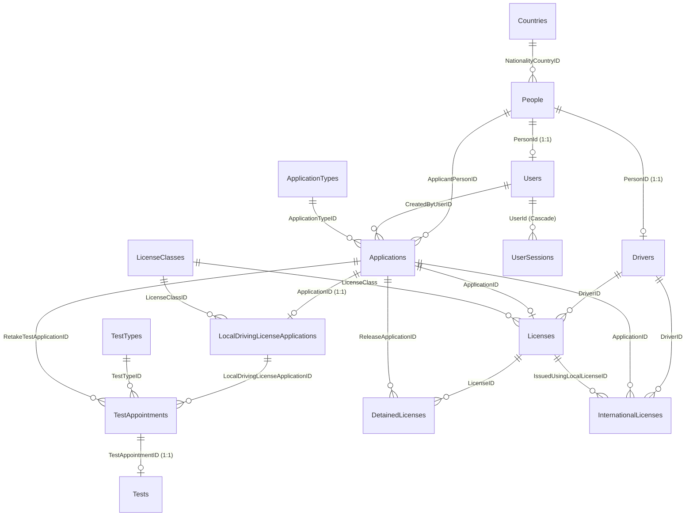

# Database Relationships

## 1. Entity-Relationship Overview

---

## 2. Foreign Key & Delete Behavior Policy

All foreign keys across the 15-table schema use **`DeleteBehavior.Restrict`** to preserve civic, financial, and audit history, with **one deliberate exception**:

| Relationship | Delete Behavior | Rationale |
|---|---|---|
| `UserSessions.UserId -> Users.UserId` | **`Cascade`** | Deleting a user account automatically removes its dependent refresh token session rows. |
| All other entity foreign keys | **`Restrict`** | Prevents accidental cascading deletion of people, applications, test histories, licenses, or detention records. |

---

## 3. Cardinality Highlights

- **1:1 Civic & Account Links**:
  - `Users.PersonId` (`IX_Users_PersonId`) binds one system account to at most one `Person`.
  - `Drivers.PersonID` (`IX_Drivers_PersonID`) binds one `Driver` record to at most one `Person`.
  - `LocalDrivingLicenseApplications.ApplicationID` (`UX_LocalDrivingLicenseApplications_ApplicationID`) specializes one `ApplicationD` record.
  - `Tests.TestAppointmentID` (`IX_Tests_TestAppointmentID`) records at most one `Test` outcome per `TestAppointment`.
- **Retake Application Link**:
  - `TestAppointments.RetakeTestApplicationID` links second and subsequent test attempts to an `ApplicationD` of type `7` (Retake Test).
- **Release Application Link**:
  - `DetainedLicenses.ReleaseApplicationID` links a released detention to an `ApplicationD` of type `5` (Release Detained Driving License).

---

## Implementation References

- DbContext & configurations: [`Infrastructure/DVLDDbContext.cs`](../../Infrastructure/DVLDDbContext.cs), [`Infrastructure/Configurations/`](../../Infrastructure/Configurations/)
- Domain entities: [`Domain/Entities/`](../../Domain/Entities/)
