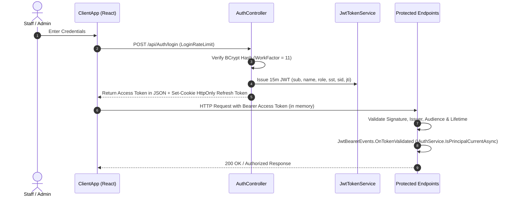

# Security Architecture & Authorization Standards

> **Authority Level:** Mandatory Security Baseline  
> **Parent Document:** [`AGENTS.md`](../../AGENTS.md)  
> **Roadmap & Decisions:** [`ENGINEERING-ROADMAP.md`](../../ENGINEERING-ROADMAP.md) | [`ENGINEERING-DECISIONS.md`](../../ENGINEERING-DECISIONS.md)  
> **Repository Root:** `D:\DVLD-System`
>
> **Baseline Commit:** `e9e843e974af86a86003bcc364f0e7686c3faa87` (Reconciled with `DVLD.Api` & `ClientApp` source on 2026-11-18)

---

## 1. Threat Model & Core Security Principles

The DVLD application is an enterprise government department management system. Authenticated actors are internal staff members and administrators managing citizen licensing records. Citizens do not hold user accounts or directly access the API.

The core security principles are:
1. **Defense in Depth:** The backend API is the absolute security boundary. Frontend route guards and UI role filtering are usability features, not security controls.
2. **Segregation of Duties (SoD):** The current API implementation enforces distinct operational roles between administrative personnel and counter staff, aligned with approved ADR-O01 (Model B).
3. **Fail-Closed Authorization:** Endpoints without explicit anonymous attributes require authentication. Endpoints modifying state require explicit role policies.
4. **Secret Confidentiality:** No passwords, signing keys, connection strings, or hash digests may ever be committed, logged, or documented in plaintext.

---

## 2. Authentication Architecture

Authentication combines short-lived HMAC-SHA256 JWT Bearer access tokens with database-persisted, rotating opaque refresh tokens (`AUTH-01` / `ADR-006`; see full lifecycle rules in [Section 12](#12-auth-01-session-management-standard)).



### 2.1 Dynamic Revocation Gate (`OnTokenValidated`)
In `API/DVLD.Api/Program.cs` (lines 99–156), `JwtBearerEvents.OnTokenValidated` intercepts every authenticated HTTP request:
- Extracts `UserId` (`ClaimTypes.NameIdentifier`), `sst` (security stamp), and `sid` (session GUID).
- Resolves `IAuthService` from the request-scoped service provider.
- Queries `await authService.IsPrincipalCurrentAsync(userId, securityStampClaim, sessionId, cancellationToken)`.
- If the user is inactive, their `SecurityStamp` rotated (password, role, or activation change), or the session family was revoked (logout / reuse detection), execution calls `context.Fail(...)` and terminates the request.
- **Security Guarantee:** Deactivating a user, changing their role/password, or revoking their session immediately invalidates active JWT access tokens without waiting for the 15-minute expiry.

### 2.2 Password Security & Secret Storage
- **Password Hashing:** Implemented in `AuthService.cs` and `UserService.cs` using `BCrypt.Net.BCrypt.HashPassword(password, workFactor: 11)`.
- **Secret Key Management:** The JWT signing key is configured under `Jwt:SecretKey` (`JwtOptions.SectionName = "Jwt"`, validated on startup to be at least 32 UTF-8 bytes in `Program.cs` lines 52–59). In staging/production environments, this value **must** be injected via environment variables, User Secrets (local dev), or a secret vault. Falling back to hardcoded development secrets in production is strictly prohibited.

---

## 3. Authorization Architecture & Policy Matrix

The API configures three distinct authorization policies in `Program.cs`:
- `AdminOnly`: `policy.RequireRole("Admin")`
- `StaffOnly`: `policy.RequireRole("Staff")`
- `StaffOrAdmin`: `policy.RequireRole("Admin", "Staff")`

### 3.1 The Canonical Role & Permission Matrix

| Controller / Endpoint Area | Active Authorization Policy | Admin Access | Staff Access | Architectural Rationale |
|---|---|---|---|---|
| **`UsersController`** (`/api/Users/*`) | `[Authorize(Policy = "AdminOnly")]` | **Allowed** | Denied | User management, password resets, role assignment. |
| **`ApplicationsController`** (`/api/Applications/*`) | `[Authorize(Policy = "StaffOnly")]` | Denied | **Allowed** | Operational licensing counter transactions (Segregation of Duties). |
| **`LocalDrivingLicenseApplicationsController`** (`/api/LocalDrivingLicenseApplications/*`) | `[Authorize(Policy = "StaffOnly")]` | Denied | **Allowed** | Local driving license application counter workflows. |
| **`DriversController`** (`/api/Drivers/*`) | `[Authorize(Policy = "StaffOnly")]` | Denied | **Allowed** | Driver registry management. |
| **`LicensesController`** (`/api/Licenses/*`) | `[Authorize(Policy = "StaffOnly")]` | Denied | **Allowed** | Viewing and querying issued driver licenses. |
| **`LicenseIssuanceController`** (`/api/LicenseIssuance/first-license`) | `[Authorize(Policy = "StaffOnly")]` | Denied | **Allowed** | Issuing driver licenses upon test completion. |
| **`LicenseRenewalController`** (`/api/LicenseRenewal`) | `[Authorize(Policy = "StaffOnly")]` | Denied | **Allowed** | Processing license renewals. |
| **`LicenseReplacementController`** (`/api/LicenseReplacement`) | `[Authorize(Policy = "StaffOnly")]` | Denied | **Allowed** | Processing lost/damaged replacements. |
| **`DetainedLicensesController`** (`/api/DetainedLicenses/*`) | `[Authorize(Policy = "StaffOnly")]` | Denied | **Allowed** | Detaining and releasing citizen licenses. |
| **`InternationalLicensesController`** (`/api/InternationalLicenses/*`) | `[Authorize(Policy = "StaffOnly")]` | Denied | **Allowed** | Issuing and querying international driving permits. |
| **`TestAppointmentsController`** (`/api/TestAppointments/*`) | `[Authorize(Policy = "StaffOnly")]` | Denied | **Allowed** | Scheduling and managing test appointments. |
| **`TestsController`** (`/api/Tests/*`) | `[Authorize(Policy = "StaffOnly")]` | Denied | **Allowed** | Recording test results and exam lockouts. |
| **`TestWorkflowController`** (`/api/TestWorkflow/*`) | `[Authorize(Policy = "StaffOnly")]` | Denied | **Allowed** | Checking examination progression eligibility. |
| **`PeopleController`** (`/api/People/*`) | `[Authorize(Policy = "StaffOrAdmin")]` | **Allowed** | **Allowed** | Viewing and updating citizen demographic profiles and photos. |
| **`ApplicationTypesController`**, **`LicenseClassesController`**, **`TestTypesController`** | `[Authorize]` (`GET`) / `[Authorize(Policy = "AdminOnly")]` (`PUT`) | **Allowed** (Read & Edit) | **Allowed** (Read-only) | Shared reference catalogs; fee/configuration updates restricted to `Admin`. |
| **`CountriesController`**, **`DashboardController`** | `[Authorize]` | **Allowed** | **Allowed** | Read-only country directory and dashboard statistics. |
| **`AuthController`** (`/api/Auth/*`) | `[Authorize]` (`AllowAnonymous` on `login`, `refresh`, `logout`) | **Allowed** | **Allowed** | Authentication, CSRF-protected cookie refresh/logout, profile, and password change. |

### 3.2 Approved Decision: Segregation of Duties (`ADR-O01` / `SEC-01` / `RSK-12`)
- **Current Technical Implementation:** The active API implementation enforces `[Authorize(Policy = "StaffOnly")]` on operational counter endpoints (`Applications`, `LocalDrivingLicenseApplications`, `Drivers`, `Licenses`, `LicenseIssuance`, `LicenseRenewal`, `LicenseReplacement`, `DetainedLicenses`, `InternationalLicenses`, `TestAppointments`, `Tests`, `TestWorkflow`), strictly excluding `Admin` users from operational counter actions. This policy is verified in `API/DVLD.Api/Controllers/` and controller authorization tests (`ApplicationsControllerTests.cs`).
- **Frontend vs. Backend RBAC Alignment (`A-03` / `SEC-01` / `RSK-12` — Implemented & Frontend Verified):** [`ClientApp/src/utils/permissions.ts`](../../ClientApp/src/utils/permissions.ts) now maps `'Person License History': ['Staff']`, matching `LicensesController` and `InternationalLicensesController` (`[Authorize(Policy = "StaffOnly")]`). [`AppRouter.tsx`](../../ClientApp/src/components/layout/AppRouter.tsx), [`sidebarNavigation.ts`](../../ClientApp/src/components/layout/sidebar/sidebarNavigation.ts), and [`CommandPalette.tsx`](../../ClientApp/src/components/layout/CommandPalette.tsx) enforce the same UX separation via `isPagePermitted` (verified in Vitest `permissions.test.ts` and `rbacNavigationGuard.test.tsx`, confirming `Admin` receives `AccessDenied` before `LicenseHistoryPage` mounts or calls license APIs). `ClientApp` guards remain strictly UX controls while backend `[Authorize(...)]` policies remain the authoritative security boundary, and `DEC-RBAC-01` remains `PROPOSAL (UNAPPROVED)` (**NOT AUTHORIZED**).
- **Approved Architectural Policy:** In [`ENGINEERING-DECISIONS.md`](../../ENGINEERING-DECISIONS.md), `ADR-O01` is formally recorded as: `APPROVED — Model B (Explicit Permission Separation)`. Administrators do not automatically inherit counter staff operational permissions; staff do not receive administrative user-management permissions; shared capabilities are explicitly granted via `StaffOrAdmin`.
- **Preservation of Current Behavior & Authorization Boundary:** Existing authorization behavior must remain unchanged. Approval of ADR-O01 records architectural policy agreement, but does **not** authorize code refactoring or policy relaxation without an authorized implementation milestone. Engineers and AI agents are strictly prohibited from changing `StaffOnly` to `StaffOrAdmin` or altering role access rules without explicit written Project Owner authorization.

---

## 4. Input Validation & File Upload Security

### 4.1 Citizen Profile Photos (`PeopleController` & `PhysicalFileStorageService`)
Profile photo uploads undergo strict multi-stage validation and sanitization before reaching physical storage:
1. **Allowed Formats & Re-Encoding:** Accepts `image/jpeg`, `image/png`, and `image/webp`. All accepted images are sanitized, oriented, resized to portrait proportions ($\le 600 \times 800$ px), stripped of EXIF metadata, and re-encoded to WebP format at quality 85 via SkiaSharp (`ImageProcessingService.cs`).
2. **File Size Limits:** Upload stream size is strictly capped at 5 MB (`5,242,880 bytes`).
3. **Decompression Bomb Protection:** Pre-decode validation enforces maximum dimensions of 4096 px and a maximum total pixel count of 16,000,000 pixels.
4. **Magic Byte Verification:** File headers are validated against constant byte arrays before decoding:
   - JPEG: `0xFF, 0xD8, 0xFF`
   - PNG: `0x89, 0x50, 0x4E, 0x47, 0x0D, 0x0A, 0x1A, 0x0A`
   - WebP: `RIFF` and `WEBP` signatures
5. **Path Traversal Prevention & Server-Generated Keys:** Storage keys are generated as random GUIDs (`Guid.NewGuid():N + ".webp"`). Original client-supplied filenames, extensions, and directory paths are discarded.
6. **Storage Location:** Files reside strictly outside `wwwroot` in an isolated directory configured by `Storage:PersonImagesPath` (defaulting to `LocalAppData/DVLD/Storage/people`). Direct public HTTP execution or browsing is impossible.
7. **Authorization & Access:** Photo upload, retrieval, and deletion endpoints on `PeopleController` enforce `[Authorize("StaffOrAdmin")]`. Public unauthenticated access is forbidden. Image streaming occurs via authenticated HTTP GET with ETag and private caching headers (`Cache-Control: private, max-age=86400, must-revalidate`).
8. **File/Database Consistency & Compensation Lifecycle:**
   - *Upload Save Ordering:* 1) Process and re-encode in memory; 2) Write new WebP file to disk; 3) Update `People.ImagePath` in EF Core DbContext; 4) Commit via `_unitOfWork.SaveChangesAsync()`.
   - *Failure Compensation:* If `SaveChangesAsync()` fails or returns $\le 0$, the newly written file is immediately deleted via `_fileStorageService.DeleteAsync(newKey)` to prevent orphaned disk files.
   - *Old Image Cleanup:* Upon successful database commit of a replacement photo, the previous physical file is deleted asynchronously.
   - *Photo Deletion:* `DELETE /api/people/{id}/photo` sets `ImagePath = null` in the database, commits via UnitOfWork, and then deletes the physical file.
   - *Orphan File Cleanup:* Immediate compensating delete is verified and implemented in code. A periodic background orphan scavenger remains a proposed future improvement.
9. **Absolute Prohibition on Manual DB Restoration:**
   AI agents and automated tools are strictly prohibited from executing manual database restoration scripts or direct filesystem batch updates under `AGENTS.md` Section 5. Disaster recovery and backups are sysadmin infrastructure operations outside agent authority.

### 4.2 Open Business Decision: Detained License Replacement (INT-03)
- **Observed System Behavior:** Static inspection confirms that `LicenseReplacementService` currently does not inject `IDetainedLicenseRepository` and does not check `IsLicenseDetainedAsync` before issuing a replacement.
- **Potential Business-Rule Gap:** Without a detention check, an applicant holding a detained license could technically be issued a replacement license.
- **Unverified Regulatory / Legal Requirements:** Whether replacing a detained license is prohibited by departmental regulations or traffic law is not documented in existing requirements and remains unverified. No legal rule can be assumed or invented.
- **Human Decision Prerequisite:** Formally resolving this gap requires explicit stakeholder/business policy direction (`ADR-O02` in [`ENGINEERING-DECISIONS.md`](../../ENGINEERING-DECISIONS.md)). Engineers must not modify `LicenseReplacementService` to block detained license replacements until authorized by an approved business decision.

---

## 5. Rate Limiting & Denial of Service Protection

In `API/DVLD.Api/Program.cs` (lines 182–243) and `API/DVLD.Api/Controllers/AuthController.cs`, fixed-window rate limiting partitioned by `HttpContext.Connection.RemoteIpAddress` (`RejectionStatusCode = 429`) protects all primary authentication routes:

| Policy Name | Endpoint | Implementation Status & Limit (`Program.cs`) | Partition Key | 429 Automated Test |
|---|---|---|---|---|
| `LoginRateLimit` | `POST /api/Auth/login` | `IMPLEMENTED` — Fixed window: 5 requests / 1 minute | `RemoteIpAddress` | Present in `AuthControllerTests.cs` *(unexecuted in doc pass)* |
| `RefreshRateLimit` | `POST /api/Auth/refresh` | `IMPLEMENTED` — Fixed window: 30 requests / 1 minute | `RemoteIpAddress` | **`NOT IMPLEMENTED`** |
| `ChangePasswordRateLimit` | `POST /api/Auth/change-password` | `IMPLEMENTED` — Fixed window: 5 requests / 1 minute | `RemoteIpAddress` | **`NOT IMPLEMENTED`** (`SEC-03` test gap) |

**Operational & Verification Considerations (`SEC-03` Reconciled across 4 Dimensions):**
- **In-Process Boundary:** These `FixedWindowRateLimiter` instances live in-process per API host; multi-instance deployments require distributed rate limiting if global enforcement is required.
- **Reverse Proxy Dependency:** Behind a reverse proxy or load balancer, `UseForwardedHeaders` must be configured with explicit `KnownProxies` / `KnownNetworks` (`DEC-DEP-01` in [`ENGINEERING-DECISIONS.md`](../../ENGINEERING-DECISIONS.md)) so `RemoteIpAddress` reflects the true client IP rather than the proxy IP (`UseForwardedHeaders` is **not** currently configured in `Program.cs`).
- **`SEC-03` Dimensional Status (`PARTIALLY IMPLEMENTED`):** While `AUTH-01` applied `[EnableRateLimiting("ChangePasswordRateLimit")]` (fixed-window 5 req/min) to `AuthController.ChangePassword` (`IMPLEMENTED` in runtime code), automated HTTP `429 TooManyRequests` integration tests exist only for `Login` (`AuthControllerTests.cs:234-292`) and are **missing** for `ChangePassword` and `Refresh`. Furthermore, the original `SEC-03` roadmap specification requested a sliding-window limiter (`PasswordChangeLimit`). Accordingly, `SEC-03` remains **open / `PARTIALLY IMPLEMENTED`** in [`ENGINEERING-ROADMAP.md`](../../ENGINEERING-ROADMAP.md) until HTTP 429 test verification is implemented and executed.

---

## 6. Audit Logging & Security Event Tracing

- High-impact events (failed logins, password changes, license revocations, administrative user deactivations) must be logged at `LogLevel.Warning` or `LogLevel.Information` with contextual metadata (User ID, IP address, timestamp).
- Sensitive values (plain text passwords, JWT signing keys, refresh tokens, cookie values, credit card or banking details) must **never** be logged. Structured logging templates must sanitize user inputs.
- Note that while `ILogger<T>` diagnostics exist today, centralized structured logging (`OBS-03`), dedicated security audit telemetry (`SEC-04`), and transactional business audit records (`AUD-01`) remain separate planned roadmap items requiring explicit approvals in [`ENGINEERING-ROADMAP.md`](../../ENGINEERING-ROADMAP.md).

---

## 7. Canonical Risk Register & Historical Inventory Mapping

The DVLD platform security governance maintains complete traceability between the foundational empirical audit findings and the active governance risk inventory:

### 7.1 Historical Baseline vs. Active Governance Inventories
1. **Foundational Phase A Findings (`RSK-S01` through `RSK-S13`):**
   Documented in [`docs/archive/audits/phase-a-security-architecture-audit.md`](../archive/audits/phase-a-security-architecture-audit.md) §6 and preserved in [`docs/archive/security-sources/SECURITY-IMPLEMENTATION-READINESS.md`](../archive/security-sources/SECURITY-IMPLEMENTATION-READINESS.md) §5.1. Represents the 13 empirical security defects and missing controls discovered in the legacy baseline.
2. **Unified Risk Inventory (`RSK-01` through `RSK-20`):**
   Codified in [`docs/archive/security-sources/SECURITY-MASTER-PLAN.md`](../archive/security-sources/SECURITY-MASTER-PLAN.md) §3 and adopted across active governance documents ([`ENGINEERING-STANDARDS.md`](./ENGINEERING-STANDARDS.md), [`ENGINEERING-DECISIONS.md`](../../ENGINEERING-DECISIONS.md), [`TESTING-STANDARDS.md`](./TESTING-STANDARDS.md), and [`ENGINEERING-ROADMAP.md`](../../ENGINEERING-ROADMAP.md)). Incorporates the 13 remapped original findings plus 7 additional architectural, threat scenario, and operational records ($13 + 7 = 20$).

### 7.2 Authoritative 13-to-20 Mapping Ledger

| Original Phase A ID | Unified Active Governance ID | Canonical Risk Title | Active Governance Source | Attached Security Package / Gate |
|:---:|:---:|---|---|---|
| **`RSK-S01`** | **`RSK-04`** | Stateless 4-Hour Access Token Without Revocation Capability | `ENGINEERING-STANDARDS.md` §9.1 | `SEC-PKG-10` / `DEC-AUTH-01` |
| **`RSK-S02`** | **`RSK-01`** | Orphaned Application Completion Route Workflow Bypass | `ENGINEERING-ROADMAP.md` (`INT-01`) | `SEC-PKG-01` / `ADR-P03`, `DEC-APP-01` |
| **`RSK-S03`** | **`RSK-05`** | Missing Account-Level Lockout Defense & Denial-of-Service Risk | `ENGINEERING-STANDARDS.md` §9.4 | `SEC-PKG-11` / `DEC-CRED-02`, Schema Gate 5 |
| **`RSK-S04`** | **`RSK-06`** | Absence of Dedicated Security Audit Trail & Event Framework | `ENGINEERING-STANDARDS.md` §10.1 | `SEC-PKG-06` / `SEC-04`, `DEC-AUD-01/02` |
| **`RSK-S05`** | **`RSK-13`** | Circumvention of License Detention in Replacement Workflow | `ENGINEERING-STANDARDS.md` §9.10 | `SEC-PKG-15` / `INT-03`, `ADR-O02`, Gate 3 |
| **`RSK-S06`** | **`RSK-14`** | Circumvention of Detention in International Permit Issuance | `ENGINEERING-STANDARDS.md` §9.10 | `SEC-PKG-16` / `DEC-POL-02`, Gate 3 |
| **`RSK-S07`** | **`RSK-02`** | ImagePath Cross-User Deletion within Storage Root | `ENGINEERING-STANDARDS.md` §9.6 | `SEC-PKG-02` / `DEC-FILE-01` |
| **`RSK-S08`** | **`RSK-03`** | Credential Verification Latency Timing Side-Channel | `ENGINEERING-STANDARDS.md` §9.3 | `SEC-PKG-08` (Constant-Time Dummy Hash) |
| **`RSK-S09`** | **`RSK-09`** | Hardcoded Administrator Protections & Single Points of Failure | `ENGINEERING-STANDARDS.md` §9.5 | `SEC-PKG-04` (Dynamic Admin Safety) |
| **`RSK-S10`** | **`RSK-07`** | Weak Password Complexity Policy & Absence of Breached Checks | `ENGINEERING-STANDARDS.md` §9.3 | `SEC-PKG-09` / `DEC-CRED-01` (NIST SP 800-63B) |
| **`RSK-S11`** | **`RSK-10`** | Unbounded Collection Retrieval via Dual-Behavior Endpoints | `ENGINEERING-STANDARDS.md` §9.7 | `SEC-PKG-03` (Pagination Clamping $\le 50$) |
| **`RSK-S12`** | **`RSK-16`** | Missing HTTP Security Headers & Unconfigured Trusted Proxies | `ENGINEERING-STANDARDS.md` §9.8 | `SEC-PKG-12` / `DEC-DEP-01`, `DEC-DEP-02` |
| **`RSK-S13`** | **`RSK-12`** | ADR-O01 Model B License History Authorization Mismatch | `ENGINEERING-STANDARDS.md` §9.2 | `SEC-PKG-05` / `DEC-RBAC-01` |

### 7.3 The Seven Additional Risk Records

| Active Governance ID | Canonical Title | Active Governance Source | Scope & Classification | Governance Status |
|:---:|---|---|---|---|
| **`RSK-08`** | Absence of Multi-Factor Authentication (MFA) for Administrative Roles | `ENGINEERING-DECISIONS.md` (`DEC-AUTH-03`) | Identity & Access Governance | **DEFERRED TO FUTURE PHASE** (`DEC-AUTH-03`) |
| **`RSK-11`** | Plaintext PII Exposure in Citizen & User DTOs | `ENGINEERING-DECISIONS.md` §10.1, `ENGINEERING-ROADMAP.md` §6 | Data Minimization / Privacy | **DEFERRED RISK / PRODUCTION GATE 8 SIGN-OFF REQUIRED** |
| **`RSK-15`** | ADR-O01 Model B Administrative Read Visibility Restriction | `TESTING-STANDARDS.md` §7.5 | Civic Policy Tension | Governed under `DEC-RBAC-01` (Model B Policy Preserved) |
| **`RSK-17`** | Production Configuration & Plaintext Secret Exposure Hazards | `ENGINEERING-STANDARDS.md` §9.8 | Deployment & Infrastructure | Governed under `SEC-PKG-13` / `DEC-DEP-01` |
| **`RSK-18`** | Automated Dependency Scanning in CI/CD Pipeline | `ENGINEERING-STANDARDS.md` §9.9 | Build & Pipeline Security | Partially mitigated in `azure-pipelines.yml` (fail-closed `dotnet list ... --vulnerable --include-transitive` gate [`0` advisories]; fail-closed `npm audit --omit=dev --audit-level=high --json` production gate blocking `high`/`critical` and malformed/missing reports [`0` advisories]; and fail-closed `npm audit --audit-level=critical --json` full dependency gate blocking `critical` and registry/JSON/metadata errors while logging devDependency-only `12` `high` `picomatch <=4.0.7` advisories as explicit CI warnings and publishing `clientapp-npm-audit`, tracked under `SEC-PKG-14`) |
| **`RSK-19`** | Unrepresented External Callers for CompleteApplication Endpoint | `ENGINEERING-STANDARDS.md` §9.11 | API Contract Deprecation | Governed under `DEC-APP-01` Telemetry Window (Gate 6) |
| **`RSK-20`** | Authorized Insider Mass PII Harvesting via Unbounded Collections | `TESTING-STANDARDS.md` §7.13 | Threat Scenario | Mitigated under `SEC-PKG-03` (Clamping $\le 50$) |

> [!IMPORTANT]
> **Definitive Clarification on `RSK-08` & `RSK-11` (Gate 8):**
> - Foundational empirical finding **`RSK-S08`** (Timing Side-Channel) remapped to **`RSK-03`** (`SEC-PKG-08` / `TST-AUTH-03`).
> - Identifier **`RSK-08`** is exclusively assigned to **Multi-Factor Authentication (MFA) for Administrative Roles** (`DEC-AUTH-03`).
> - Identifier **`RSK-11`** governs citizen PII and photograph/biometric exposure. Production Approval Gate 8 requires formal legal and regulatory review regarding data privacy and statutory compliance under the Jordan Personal Data Protection Law (Law No. 24 of 2023). Engineering data minimization and masking practices are distinguished from confirmed statutory obligations, and legal verification remains an outstanding project item.
> - There is zero duplication across active or historical risk registers.

---

## 12. AUTH-01 Session Management Standard

1. **Access tokens:** 15-minute HS256 JWT with `sub` (`NameIdentifier`), `name`, `role`, `FullName`, `PersonId`, `sst` (security stamp), `sid` (session ID), and `jti`. No secrets or sensitive personal data in claims.
2. **Refresh tokens:** 256-bit CSPRNG values (32 random bytes, 43 Base64Url chars in `RefreshTokenService.cs`) delivered only in an `HttpOnly`, `SameSite=Lax`, `Secure`-when-HTTPS cookie (`RefreshCookieName = "dvld_rt"`) scoped to `RefreshCookiePath = "/api/Auth"` (`AuthSessionOptions.cs` & `appsettings.json`). Only the Base64Url SHA-256 hash is persisted (`UserSessions.RefreshTokenHash`, unique index) and verified with `CryptographicOperations.FixedTimeEquals`.
3. **Session model:** one row per issued refresh generation; `TokenFamilyId` groups a login and `ReplacedBySessionId` records rotation. Absolute lifetime 14 days (never extended); idle lifetime 7 days.
4. **Rotation:** every refresh consumes the current generation through one conditional `UPDATE ... WHERE RevokedAtUtc IS NULL AND ExpiresAtUtc > now`. Exactly one concurrent caller may win; losers receive 409 and retry once.
5. **Reuse detection:** a consumed token presented after a 30-second grace window revokes the whole family and returns a generic 401. Inside the grace window with a still-active family it returns 409 without revocation (multi-tab tolerance).
6. **Immediate invalidation:** `User.SecurityStamp` rotates on password change, role change, and activation change. `OnTokenValidated` compares the `sst` claim with the persisted stamp on every request.
7. **Revocation triggers & Two-Step `ChangePassword` Behavior:** logout (current session), logout-all (all user sessions), role/activation change (all + stamp rotation), deletion (all), and password change (commits new BCrypt hash + rotates `SecurityStamp` + revokes all active sessions, then attempts `StartSessionAsync` to issue a fresh session for the current device; if session establishment fails after the password change commits, `AuthController.ChangePassword` clears the `dvld_rt` cookie and `ChangePasswordPage.tsx` clears form fields and logs out the user with a re-login notice—verified in `AuthControllerTests.cs:456-529`).
8. **CSRF & Local Development Proxy Caveat:** `SameSite=Lax` cookie + explicit credential-enabled CORS origin (`http://localhost:5173`) + mandatory `X-CSRF-Protection: 1` header on refresh/logout. Refresh and logout are anonymous because the cookie is the credential; the access token is not required. *(Local Dev Only Warning: `ClientApp/vite.config.ts` sets `secure: false` and strips `; Secure` from `Set-Cookie` headers when proxying `/api` to `https://localhost:7125` so browsers over HTTP localhost accept the cookie. Never replicate `secure: false` or `; Secure` stripping in Production; deploy Production strictly over HTTPS.)*
9. **Client storage:** access tokens are held in memory only. Refresh tokens are never readable by JavaScript and never stored in `localStorage`/`sessionStorage`. Legacy token keys are purged at startup.
10. **Logging:** raw refresh tokens, JWTs, passwords, and signing keys must never be logged. Security events log user id and token-family id only.

---

## 13. Frontend (`ClientApp`) Security & Token Storage Architecture

*(Verified against `ClientApp/src` and consolidated from the retired `ClientApp/SECURITY.md`.)*

### 13.1 Token & Browser Storage Separation
1. **Access Token (In-Memory Only):** `ClientApp/src/utils/authTokenStore.ts` stores the active JWT access token solely in a module-scoped JavaScript variable (`currentAccessToken`). It is never written to `localStorage`, `sessionStorage`, or non-HttpOnly cookies, and is automatically lost when the browser tab closes or refreshes.
2. **Refresh Token (`HttpOnly` Cookie Only):** Refresh tokens are issued and rotated exclusively via an `HttpOnly`, `SameSite=Lax`, `Secure`-when-HTTPS cookie (`dvld_rt`) scoped to `/api/Auth` (`AuthSessionOptions.RefreshCookiePath`). JavaScript (`document.cookie`) cannot read or modify it. On page reload, `AuthContext.tsx` calls `refreshSession()` (`POST /api/Auth/refresh` with `credentials: 'include'` and `X-CSRF-Protection: 1`) to obtain a fresh in-memory access token. In local development, `ClientApp/vite.config.ts` proxies `/api` to `https://localhost:7125` with `secure: false` and strips `; Secure` from `Set-Cookie` responses; Production hosts must enforce HTTPS with `Secure` intact.
3. **Web Storage (`localStorage` / `sessionStorage`) Boundaries:**
   - Authentication tokens are **never** stored in `sessionStorage` or `localStorage` (superseding legacy documentation that described `dvld_auth_session` in `sessionStorage`).
   - On startup, `purgeLegacyTokenStorage()` (`ClientApp/src/utils/sessionStorage.ts`) explicitly removes legacy keys (`access_token`, `dvld_token`, `dvld_auth_session`) from both `localStorage` and `sessionStorage`.
   - The **only** key verified in `localStorage` across `ClientApp/src` is `"dvld_remembered_username"` (`ClientApp/src/components/auth/Login.tsx`), stored strictly when the user opts into "Remember me" on the login form.
4. **Cross-Tab Synchronization & Single-Flight Refresh:**
   - `apiClient.ts` deduplicates concurrent 401 refresh attempts via a single-flight `inFlightRefresh` promise and session generation counter (`authGeneration`), retrying a 409 rotation conflict once after 250 ms.
   - `AuthContext.tsx` coordinates login, logout, and `token-refreshed` timestamps across open tabs on the same browser origin via `BroadcastChannel('dvld-auth')` (`IMPLEMENTED`).
5. **Known Client Logout Reliability Follow-Up (`logoutSession()` Gap):**
   - `AuthContext.logout()` triggers `void logoutSession()` (`ClientApp/src/services/apiClient.ts`), clears in-memory session state immediately, and broadcasts `'logout'` to other open tabs via `BroadcastChannel('dvld-auth')`. Because `logoutSession()` does not inspect `response.ok` / `response.status` (and discards network/5xx errors in its `finally`/outer catch path), other local tabs clear their in-memory UI state, **but** if `POST /api/Auth/logout` failed on the server, the `HttpOnly` `dvld_rt` cookie may remain valid and restore the session on a full browser reload (compare with `LogoutAll`, which invokes `logoutAllSessions().finally(...)`, and `Logout_WhenLockAcquisitionFails_ReturnsConflictAndDoesNotClearCookie` on the API side). Surfacing server revocation failure in the UI remains an open reliability follow-up (`FE-01` / `AUTH-01` follow-up).

### 13.2 XSS & Credential Leakage Controls
- Static inspection of `ClientApp/src` enforces React JSX escaping with zero raw DOM injection APIs (`dangerouslySetInnerHTML`, `innerHTML`, `outerHTML`, `document.write`) and prohibits logging credentials or tokens to browser console sinks.

### 13.3 Frontend RBAC & Route Guards (Usability Layer)
1. **Navigation Filtering (`ClientApp/src/utils/permissions.ts` & `sidebarNavigation.ts`):** Sidebar entries are filtered via `isPagePermitted(page, user.role)` and fail closed for unknown roles or pages.
2. **Route Guarding (`ClientApp/src/components/layout/AppRouter.tsx`):** Unauthorized page selections render `<AccessDenied />`.
3. **403 Response Handling (`ClientApp/src/services/apiClient.ts`):** HTTP 403 responses throw a typed `ForbiddenError`.
4. **Security Boundary Reminder:** Frontend guards are purely UX controls; backend `[Authorize(...)]` policies in `DVLD.Api` are the sole security boundary.

### 13.4 Recommended SPA Host CSP & Defensive Headers (`DEC-DEP-02`)
Per `DEC-DEP-02`, `DVLD.Api` serves JSON only and does not emit HTML Content-Security-Policy headers. For production reverse proxies or web hosts serving `ClientApp/dist`, configure defensive headers appropriate to the actual deployment origins:
```http
Content-Security-Policy: default-src 'self'; script-src 'self'; style-src 'self' 'unsafe-inline'; font-src 'self' data:; img-src 'self' data: https:; connect-src 'self' <ACTUAL_API_ORIGIN>; frame-ancestors 'none'; base-uri 'self'; form-action 'self';
X-Content-Type-Options: nosniff
X-Frame-Options: DENY
Referrer-Policy: strict-origin-when-cross-origin
Permissions-Policy: camera=(), microphone=(), geolocation=()
```
