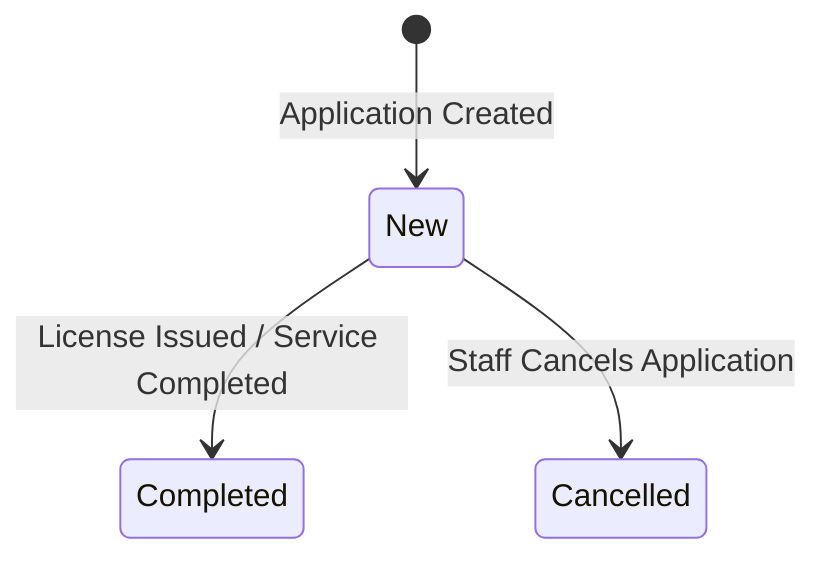
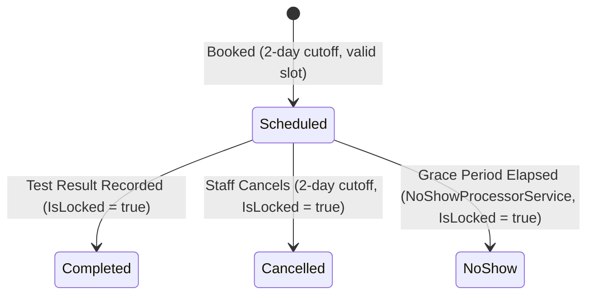

# Domain Model

## 1. Overview

The `Domain` project (`Domain/Domain.csproj`, targeting `net10.0` with zero project dependencies) defines **15 domain entities** (`Domain/Entities/*.cs`) and **7 domain enums** (`Domain/Enums/*.cs`) that model civic identity, licensing applications, sequential examinations, issued licenses, detentions, international permits, and user security sessions.

---

## 2. Core Domain Entities

| Entity | Domain Role |
|---|---|
| `Person` | Civic identity record (`NationalNo`, names, `DateOfBirth`, `Gender`, `Address`, `Phone`, `Email`, `NationalityCountryID`, `ImagePath`, and `RowVersion` concurrency token). |
| `Country` | Reference lookup for person nationality. |
| `User` | System account linked 1:1 to a `Person`, storing `UserName`, BCrypt `Password`, `Role`, `IsActive`, and `SecurityStamp`. |
| `UserSession` | Refresh token session record (`Id`, `UserId`, `RefreshTokenHash`, `TokenFamilyId`, `CreatedAtUtc`, `ExpiresAtUtc`, `LastUsedAtUtc`, `RevokedAtUtc`, `RevocationReason`, `ReplacedBySessionId`). |
| `ApplicationD` | Master licensing application (`ApplicationTypeID`, `ApplicantPersonID`, `ApplicationDate`, `ApplicationStatus`, `LastStatusDate`, `PaidFees`, `CreatedByUserID`). |
| `ApplicationType` | Fee and title catalog for the 7 application categories (Local License, Renew, Lost, Damaged, Release Detained, International, Retake Test). |
| `LocalDrivingLicenseApplication` | Specialization of `ApplicationD` linking a new local license application (`ApplicationTypeID == 1`) to a `LicenseClassID`. |
| `LicenseClass` | License category definition (e.g., Ordinary Class 3), including `MinimumAllowedAge`, `DefaultValidityLength`, and `ClassFees`. |
| `TestType` | Examination stage definition (`Theory`, `Written`, `Practical`) with `TestTypeFees`. |
| `TestAppointment` | Scheduled examination slot for a `LocalDrivingLicenseApplication` and `TestType`, tracking `AppointmentDate`, `PaidFees`, `IsLocked`, `Status`, `CancelledAt`, `CancelledByUserID`, `NoShowDate`, and optional `RetakeTestApplicationID`. |
| `Test` | Examination outcome (`TestResult`, `Notes`, `CreatedByUserID`) recorded 1:1 against a `TestAppointment`. |
| `Driver` | Licensed driver record linked 1:1 to a `Person`. |
| `License` | Issued local driving license tied to a `Driver`, `ApplicationD`, and `LicenseClass`, tracking `IssueDate`, `ExpirationDate`, `IsActive`, `IssueReason`, `PaidFees`, and `Notes`. |
| `DetainedLicense` | Detention and release record against a `License`, tracking `DetainDate`, `FineFees`, `IsReleased`, `ReleaseDate`, `ReleasedByUserID`, and `ReleaseApplicationID`. |
| `InternationalLicense` | 1-year international driving permit linked to a `Driver`, `ApplicationD`, and `IssuedUsingLocalLicenseID`. |

---

## 3. Domain Enumerations (`Domain/Enums/*.cs`)

| Enum | Key Values / Semantics |
|---|---|
| `UserRole` | `Admin`, `Staff` |
| `AppStatus` | `New`, `Cancelled`, `Completed` |
| `AppointmentStatus` | `Scheduled`, `Completed`, `Cancelled`, `NoShow` |
| `TestType` | `Theory`, `Written`, `Practical` |
| `IssueReason` | `FirstTime`, `Renew`, `ReplacementForDamaged`, `ReplacementForLost` |
| `Gender` | Person gender classification |
| `LicenseStatus` | License state representation |

---

## 4. Core Domain State Transitions

### 4.1 Application Lifecycle (`AppStatus`)

### 4.2 Test Appointment Lifecycle (`AppointmentStatus`)

---

## 5. Domain Invariants

1. **Single Active Local License per Driver and Class**: Enforced by filtered unique index `IX_Licenses_DriverID_LicenseClass` (`[IsActive] = 1`) and service-level checks.
2. **Single Active International License per Driver**: Enforced by filtered unique index `IX_InternationalLicenses_DriverID` (`[IsActive] = 1`).
3. **Single Active Detention per Local License**: Enforced by filtered unique index `IX_DetainedLicenses_LicenseID_IsReleased` (`[IsReleased] = 0`).
4. **Sequential Examination Order**: An applicant must pass `Theory` -> `Written` -> `Practical` in strict order for a `LocalDrivingLicenseApplication`.
5. **Immutable Session Family Expiry**: Refresh token rotation creates a new `UserSession` row within the same `TokenFamilyId` and preserves the original `ExpiresAtUtc`.

---

## Implementation References

- Domain project & entities: [`Domain/Domain.csproj`](../../Domain/Domain.csproj), [`Domain/Entities/`](../../Domain/Entities/)
- Domain enums: [`Domain/Enums/`](../../Domain/Enums/)
- EF Core schema & filtered indexes: [`Infrastructure/DVLDDbContext.cs`](../../Infrastructure/DVLDDbContext.cs), [`Infrastructure/Configurations/`](../../Infrastructure/Configurations/)
