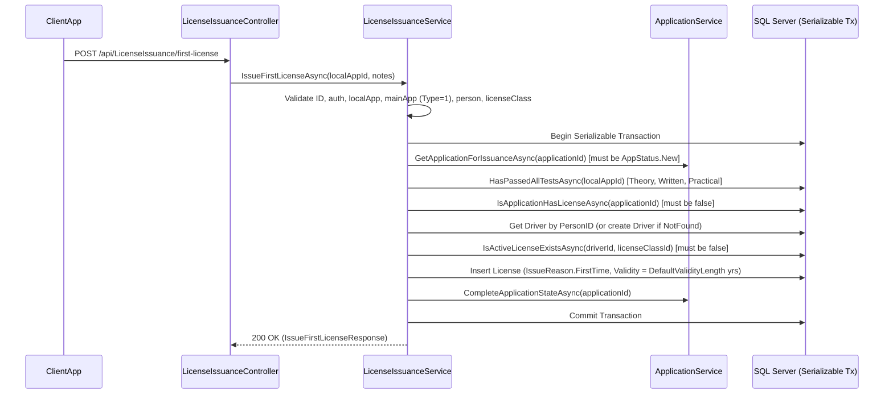

# Workflow: First License Issuance

## 1. Purpose

Issues a driver's first local driving license for a completed examination sequence under a `New Local Driving License Application` (`ApplicationTypeID = 1`), creating a `Driver` record if one does not yet exist and marking the application `Completed`.

---

## 2. Execution Sequence (`LicenseIssuanceService.IssueFirstLicenseAsync`)

---

## 3. Preconditions & Invariants

- **Pre-Transaction Checks**:
  - `localAppId > 0`, caller authenticated (`StaffOnly`).
  - Local application and parent `ApplicationD` exist (`ApplicationTypeID == 1`, `ApplicantPersonID > 0`).
  - Person and `LicenseClass` exist (`DefaultValidityLength > 0`, `LicenseClassFees >= 0`).
- **Transactional Checks (`IsolationLevel.Serializable`)**:
  - Parent application must be in `AppStatus.New` (`409 Conflict` otherwise).
  - All three required tests (`Theory`, `Written`, `Practical`) must be passed (`409 Conflict` otherwise).
  - No license may already exist for `applicationId`, and no active license may exist for `(DriverID, LicenseClassID)` (`409 Conflict`).
- **Side Effects**:
  - Creates a `Driver` entity if `GetByPersonIdAsync` returns `NotFound`.
  - Creates `License` with `IssueReason.FirstTime`, `PaidFees = licenseClass.LicenseClassFees`, `IssueDate = _clock.Now`, `ExpirationDate = issueDate.AddYears(DefaultValidityLength)`, `IsActive = true`.
  - Transitions parent `ApplicationD` to `AppStatus.Completed`.

---

## Implementation References

- Controller: [`API/DVLD.Api/Controllers/LicenseIssuanceController.cs`](../../../API/DVLD.Api/Controllers/LicenseIssuanceController.cs)
- Service: [`Application/Services/LicenseIssuanceService.cs`](../../../Application/Services/LicenseIssuanceService.cs)
- Validator: [`Application/Validators/LicenseValidator.cs`](../../../Application/Validators/LicenseValidator.cs)
