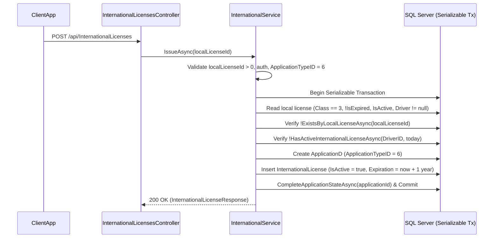

# Workflow: International License Issuance

## 1. Purpose

Issues a **1-year International Driving License** (`ApplicationTypeID = 6`, `InternationalLicenseValidityYears = 1`) backed by an active, non-expired **Class 3 (Ordinary)** local driving license (`OrdinaryLicenseClassId = 3`).

---

## 2. Execution Sequence (`InternationalService.IssueAsync`)

---

## 3. Eligibility & Constraints

- **License Class Gate**: Only **Class 3 (Ordinary)** local licenses are eligible (`LicenseClassID == 3`).
- **Active & Non-Expired**: Local license must be active and not expired at issuance time.
- **Uniqueness**:
  - At most one international license per `IssuedUsingLocalLicenseID` (`ExistsByLocalLicenseAsync`).
  - At most one active international license per `DriverID` (`HasActiveInternationalLicenseAsync` + filtered unique index `IX_InternationalLicenses_DriverID` where `[IsActive] = 1`).
- **Pre-Flight Endpoint**: `GET /api/InternationalLicenses/license/{licenseId}/info` runs `GetLocalLicenseInfoAsync` to perform these eligibility checks before returning `DriverLicenseInfoResponse`.

---

## Implementation References

- Controller: [`API/DVLD.Api/Controllers/InternationalLicensesController.cs`](../../../API/DVLD.Api/Controllers/InternationalLicensesController.cs)
- Service: [`Application/Services/InternationalService.cs`](../../../Application/Services/InternationalService.cs)
- Validator: [`Application/Validators/InternationalLicenseValidator.cs`](../../../Application/Validators/InternationalLicenseValidator.cs)
