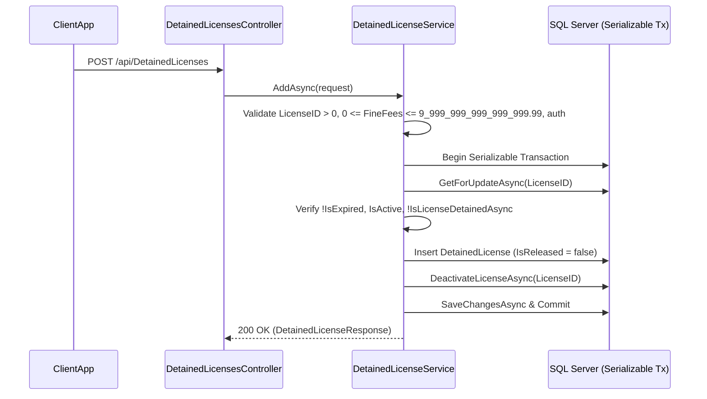
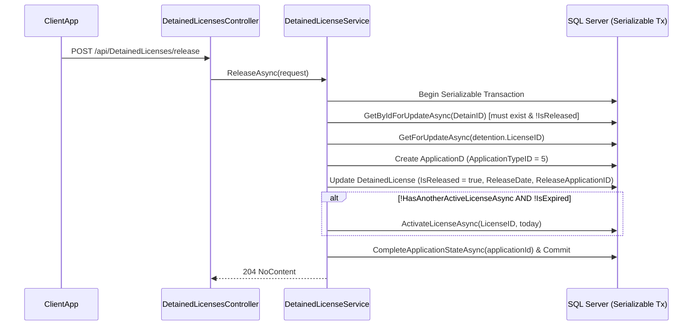

# Workflow: License Detention & Release

## 1. Purpose

Manages the administrative detention of an active, non-expired local license with an associated fine, and its subsequent release via a `Release Detained Driving License` application (`ApplicationTypeID = 5`).

---

## 2. Detention Flow (`DetainedLicenseService.AddAsync`)

---

## 3. Release Flow (`DetainedLicenseService.ReleaseAsync`)

---

## 4. Key Invariants

- **Filtered Unique Detention Index**: `IX_DetainedLicenses_LicenseID_IsReleased` (`[IsReleased] = 0`) guarantees at most one active detention per license at the database level.
- **Conditional Reactivation**: Releasing a detained license reactivates it **only if** the license has not expired and the driver does not already hold another active license in the same class.

---

## Implementation References

- Controller: [`API/DVLD.Api/Controllers/DetainedLicensesController.cs`](../../../API/DVLD.Api/Controllers/DetainedLicensesController.cs)
- Service: [`Application/Services/DetainedLicenseService.cs`](../../../Application/Services/DetainedLicenseService.cs)
- Validator: [`Application/Validators/DetainedLicenseValidator.cs`](../../../Application/Validators/DetainedLicenseValidator.cs)
