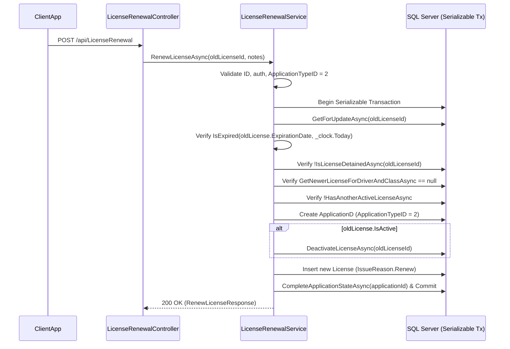

# Workflow: License Renewal

## 1. Purpose

Renews an **expired**, non-detained local driving license by creating a `Renew Driving License` application (`ApplicationTypeID = 2`), deactivating the superseded license if still active, and issuing a new active license with a fresh validity period.

---

## 2. Execution Sequence (`LicenseRenewalService.RenewLicenseAsync`)

---

## 3. Business Rules & Guards

- **Expiration Requirement**: Renewal is rejected with `409 Conflict` (`"Cannot renew before expiration date."`) if `!LicenseExpirationPolicy.IsExpired(oldLicense.ExpirationDate, _clock.Today)`.
- **Detention Guard**: Detained licenses cannot be renewed (`409 Conflict`).
- **Supersession & Uniqueness Guards**: Rejected if a newer license already exists for the same `(DriverID, LicenseClass)` or if another active license exists in that class (`409 Conflict`).
- **Validity & Reason**: New license sets `IssueReason.Renew`, `ExpirationDate = now.AddYears(DefaultValidityLength)`, and `IsActive = true`.
- **Rollback**: Explicit `RollbackAsync` is invoked on every failure branch inside the `Serializable` transaction.

---

## Implementation References

- Controller: [`API/DVLD.Api/Controllers/LicenseRenewalController.cs`](../../../API/DVLD.Api/Controllers/LicenseRenewalController.cs)
- Service: [`Application/Services/LicenseRenewalService.cs`](../../../Application/Services/LicenseRenewalService.cs)
- Validator: [`Application/Validators/LicenseValidator.cs`](../../../Application/Validators/LicenseValidator.cs)
