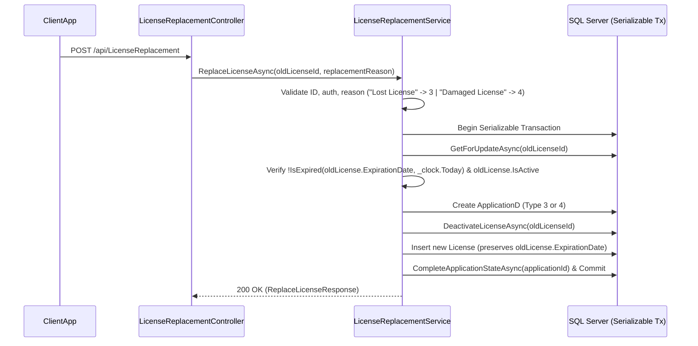

# Workflow: License Replacement

## 1. Purpose

Replaces an **active, non-expired** local driving license that was lost (`ApplicationTypeID = 3`, `IssueReason.ReplacementForLost`) or damaged (`ApplicationTypeID = 4`, `IssueReason.ReplacementForDamaged`), preserving the original expiration date.

---

## 2. Execution Sequence (`LicenseReplacementService.ReplaceLicenseAsync`)

---

## 3. Business Rules & Guards

- **Supported Reasons**: `replacementReason` must match `"Lost License"` (`LostReplacementApplicationTypeId = 3`) or `"Damaged License"` (`DamagedReplacementApplicationTypeId = 4`), case-insensitively.
- **Active & Non-Expired**: Expired or inactive licenses cannot be replaced (`409 Conflict`).
- **Expiration Preservation**: Unlike renewal, replacement **preserves `oldLicense.ExpirationDate`** on the newly issued license (`PaidFees = oldLicense.LicenseClassInfo.ClassFees`, `Notes = replacementReason`).
- **Deactivation**: The old license is deactivated (`DeactivateLicenseAsync`) within the same `Serializable` transaction before inserting the replacement.

---

## Implementation References

- Controller: [`API/DVLD.Api/Controllers/LicenseReplacementController.cs`](../../../API/DVLD.Api/Controllers/LicenseReplacementController.cs)
- Service: [`Application/Services/LicenseReplacementService.cs`](../../../Application/Services/LicenseReplacementService.cs)
- Validator: [`Application/Validators/LicenseValidator.cs`](../../../Application/Validators/LicenseValidator.cs)
