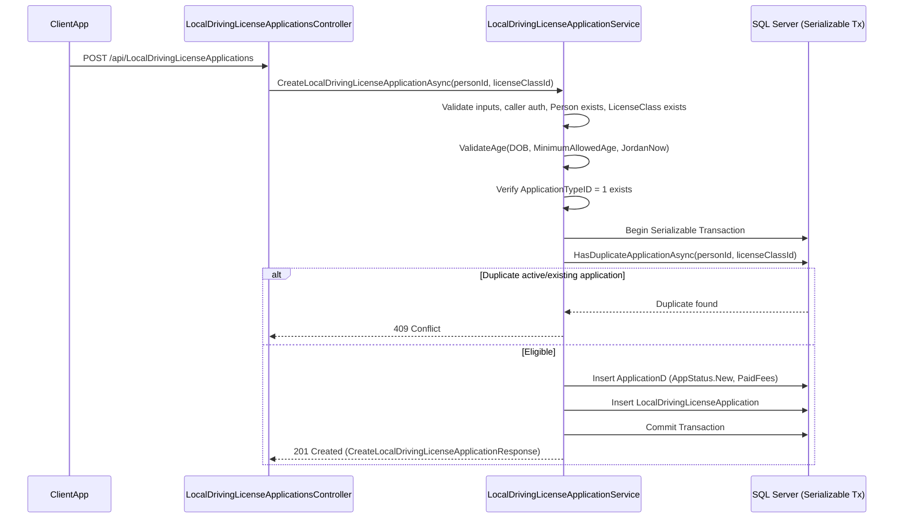

# Workflow: Local License Application

## 1. Purpose

Manages the creation, modification, deletion, and cancellation of a **New Local Driving License Application** (`ApplicationTypeID = 1`), binding an eligible `Person` to a target `LicenseClass`.

---

## 2. Create Application Flow (`CreateLocalDrivingLicenseApplicationAsync`)

### Preconditions & Validation

- Caller must be authenticated (`StaffOnly` at controller; `IsAuthenticated()` in service).
- `ApplicantPersonID > 0` and `LicenseClassID > 0`.
- Applicant `Person` and `LicenseClass` must exist (`404 NotFound` otherwise).
- Applicant age on `_clock.Now` must satisfy `>= licenseClass.MinimumAllowedAge` (`400 Validation` otherwise).
- `ApplicationTypeID = 1` must exist (`404 NotFound`).

### Transactional Side Effects

- Executes under `IsolationLevel.Serializable`.
- Verifies `!HasDuplicateApplicationAsync(applicantPersonId, licenseClassId)` (`409 Conflict` if duplicate).
- Inserts `ApplicationD` (`AppStatus.New`, `PaidFees = applicationType.ApplicationFees`, `CreatedByUserID`).
- Inserts `LocalDrivingLicenseApplication` linked to the new `ApplicationID`.

---

## 3. Update, Delete, and Cancel Flows

| Operation | Endpoint | Transaction | Rules & Side Effects |
|---|---|---|---|
| **Update** | `PUT /api/LocalDrivingLicenseApplications/{id}` | `Serializable` | Acquires `GetForUpdateAsync(id)`. Rejects if `ApplicationStatus != AppStatus.New` (`409`). Re-validates age and duplicate check (excluding current `ApplicationID`), then updates `LicenseClassID`. |
| **Delete** | `DELETE /api/LocalDrivingLicenseApplications/{id}` | None (`SaveChangesAsync`) | Rejects if `ApplicationStatus != AppStatus.New` (`409`). Deletes the local application record. |
| **Cancel** | `POST /api/LocalDrivingLicenseApplications/{id}/cancel` | `ReadCommitted` | Calls `ApplicationService.CancelApplicationStateAsync` (`GetApplicationForCancellationAsync`, rejects `Completed`/`Cancelled`, sets `AppStatus.Cancelled` + `LastStatusDate`). Also fetches `GetActiveScheduledByLocalAppIdForUpdateAsync(id)` and marks all active `Scheduled` test appointments as `Cancelled`, `IsLocked = true`, `CancelledAt`, `CancelledByUserID`. |

---

## Implementation References

- Controller: [`API/DVLD.Api/Controllers/LocalDrivingLicenseApplicationsController.cs`](../../../API/DVLD.Api/Controllers/LocalDrivingLicenseApplicationsController.cs)
- Service: [`Application/Services/LocalDrivingLicenseApplicationService.cs`](../../../Application/Services/LocalDrivingLicenseApplicationService.cs), [`Application/Services/ApplicationService.cs`](../../../Application/Services/ApplicationService.cs)
- Validators: [`Application/Validators/LocalDrivingLicenseApplicationValidator.cs`](../../../Application/Validators/LocalDrivingLicenseApplicationValidator.cs), [`Application/Validators/ApplicationValidator.cs`](../../../Application/Validators/ApplicationValidator.cs)
