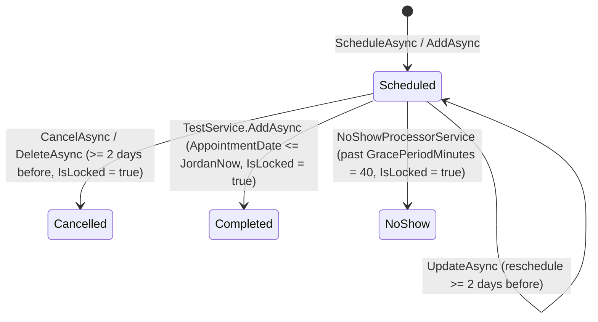
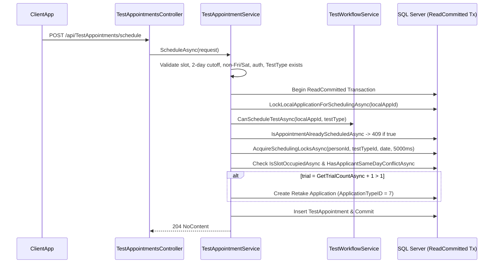

# Workflow: Test Appointment Lifecycle

## 1. Purpose

Governs examination slot availability, sequential test scheduling (`Theory` → `Written` → `Practical`), automatic retake fee applications, rescheduling, cancellation, examination result recording, and automated no-show processing.

---

## 2. State Machine

---

## 3. Slot Availability (`GetAvailabilityAsync`)

1. Validates input range and checks `TestWorkflowService.CanScheduleTestAsync(localAppId, testType)`.
2. Rejects if an active scheduled appointment already exists (`IsAppointmentAlreadyScheduledAsync` -> `409 Conflict`).
3. Computes `minimumBookingDate = currentJordanDate.AddDays(2)` and, if a prior test attempt exists, `earliestEligibleDate = GetFirstWorkingDayAfter(lastTestDate)`.
4. Skips **Friday and Saturday**, excludes applicant same-day conflicts (`applicantDates`) and `occupiedSlots`, and returns available 40-minute slots from **`08:00` through `15:20`** (`ValidSlotTimesSet`).

---

## 4. Scheduling Flow (`ScheduleAsync`)

---

## 5. Reschedule, Cancel, Result Recording & No-Show

- **Reschedule (`PUT /api/TestAppointments/{id}`)**: Runs in `ReadCommitted`. Acquires `GetForUpdateAsync(id)`, rejects `Cancelled`/`Completed`/`NoShow`/`IsLocked`/`Test != null` (`409`), enforces `(facilityDate.Date - currentJordanDate).Days >= 2`, re-checks `CanScheduleTestAsync` and `AcquireSchedulingLocksAsync` (excluding self), and updates `AppointmentDate`.
- **Cancel (`POST` or `PUT /api/TestAppointments/{id}/cancel`, `DELETE /api/TestAppointments/{id}`)**: Same status/lock guards and 2-day cutoff; sets `Status = AppointmentStatus.Cancelled`, `CancelledAt = _clock.Now`, `CancelledByUserID`, `IsLocked = true`.
- **Record Test Result (`POST /api/Tests` -> `TestService.AddAsync`)**:
  - Runs in `IsolationLevel.Serializable`.
  - Acquires `GetForUpdateAsync(TestAppointmentID)`, rejects `IsLocked` or existing `Test` (`409`), and verifies `TestWorkflowService.CanTakeTestAsync` (`AppStatus.New`, `AppointmentDate <= _clock.Now`, next required test matches `TestTypeID`).
  - Inserts `Test` (`TestResult`, trimmed `Notes <= 500`, `CreatedByUserID`), sets `appointment.Status = AppointmentStatus.Completed` and `appointment.IsLocked = true`, and commits.
- **No-Show Background Processing (`NoShowBackgroundService` -> `NoShowProcessorService`)**:
  - Polls every `PollingIntervalSeconds` (default `60s`), processes up to 20 batches of `BatchSize` (default `50`) for appointments older than `GracePeriodMinutes` (default `40` min).
  - Acquires `AcquireAppointmentLockAsync(id, LockTimeoutMs = 5000)`, re-verifies `Status == Scheduled && !IsLocked && AppointmentDate <= cutoff` and `!IsTestAlreadyTakenAsync`, then sets `Status = AppointmentStatus.NoShow`, `NoShowDate = nowJordan`, `IsLocked = true`.

---

## Implementation References

- Controllers: [`API/DVLD.Api/Controllers/TestAppointmentsController.cs`](../../../API/DVLD.Api/Controllers/TestAppointmentsController.cs), [`API/DVLD.Api/Controllers/TestsController.cs`](../../../API/DVLD.Api/Controllers/TestsController.cs), [`API/DVLD.Api/Controllers/TestWorkflowController.cs`](../../../API/DVLD.Api/Controllers/TestWorkflowController.cs)
- Services: [`Application/Services/TestAppointmentService.cs`](../../../Application/Services/TestAppointmentService.cs), [`Application/Services/TestService.cs`](../../../Application/Services/TestService.cs), [`Application/Services/TestWorkflowService.cs`](../../../Application/Services/TestWorkflowService.cs), [`Application/Services/NoShowProcessorService.cs`](../../../Application/Services/NoShowProcessorService.cs)
- Validators & background worker: [`Application/Validators/TestAppointmentValidator.cs`](../../../Application/Validators/TestAppointmentValidator.cs), [`Application/Validators/TestValidator.cs`](../../../Application/Validators/TestValidator.cs), [`API/DVLD.Api/BackgroundServices/NoShowBackgroundService.cs`](../../../API/DVLD.Api/BackgroundServices/NoShowBackgroundService.cs)
