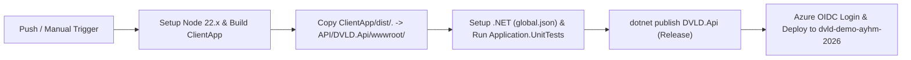

# Deployment & CI/CD

DVLD defines two automated pipelines in the repository: a **GitHub Actions** workflow for Azure App Service deployment and an **Azure Pipelines** CI definition for full-stack build and SQL Server integration verification.

---

## 1. GitHub Actions: Azure App Service (`.github/workflows/deploy-azure-appservice.yml`)

- **Runner**: `ubuntu-latest`
- **Node.js**: `22.x` (`npm ci && npm run build` inside `ClientApp/`)
- **SPA Bundling**: Copies `ClientApp/dist/.` into `API/DVLD.Api/wwwroot/` prior to publishing `DVLD.Api` so the ASP.NET Core host serves both the SPA and `/api/*`.
- **Test Gate**: Executes `Application.UnitTests`.
- **Azure Auth**: Uses OpenID Connect (OIDC) federated credentials (`AZURE_CLIENT_ID`, `AZURE_TENANT_ID`, `AZURE_SUBSCRIPTION_ID`) to deploy to Azure App Service `dvld-demo-ayhm-2026`.

---

## 2. Azure Pipelines CI (`azure-pipelines.yml`)

- **Agent**: `windows-latest`
- **SDKs**: .NET `10.0.404` (`useGlobalJson: true`), Node `26.x` *(note: `azure-pipelines.yml` targets Node `26.x`, whereas `.github/workflows/deploy-azure-appservice.yml` targets Node `22.x`)*.
- **Stage 1 — `Frontend_CI`**:
  - `npm ci`
  - Two-tier `npm audit` vulnerability check
  - `npm run lint`, `tsc -b`, Vitest unit tests, Playwright Chromium E2E tests (`CI=true`), and `vite build`
- **Stage 2 — `Backend_CI`**:
  - NuGet vulnerable package scan
  - `Release` build
  - `Application.UnitTests`
  - Isolated SQL Server LocalDB test database `DVLD_CI_<BuildId>_<Attempt>`
  - `API.IntegrationTests` and `Infrastructure.IntegrationTests`
  - Ephemeral CI database cleanup, report staging, and artifact publication (`dvld-api-release`)

---

## Implementation References

- GitHub Actions workflow: [`.github/workflows/deploy-azure-appservice.yml`](../../.github/workflows/deploy-azure-appservice.yml)
- Azure Pipelines definition: [`azure-pipelines.yml`](../../azure-pipelines.yml)
- SPA static hosting fallback: [`API/DVLD.Api/Configuration/MiddlewareExtensions.cs`](../../API/DVLD.Api/Configuration/MiddlewareExtensions.cs)
