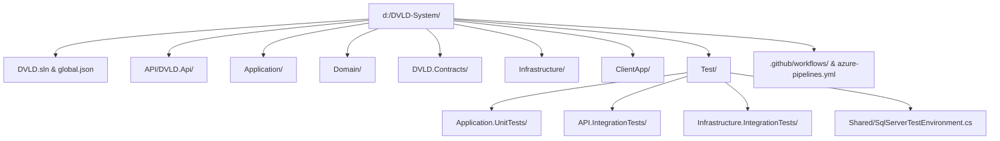

# System Overview

## 1. Purpose and Domain Scope

The **Driver & Vehicle Licensing Department (DVLD) Management System** digitizes civic driver licensing operations, from initial person registration and local driving license applications through sequential examinations, license issuance, renewals, replacements, detentions, and international driving permits.

The platform is built as a decoupled **ASP.NET Core Web API** backend paired with a **React** single-page application, backed by **SQL Server** and local disk storage for person profile photographs.

---

## 2. User Roles and Capabilities

Access is governed by two application roles (`UserRole` enum) enforced at both the API authorization layer and the frontend route/navigation layer:

| Role | Policy | Scope of Access |
|---|---|---|
| **Admin** | `AdminOnly` | User account management (`UsersController`), reference data updates (`ApplicationTypes`, `LicenseClasses`, `TestTypes`), and shared person/profile operations. |
| **Staff** | `StaffOnly` | Operational licensing workflows: applications, local driving license applications, test appointments, test results, drivers, local licenses, international licenses, and detained licenses. |
| **Admin & Staff** | `StaffOrAdmin` / `[Authorize]` | Dashboard statistics, people directory and photo management, read-only reference data (`Countries`, `ApplicationTypes`, `LicenseClasses`, `TestTypes`), and self-service account actions (`/api/Auth/me`, `/api/Auth/profile`, `/api/Auth/change-password`). |

---

## 3. Technology Stack

### Backend (.NET 10 LTS)

- **SDK**: `.NET 10.0.404` (`global.json`, `rollForward: latestFeature`)
- **Target Framework**: `net10.0` across all 8 solution projects (`ImplicitUsings=enable`, `Nullable=enable`)
- **Web Framework**: ASP.NET Core Web API (`DVLD.Api`)
- **ORM & Database**: Entity Framework Core `10.0.15` (`Microsoft.EntityFrameworkCore`, `.SqlServer`, `.Design`, `.Tools`) with SQL Server
- **Authentication & Cryptography**: `Microsoft.AspNetCore.Authentication.JwtBearer` `10.0.15`, `BCrypt.Net-Next` `4.2.0`
- **Image Processing**: `SkiaSharp` `4.154.0`
- **Logging**: `Serilog.AspNetCore` `10.0.0`, `Serilog.Sinks.Seq` `9.1.0`
- **API Documentation**: `Swashbuckle.AspNetCore` `6.6.2` (enabled in `Development`)

### Frontend (`ClientApp/`)

- **UI Library**: React `^19.3.1` with React DOM `^19.3.1`
- **Language**: TypeScript `~6.0.3` (`strict: true`, `erasableSyntaxOnly: true`, `verbatimModuleSyntax: true`)
- **Bundler**: Vite `^8.3.4`
- **Styling & UI Primitives**: Tailwind CSS `^4.3.3` (`@tailwindcss/vite`), `@radix-ui/*`, `lucide-react` `^1.65.0`, `motion` `^14.9.0`
- **Testing**: Vitest `^5.1.0`, `@testing-library/react` `^16.3.3`, `jsdom` `^31.0.0`, Playwright `^1.65.0`, `@axe-core/playwright` `^4.14.0`

---

## 4. Solution and Repository Layout

| Directory | Contents |
|---|---|
| `Domain/` | 15 entity classes (`Domain/Entities/*.cs`) and 7 domain enums (`Domain/Enums/*.cs`). |
| `DVLD.Contracts/` | Shared API request/response contracts and pagination/enum types referenced by `DVLD.Api`. |
| `Application/` | Business services (`Application/Services/`), validators (`Application/Validators/`), strongly typed options (`Application/Options/`), and repository/service contracts. |
| `Infrastructure/` | `DVLDDbContext`, 15 entity configurations (`Infrastructure/Configurations/`), 7 EF Core migrations (`Infrastructure/Migrations/`), repositories, `UnitOfWork` partial classes, `JordanClock`, and `PhysicalFileStorageService`. |
| `API/DVLD.Api/` | `Program.cs`, 20 REST controllers, configuration extensions (`Configuration/`), security services (`Security/`), ProblemDetails mapping (`Results/`), and background workers (`BackgroundServices/`). |
| `ClientApp/` | React 19 SPA (`src/pages/`, `src/components/`, `src/context/`, `src/hooks/`, `src/services/`, `src/utils/`) and unit/E2E tests (`tests/`). |
| `Test/` | Automated unit and SQL Server integration test suites with isolated ephemeral test database lifecycle. |

---

## 5. Runtime Architecture

In production (such as Azure App Service), the compiled frontend bundle (`ClientApp/dist/`) is copied into `API/DVLD.Api/wwwroot/`. `DVLD.Api` serves static assets and falls back non-`/api` `GET`/`HEAD` requests without file extensions to `wwwroot/index.html`, allowing a single deployment unit to host both the SPA and the REST API.

In local development, `ClientApp` runs on Vite (`http://localhost:5173`) and proxies `/api` calls to `https://localhost:7125` while stripping the `; secure` cookie attribute for local HTTP testing.

---

## Implementation References

- Solution & SDK: [`DVLD.sln`](../../DVLD.sln), [`global.json`](../../global.json)
- Backend entry & configuration: [`API/DVLD.Api/Program.cs`](../../API/DVLD.Api/Program.cs), [`API/DVLD.Api/appsettings.json`](../../API/DVLD.Api/appsettings.json)
- Frontend manifest & Vite proxy: [`ClientApp/package.json`](../../ClientApp/package.json), [`ClientApp/vite.config.ts`](../../ClientApp/vite.config.ts)
- CI/CD definitions: [`.github/workflows/deploy-azure-appservice.yml`](../../.github/workflows/deploy-azure-appservice.yml), [`azure-pipelines.yml`](../../azure-pipelines.yml)
