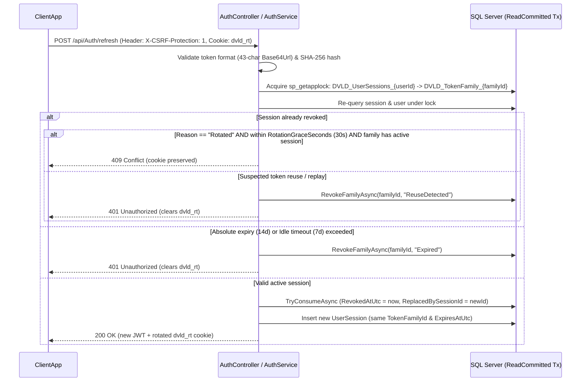

# Authentication & Security Architecture

## 1. Hybrid Token & Session Architecture

DVLD pairs short-lived **HMAC-SHA256 JWT access tokens** (stored solely in frontend module memory) with **256-bit opaque refresh tokens** delivered exclusively in an `HttpOnly` cookie (`dvld_rt` by default, never returned in JSON response bodies).

### 1.1 JWT Structure & Validation

- **Signing**: `SymmetricSecurityKey` over UTF-8 bytes of `Jwt:SecretKey` (minimum 32 bytes), `SecurityAlgorithms.HmacSha256`.
- **Lifetime**: Configurable via `Jwt:ExpirationMinutes` (validated `5..60` via `JwtOptionsValidator`, `15` in `appsettings.json`, `ClockSkew = 30s`).
- **Claims (`JwtTokenService`)**:
  - `ClaimTypes.NameIdentifier` (`UserId`), `ClaimTypes.Name` (`UserName`), `"FullName"`, `"PersonId"`, `ClaimTypes.Role` (`Admin` or `Staff`), `"sst"` (`User.SecurityStamp`), `jti`, and `"sid"` (`UserSession.TokenFamilyId`).
- **Live Session Validation (`JwtBearerEvents.OnTokenValidated`)**:
  - Every authenticated API request extracts `UserId`, `"sst"`, and `"sid"` and verifies against SQL Server (`UserRepository.GetSecurityStateAsync`) that `IsActive == true`, `SecurityStamp` matches `"sst"` ordinally, and `TokenFamilyId == sid` has an unrevoked, unexpired `UserSession`.

---

## 2. Refresh Token Rotation, Locking, and Reuse Detection

- **Entropy & Hashing (`RefreshTokenService`)**: 32 random bytes (`RandomNumberGenerator.GetBytes(32)`), Base64Url-encoded to 43 characters; stored only as Base64Url-encoded SHA-256 hashes.
- **Session Expiry**: `ExpiresAtUtc` (`RefreshTokenLifetimeDays = 14` default) is fixed at login and never extended on rotation. `LastUsedAtUtc` enforces `IdleTimeoutDays = 7`.
- **Cookie Security (`AuthController`)**: `HttpOnly = true`, `Secure = Request.IsHttps`, `SameSite = SameSiteMode.Lax`, `Path = "/api/Auth"`, `IsEssential = true`.
- **CSRF Mitigation**: `POST /api/Auth/refresh`, `/api/Auth/logout`, and `/api/Auth/logout-all` require `X-CSRF-Protection: 1`.
- **SecurityStamp Rotation**: Rotated on `LogoutAll`, `ChangePassword`, and `UpdateUserAsync` (when `Role` or `IsActive` changes), immediately invalidating existing JWTs and revoking active sessions.

---

## 3. Authorization Policies & Rate Limiting

- **Policies (`AuthorizationExtensions`)**:
  - `AdminOnly`: `RequireRole("Admin")`
  - `StaffOnly`: `RequireRole("Staff")`
  - `StaffOrAdmin`: `RequireRole("Staff", "Admin")`
- **IP Rate Limiting (`RateLimitingExtensions`)**: Fixed-window limiters partitioned by `RemoteIpAddress` (`RejectionStatusCode = 429`):
  - `LoginRateLimit`: `5` requests / minute
  - `RefreshRateLimit`: `30` requests / minute
  - `ChangePasswordRateLimit`: `5` requests / minute
- **CORS (`ApiAndSwaggerExtensions`)**: Policy `"ReactApp"` allows `http://localhost:5173` with `.AllowAnyHeader()`, `.AllowAnyMethod()`, and `.AllowCredentials()`.

---

## 4. Log & Exception Redaction

- **Route Sanitization (`LoggingExtensions`)**: Overwrites `RequestPath` with route templates (e.g., `/api/People/national/{nationalNo}`, `/api/Users/username/{username}`) so raw national numbers and usernames are not written to logs.
- **Serilog Enricher (`SensitiveDataRedactingEnricher`)**: Recursively replaces sensitive property names (passwords, tokens, secrets, cookies, `SecurityStamp`, `NationalNo`, `Phone`, `Email`, `Address`, names, storage keys) with `"[REDACTED]"`.
- **Exception Scrubbing (`GlobalExceptionHandler`)**: Masks `Password`/`Secret`/`Token` key-value pairs and `Bearer ...` tokens in logged exception messages while preserving stack traces.

---

## Implementation References

- Auth & session services: [`Application/Services/AuthService.cs`](../../Application/Services/AuthService.cs), [`Application/Services/RefreshTokenService.cs`](../../Application/Services/RefreshTokenService.cs), [`Application/Services/UserService.Security.cs`](../../Application/Services/UserService.Security.cs)
- API security & configuration: [`API/DVLD.Api/Controllers/AuthController.cs`](../../API/DVLD.Api/Controllers/AuthController.cs), [`API/DVLD.Api/Security/JwtTokenService.cs`](../../API/DVLD.Api/Security/JwtTokenService.cs), [`API/DVLD.Api/Security/GlobalExceptionHandler.cs`](../../API/DVLD.Api/Security/GlobalExceptionHandler.cs)
- Middleware & redaction: [`API/DVLD.Api/Configuration/AuthenticationExtensions.cs`](../../API/DVLD.Api/Configuration/AuthenticationExtensions.cs), [`API/DVLD.Api/Configuration/AuthorizationExtensions.cs`](../../API/DVLD.Api/Configuration/AuthorizationExtensions.cs), [`API/DVLD.Api/Configuration/RateLimitingExtensions.cs`](../../API/DVLD.Api/Configuration/RateLimitingExtensions.cs), [`API/DVLD.Api/Configuration/SensitiveDataRedactingEnricher.cs`](../../API/DVLD.Api/Configuration/SensitiveDataRedactingEnricher.cs)
- Frontend auth: [`ClientApp/src/context/AuthContext.tsx`](../../ClientApp/src/context/AuthContext.tsx), [`ClientApp/src/services/apiClient.ts`](../../ClientApp/src/services/apiClient.ts)
